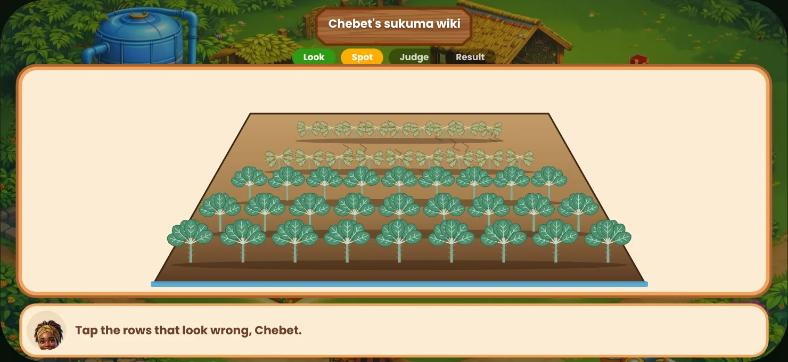
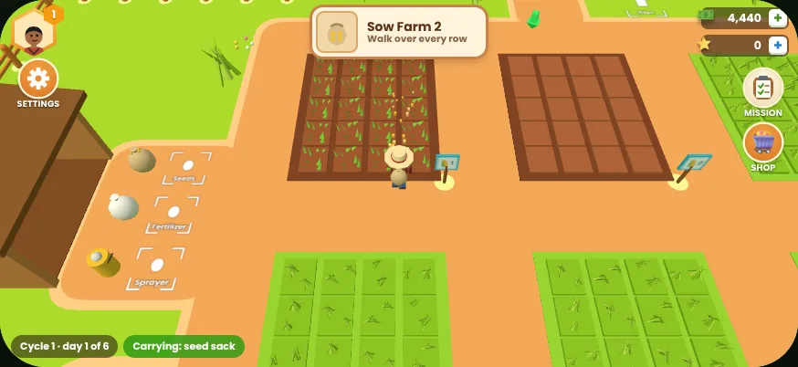
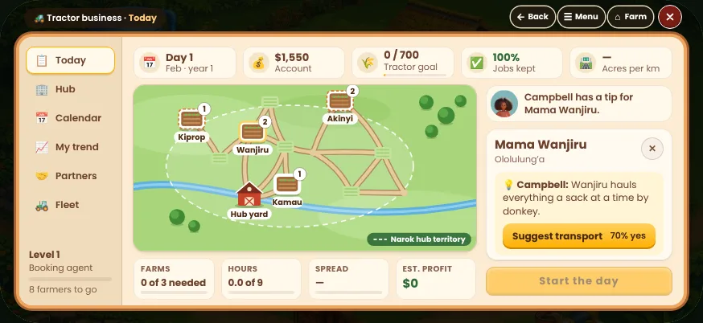
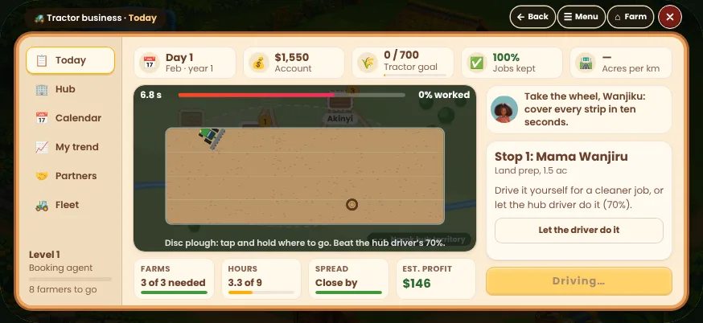
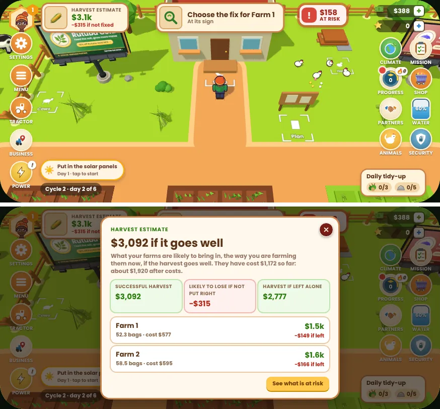
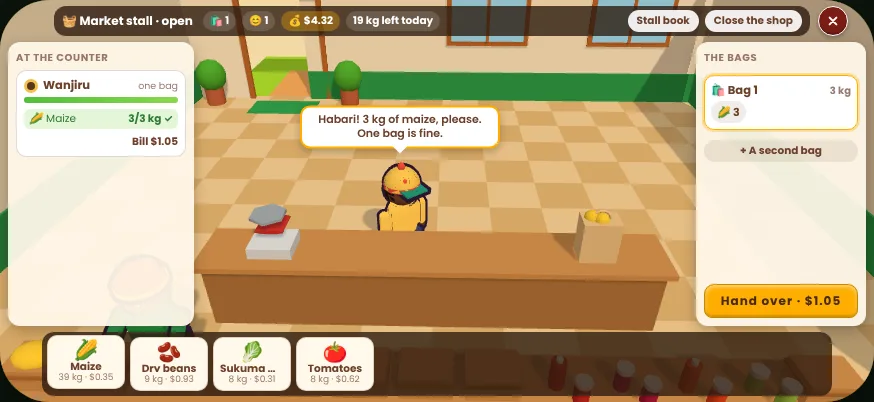
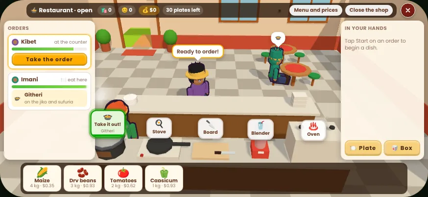

# TemoLima

*TemoLima* means **farming** in a combination of Swahili and Sesotho: *temo* is Sesotho and *lima* is Swahili.

A farming game for young Africans who farm or want to — including "satellite farmers" with a city job and a
rural farm — played on a landscape phone. It is **one farm, the player's own** — there are no neighbours. The
player learns to read their crops with their own eyes, then checks every bed on the farm often, so the farm keeps
growing healthy, nutritious food. Its core is **the six farms**: the same maize grown to six different plans side
by side, so a year or more of trial and error happens in a few weeks of play. Seasons of maize turn every choice
(doing the work, when to harvest, how to store, whether to process) into what they earn. Every job also records what it
does to the climate, the water and the soil, on its own Climate page. Points unlock real partner discounts.

The game is built in React + TypeScript from the Figma file **"29 Oct Farm Management App"**
(`dvRxEJtTy8rGBPIVmCLb4E`, section *Farm game*). The Figma farm map is the ground of the whole game.

**▶ Play it: https://dgtechbuilder.github.io/limagame/** — best on a phone held sideways. On Android or
iPhone, *Add to Home screen* runs it full screen like an app.


---

## Contents

- [What a player does](#what-a-player-does)
- [Run it locally](#run-it-locally)
- [Deploy](#deploy)
- [Project structure](#project-structure)
- [How the Figma design maps to code](#how-the-figma-design-maps-to-code)
- [The first session](#the-first-session)
- [The season](#the-season)
- [Field rounds](#field-rounds)
- [The farm world](#the-farm-world)
  - [Scheduled care](#scheduled-care)
- [The daily tidy-up](#the-daily-tidy-up)
- [Jobs done by hand on the farm](#jobs-done-by-hand-on-the-farm)
- [The six farms](#the-six-farms)
- [From Wakala Agent](#from-wakala-agent)
- [The tractor business](#the-tractor-business)
- [Plots and inputs](#plots-and-inputs)
- [Navigation and the main menu](#navigation-and-the-main-menu)
- [Page addresses](#page-addresses)
- [Sound effects](#sound-effects)
- [Money on screen](#money-on-screen)
- [Settings](#settings)
- [Game controllers](#game-controllers)
- [Money at risk](#money-at-risk)
- [Harvest estimate](#harvest-estimate)
- [Climate-smart farming: row strategies and treatment choices](#climate-smart-farming-row-strategies-and-treatment-choices)
- [Water as a real resource](#water-as-a-real-resource)
- [The animals: cows, hens and the chicken coop](#the-animals-cows-hens-and-the-chicken-coop)
  - [Farm checks: the plant, the tractor, the farm, the water and the power](#farm-checks-the-plant-the-tractor-the-farm-the-water-and-the-power)
- [Theft, and keeping the farm safe](#theft-and-keeping-the-farm-safe)
- [The evidence layer](#the-evidence-layer)
- [Climate tracking](#climate-tracking)
- [Climate Smart Agriculture](#climate-smart-agriculture)
- [The wallet](#the-wallet)
- [Money: savings, investments and profit](#money-savings-investments-and-profit)
- [The power system](#the-power-system)
- [Night mode](#night-mode)
- [The tractor screen](#the-tractor-screen)
- [The coop and the cow shed](#the-coop-and-the-cow-shed)
- [The shed's options](#the-sheds-options)
- [Options that open as you grow](#options-that-open-as-you-grow)
- [The market stall](#the-market-stall)
- [The restaurant](#the-restaurant)
- [The shop floor: serving customers](#the-shop-floor-serving-customers)
- [Nutrition](#nutrition)
- [The greenhouse and the storehouse](#the-greenhouse-and-the-storehouse)
- [Mini-games](#mini-games)
- [The tractor game: the mini farm](#the-tractor-game-the-mini-farm)
- [Achievements, the daily streak and certificates](#achievements-the-daily-streak-and-certificates)
- [My Progress: certification levels and learning credits](#my-progress-certification-levels-and-learning-credits)
- [Partners: billboards, branded products and offers](#partners-billboards-branded-products-and-offers)
- [Farm words: info buttons and Farm basics](#farm-words-info-buttons-and-farm-basics)
- [Special events, regions and Donate](#special-events-regions-and-donate)
- [Special event: Kakuma, with the World Food Programme](#special-event-kakuma-with-the-world-food-programme)
- [Character art: retro anime](#character-art-retro-anime)
- [Design review mode](#design-review-mode)
- [Saving, events and privacy](#saving-events-and-privacy)
- [Performance on low-cost phones](#performance-on-low-cost-phones)
- [Playing on a weak, slow or missing signal](#playing-on-a-weak-slow-or-missing-signal)
- [Tests](#tests)
- [Assumptions and open decisions](#assumptions-and-open-decisions)

---

## What a player does

| When | What happens |
| --- | --- |
| **0:00** | Names a farmer (or taps *Wanjiku*, *Otieno* or *Chebet*) and picks a look. No menus or text walls first. |
| **0:05** | **The story so far**, three short pages: they bought this farm (and give its cows and hens their morning care), last season's harvest results (they plant by hand, then watch the season fail and lose money), and this season they start by learning from each mistake. |
| **0:10** | Walks across their farm to the maize. The rest of the farm is under mist. |
| **0:25** | Checks the maize by looking: spots the rows with fall armyworm and makes the right call. This is the moment the game is built around. |
| **~2:00** | The whole farm opens. Their sukuma wiki needs the same kind of check, with fewer hints. |
| **~3:00** | **Field rounds**: checks every bed on the farm, one after another — and comes back often, because every bed changes every day. |
| **Then** | **The first planting period** (about 10 minutes): maize on Farm 1, which they clear plot by plot, and sukuma wiki on Farm 2, which they plant plot by plot; then they check both every day for six days and harvest. |
| **Every day** | **The daily tidy-up**: 3 bushes and 5 rocks turn up around the farm each new day; they clear them all to keep the farm and the neighbourhood tidy. |
| **Every week** | **Six farms**: a different plan on each farm, one day of checks each real day (or all now), then the harvests compared. The plan that worked becomes their recipe for the next cycle. |
| **Any time** | Plays seasons of maize on Farm Moja: six farming steps, harvest timing, storage, processing, selling, results, rewards. |
| **Any time** | Opens **Climate** to see what their farming did to the climate, the water and the soil, and the climate credits it earned. |
| **Any time** | **Climate › Climate Smart Agriculture**: learns seven practices used in Kenya and West Africa (half-moons, saving water, the right time of day, zaï pits, push-pull, kisiki hai, drought-tolerant seed with intercropping) and practises each one by hand in its own game. |
| **Every day** | The **CLIMATE-SMART** chip on the farm: today's drill (one practice a day) and the **field clock**, which says what the hour on the phone is good for. Watering a dry farm by hand at midday loses water to the sun; in the cool it earns points. |
| **From day 2** | Looks after the **cows and hens** every day (feed, water, milk, eggs, cleaning), treats their diseases by their signs, and **keeps the farm safe from thieves** at night. The **Animal chores** chip walks the farmer to each chore at the pen or the coop, where it is done by hand. |
| **Every job** | **Does the work on the farm**: buying the inverter, building the coop, servicing the tractor or feeding the hens closes the page and the farmer walks there, then works at each spot (round the tractor, every corner of the coop, each light pole) before it counts. See [Jobs done by hand on the farm](#jobs-done-by-hand-on-the-farm). |
| **Days 1 to 7** | **Builds a solar power system**, one part a day, each with its own mini-game: panels, inverter, battery, lights, generator, diesel, then switches it on. It powers the pump, the milk cooler, the lights, the house and the workshop. |
| **Day 1 · day 3** | **Upgrades the chicken coop** (day 1) and **the cow shed** (day 3), nail by nail. |
| **From day 4** | Plants the **greenhouse**'s four beds (tomatoes, capsicum, cucumbers, strawberries, chillies) and makes sauce, jam, pickles or flour in the **storehouse**. |
| **Every day** | The **market stall** sells **25 kg** of the store (maize, beans, sukuma wiki…): the farmer picks, or the day's sale is made for them each evening, with its profit. The **restaurant** beside it cooks the store into meals. Every crop shows its **nutrition**. Every payment in and out is kept in the **Wallet**. |
| **Any time** | Taps **TRACTOR** to train, learn, check, service, repair, refuel, hire or drive the tractor (each a mini-game). |

A wrong call is part of learning: the clue they missed is circled, and they try again on a second maize bed.

## Run it locally

```bash
npm install
npm run dev        # http://localhost:5173
npm run build      # production build in dist/
npm run preview    # serve the production build
npm run typecheck  # TypeScript, no output files
npm test           # Playwright play-tests (see Tests)
```

Needs Node 18 or newer (CI uses Node 20). There is no backend: everything runs in the browser.

**Stack**: React 19 and TypeScript 5, Vite 6, [three.js](https://threejs.org) 0.170 for the 3D farm, Playwright for
the play-tests. No other runtime dependencies. `package-lock.json` pins every install.

## Deploy

Every push to `main` builds the site and publishes it to GitHub Pages with
[`.github/workflows/deploy.yml`](.github/workflows/deploy.yml) (install → type-check → `vite build` →
deploy). A type error stops the deploy. The workflow can also be started by hand from the *Actions* tab. Pages is set
to deploy from **GitHub Actions** in the repository settings.

**Custom domain.** `CNAME` names `limathegame.online`. With Pages deploying from Actions, the domain that counts is
the one set under *Settings → Pages → Custom domain* (the file in the repository root is not part of the build);
set it there, with the domain's DNS pointing at GitHub Pages, and `dgtechbuilder.github.io/limagame/` redirects to it.

Pull requests run [`.github/workflows/tests.yml`](.github/workflows/tests.yml): type-check, build and the
Playwright play-tests, with the report and screenshots kept for 14 days. Its browser install tries three times.

`vite.config.ts` uses a relative base (`./`), so the same build works at
`https://<user>.github.io/<repo>/` or any other path.

Optional build setting: `VITE_EVENTS_URL=https://…` sends the first-session events (see below) to your
own collector.

## Project structure

```
src/
  main.tsx                 entry point
  App.tsx                  scales the 874 × 402 stage to the screen; routes first session / farm / modals
  state.ts                 game state, season rules and saving (useReducer + localStorage)
  route.ts                 page addresses: pathOf (the address of the page on show), routeTo (an address to the page); see Page addresses
  data.ts                  farm copy, prices, tasks, rewards, storage and processing options
  money.ts                 money on screen (money(), kshText()): see Money on screen
  sfx.ts                   the two sound effects, made in the browser (nothing downloaded)
  speech.ts                Read aloud: the phone's own voice (speechSynthesis)
  assets.ts                image paths (art exported from Figma into public/assets)
  net/                     a weak, slow or missing signal: connection.ts (online, Data saver), outbox.ts (batched
                           sending), LoadGuard.tsx (the not-downloaded card), offline.ts (the service worker's side)
  prefetch.ts              activities fetched ahead of time, and retried when a download fails
  fonts/                   Poppins (latin, 400–700), kept with the game
  styles.css               design tokens (colours, gold button, panels) and component styles
  input/
    gamepad.ts             game controllers, live: read every frame, turned into keys, focus moves and presses
    pad.ts                 game controllers, pure: which make, button names, standard and unmapped layouts
  components/
    Nav.tsx                Back / Menu / Farm buttons shared by every screen (NavBar, NavContext)
    FarmMap.tsx            the Figma farm map: the ground of the whole game (1× and 2×)
    FarmScene.tsx          the classic farm screen: HUD, Next Task, field bubbles, selected plot
    PhotoPicture.tsx       a real photo with its clue ring and credit (author and licence)
    TractorArt.tsx         the tractor types, drawn
    Modal.tsx, ui.tsx, Icons.tsx   modal frames, buttons, chips, inline SVG icons
  screens/
    MainMenu.tsx           the main menu
    Catalog.tsx            Shop and Farming Steps
    Journey.tsx            harvest timing → sale → storage → value addition → process → results; rewards; info
    Meta.tsx               How the farm works
    Settings.tsx           the Settings page: My farmer, Game, Display, Help & data
    Climate.tsx            the Climate page: Overview, Emissions, Water & soil, Climate shocks, Activity
    Achievements.tsx       My Progress: Journey, Modules, Today, Badges, Certificates
    Partners.tsx           the Partners page: Offers, Placements, Partner with us, Shortlist
  progress/model.ts        My Progress: modules, learning credits, certification levels (no screens)
  partners/                partner brands and every slot they can buy (data.ts), the ways to partner (catalogue.ts), engagement counts (track.ts),
                           sponsor lines, ribbons and the classic farm's sign (ui.tsx)
  art/                     retro anime characters: anime.tsx (SVG kit: farmer, guide, shopkeeper, Ojuok),
                           Cast.tsx (anime or original picture), style.ts (style and read-aloud contexts)
  achievements/            badges, the daily streak and certificates: model.ts (every rule), track.ts
  finance/loan.ts          the loan calculator (no coins change hands)
  wallet/                  every payment in and out: model.ts (trackWallet, addEntry), Wallet.tsx (the page)
  power/                   the solar power system: config.ts (every number), model.ts (a day of power), Power.tsx
  produce/                 the store, the market stall (25 kg a day) and the restaurant: model.ts, restaurant.ts, Market.tsx
  shop/                    the stall and the restaurant played: model.ts (customers, orders, recipes), scene.ts (the 3D room), Shop.tsx
  nutrition/               what each crop gives the people who eat it: data.ts (every number), Nutri.tsx (the markers)
  greenhouse/              the greenhouse where Farm 7 was (four beds under glass): model.ts, Greenhouse.tsx
  storehouse/              the storehouse where Farm 8 was (store, harvest, produce): model.ts, Storehouse.tsx
  systems/track.ts         the newer systems through the days: power, gutters, drip, wilting, tractor wear, morning news
  minigames/MiniGame.tsx   the mini-games: timing, hold-to-fill, tap the spots, wires, order, quiz, aim, steer, balance
  minifarm/                the tractor game: sim.ts (the rules, no DOM), MiniFarm.tsx (the page and its canvas)
  components/Page.tsx      a page with sections down the left (Wallet, Power, Market, Greenhouse, Storehouse, Tractor)
  training/data.ts         farmer training courses and bookings
  learn/                   Farm words: glossary.ts (every word, the sections, the Farm basics lessons, termFor),
                           Info.tsx (the ⓘ button and the card it opens), Glossary.tsx (the page), Basics.tsx
  farmSize.ts              how big the six farms are (4 acres, 20 plots) and FARM_SCALE
  fit.ts                   the 874 × 402 stage and how it fits the screen
  first/                   the first session (see below): Story.tsx the story so far, Update.tsx the farm update,
                           Village.tsx, Create.tsx, Review.tsx; data.ts its words, track.ts the events
  rounds/                  field rounds (see below), loaded only when opened:
    data.ts, farms.ts      the beds, their crops and the points a check pays
    hazards.ts             every situation, by crop and stage, and the calls
    walk.ts                the walking network over the painted map
    Rounds.tsx, Inspect.tsx, scene.tsx   the rounds, a bed's check, and the drawn pictures
    trial.ts               a six-farm check: what a farm shows today, from its own plan
    photos.ts, photos/     real photos from Wikimedia Commons by situation, credits.json + CREDITS.md (see photos/README.md)
    photos-lite/           their light copies for Data saver (scripts/lite-photos.py)
  world/                   the 3D farm world (see below): field.ts the work by hand and the task card (no three.js),
                           engine.ts the scene, models.ts the low-poly models, toon.ts the cel shading, World.tsx the HUD
  trials/                  the six farms (see below): model.ts holds every number; Trials.tsx the screens (loaded when
                           opened); samples.ts sample cycles for design review and the play-tests
  care/                    from Wakala Agent: the fix after a right call, the safety kit and product, follow-ups (data.ts),
                           Mama Achieng's lines (voice.ts), and their screens Prescribe.tsx, Spray.tsx (loaded when opened)
  plots/                   plots and inputs: data.ts (20 plots a farm; seeds, fertilizers, sprayers, tractor types and
                           tools, scheduled care, with what each does and costs); PlotBoard.tsx (a farm's seed,
                           fertilizer and sprayer); TractorPick.tsx (the tractor's type and tool)
  strategy/                climate-smart rows: data.ts (every dimension and option), model.ts, StrategyBoard.tsx
  water/                   the tank, the animals, the shared catchment, crop cover: config.ts, model.ts, track.ts, WaterPanel.tsx
  csa/                     Climate Smart Agriculture (see below): data.ts the seven practices in words, rules.ts the games'
                           rules (no DOM), model.ts skills, the daily drill, the field clock and what skills do on the farm,
                           track.ts the field clock on farm work, Csa.tsx the module's tab and lessons, Chip.tsx the farm's
                           chip, games/ one hands-on game for each practice
  credits/ledger.ts        every kind of credit (CO₂, water) earned and paid
  livestock/               the cows and the hens: config.ts (every number: care, coop, prevention, diseases), model.ts
                           (care, health, problems, a night), track.ts (the nights, day 2), Animals.tsx (the page),
                           HudButtons.tsx (ANIMALS and SECURITY), rand.ts (seeded nights)
  security/                theft: config.ts (what is taken, every measure and what it cuts), model.ts (tonight's risks,
                           a night's thefts, the harvest and store less theft), Security.tsx (the page)
  evidence/                the decision log, programme tags, "tried it on your own farm?": model.ts, Ask.tsx
  tidy/model.ts            the daily tidy-up: today's bushes and rocks, where they turn up, what they pay, the tidy streak
  onsite/                  jobs done by hand on the 3D farm: spots.ts (where the farmer stands for each job), model.ts (each
                           action's walk and work: jobFor, careJob, treatJob; act() for a page's button; the chores counts)
  risk/                    money at risk: config.ts (every number to tune), model.ts (the list, from the save), RiskHud.tsx (the button)
  tractor/                 from Wakala Agent: the tractor drive before planting: data.ts, sim.ts (no DOM), Tractor.tsx;
                           the tractor screen: hub.ts (training, condition, diesel), TractorHub.tsx
  business/                the tractor business (see below): model.ts every rule and number, drive.ts the day's
                           drive (DayDrive.tsx, driveArt.ts, driveAudio.ts; tune.ts Settings → Tractor), Business.tsx
                           the screens, Cast.tsx and cast/ the brand characters
  climate/                 climate tracking: model.ts (every factor, the ledger, rating, levels), track.ts (which
                           actions record what, and the end-of-day payment), land.ts (land farmed, bare or idle,
                           and what a credit pays), Tag.tsx (climate tags on choices), sample.ts (design review)
  review/Review.tsx        design review (?review=1): sample states for every screen, loaded only in review
  dev/hook.ts              ?dev in dev builds only: state and jump-to-state helpers for the play-tests
tests/                     Playwright play-tests (npm test, see Tests); helpers.ts the shared set-up
public/
  assets/                  130 images exported from Figma, incl. bg-farm.webp and bg-farm@2x.webp
  manifest.webmanifest     installable web app (landscape, full screen) + icon-192.png, icon-512.png
  sw.js                    service worker (published game only): a second visit opens without downloading again
design-refs/               PNG renders of the 22 Figma frames, for side-by-side checks
docs/                      screenshots used in this README (docs/wakala/ for the Wakala moments) and
                           plot-trials-plan.md (the November plan for plots A to D, kept for its reasoning)
.github/workflows/         deploy.yml (GitHub Pages, on main) and tests.yml (pull requests)
CNAME                      the custom domain (see Deploy)
```

## How the Figma design maps to code

The design is a landscape phone game on an **874 × 402** frame. The app draws everything on a fixed
874 × 402 stage and scales it to fit the screen, so positions match the Figma frames exactly. Portrait
phones see a "rotate your phone" prompt. The fit (`fitScale()` in `src/fit.ts`) uses the whole screen on phones and a
small margin (3–4%, at most 48px) on larger screens. It is re-taken on resize, rotation, the visual viewport and a
ResizeObserver, and re-checked for 700 ms after each, because iOS browsers report a rotation before the new size is
readable (the stage otherwise kept its portrait size, small in the middle of a landscape screen).

The stage is drawn as a phone, with rounded corners (a 50px radius). Nothing a player reads or taps sits in those
corners: the nav row and Close sit 28px in from the right and 8px down, the side-tab pages' panel is 24px in, and the
HUD pills, the stake banner and the guide line clear the curve. `tests/frame.spec.ts` checks every screen.

| Figma group | Frames | Code |
| --- | --- | --- |
| Game Design | Game (3 variants), Food, Fertilizer, Water tanks, Equipments | `components/FarmScene.tsx`, `screens/Catalog.tsx` → `ShopModal` |
| New Design | Land Prep (+ completed), Planting, Fertilizer, Pesticides, Water, Harvest, Sale of produce, Info | `screens/Catalog.tsx` → `StepsModal`; `screens/Journey.tsx` → `SaleModal`, `InfoModal` |
| New features | Storage, Outcome comparison, Real world reward (Harvest timing), Reward hub, Value addition, Preview (Select process) | `screens/Journey.tsx` |
| Map (`IMG_5612 1`, in every frame) | The painted farm | `components/FarmMap.tsx`, used by the farm, the first session and behind every review |

Added beyond the Figma file: the first session, Settings, season results with history, empty states and
locked steps. They reuse the Figma frames, colours, wooden title plank and gold buttons.


## The first session

A new player never sees the farm screen first. Everything happens on their own farm. In order:

1. **Create the farmer** — name plus one of four looks, saved immediately. The name is used in every line
   from then on, and the farmer's portrait replaces the HUD avatar.
2. **The story so far** — three pages, each with something to do, in the first session's own art
   ([`src/first/Story.tsx`](src/first/Story.tsx); the words are `STORY` in [`src/first/data.ts`](src/first/data.ts)).
   Next shows once a page's part is done (*Sign for your farm to go on* until then); *Skip story* is always there,
   and *Previous* keeps what was done.
   Every action ends with a pop-up and **Continue**: signing — *Congratulations! Hi Chebet, welcome to your farm*;
   planting — *Well done, Chebet!*; weeding — *Good job!*; the harvest — *Congratulations! Your first harvest is
   done*, then *Your first harvest: here is the financial result* above the sum.
   - *A farm of my own*: the farmer saved from a job in town and bought this farm. The signpost says FOR SALE and the
     title deed's owner line is blank: **Sign for my farm** writes the player's name onto the deed a letter at a
     time, and the signpost becomes *Chebet's farm* with a SOLD sticker. Then the **two cows and four hens** that
     came with the farm get their morning care: **Feed the cows**, **Water the hens** and **Collect the eggs**, each a
     tap and a short timer (`STORY_CHORE_S`, 1.2 seconds) while the picture changes (hay in the feeder and the cow's
     head down to eat, the hens pecking at a full drinker, eggs in the basket), then *Well done, Chebet! Fed and
     watered every day, cows give milk and hens lay eggs*. Next waits for all three (*Care for your cows and hens to
     go on*). Words: `animals` on the page in `STORY` (`src/first/data.ts`); event `story_care`.
   - *Last season's Harvest results*: last season, played a step at a time. **Plant the season** is done by hand:
     the picture shows a maize bed and a sukuma bed, with a bunch of maize seeds and a bunch of sukuma seeds in an
     open palm; the player taps the maize seeds, then the maize bed (the seed lands and shoots come up), then the
     same with the sukuma seeds. **Weed the farm** and **Harvest** each run a short timer (`STORY_STEP_S`, 2 seconds,
     a ring in the button) while the picture changes: ragged maize with a real armyworm photo (credited) and dry
     sukuma wiki, then stubble and one small sack. The sum fills in as it goes (Spent KSh 95,000 − Earned ?), and
     **=** reveals the loss, counting up to KSh 59,000 (10 bags sold at KSh 3,600, on a 4-acre farm).
   - *What went wrong*: three mistakes, each crossed out; tap one to turn it over and see the practical fix, and its
     line is ticked in the farmer's notebook: walk every bed **every 2 days** and treat pests the same day (the maize
     check); feel the soil every 2 days and water at the roots when it is dry a finger deep, checking again after
     each step (planting, weeding, top-dressing), because the soil changes (the sukuma wiki check); dry, store in
     sealed bags and sell in batches as the price rises (the season). **Start with my maize** begins the walk once
     all three are turned over.

   The top Back button goes from the story to creating the farmer, and from the walk back to the story. Events:
   `story_page`, `story_signed`, `story_sow`, `story_step`, `story_sum`, `story_done`, `story_skipped`.
3. **Walk to the maize** — on the picture of the 3D farm (see [The first session on the 3D farm](#the-first-session-on-the-3d-farm)): out along the dirt lane to the front of Farm 1's maize.
   The first tap or drag moves the farmer; a pulsing ring shows where to tap. The farmer walks quickly (156 stage
   px a second, three times the first version's pace): about 4 seconds.
   - **The farm update** (on arriving, before the first check): *week 7 of the season*. The farm has been running for
     7 weeks and has cost KSh 54,000 in seed, fertilizer and labour; at this rate the harvest brings back about
     KSh 15,000, a loss of KSh 39,000 (a bar chart shows it). The maize (*some rows look ragged*) has KSh 25,000 at
     stake and the sukuma wiki (*the back rows look dull*) KSh 12,500: catching both turns most of the loss around.
     **Check my maize** opens the check. Words and numbers: `FARM_UPDATE` in `src/first/data.ts`; event
     `farm_update_shown`.
   - **What is at stake, on every check**: a red line at the top left while the player reads the crop, *This problem
     will cost you about KSh 25,000 of harvest if it is left alone* (KSh 12,500 on the sukuma wiki: `atStake` on each
     shamba), which turns green once it is caught: *Caught in time: about KSh 25,000 of harvest saved*.
4. **First check (the aha moment)** — four steps, the template for every check in TemoLima:
   - **Look** at four pictures (the crop, pests & disease, soil & water, layout). Tap to zoom; the next one glows.
   - **Spot** the rows that look wrong in the field.
   - **Judge**: healthy · needs water · pests · needs fertiliser.
   - **Result**. Right: the damaged rows light up, the farmer cheers by name and the maize recovers, ending on
     *"You can read your crops now, so check every one of them often."* Wrong: the missed clue is circled and
     the player walks round to the **back maize bed** to try again.
5. **The whole farm opens** — the mist lifts on screen and the crops are labelled. The farmer's **sukuma
   wiki** (the greens on the left of the map) needs a check with fewer hints. Its problem is subtler: no
   holes, just limp, dull leaves and cracked soil at the back.
6. **Into the field rounds** — *"Your tomatoes need a check too: healthy crops mean good food for your
   family."* **Check all my crops** opens the [field rounds](#field-rounds), where the player checks every
   bed on the farm. From then on the farm screen's **Rounds** button brings them back.

Passing the first check marks onboarding done, so it never repeats. Reloading mid-session resumes at the
current moment.



### Every review is data

All the pictures are drawn in SVG from a short record in [`src/first/data.ts`](src/first/data.ts), so every
later review is the same experience with new content:

```ts
first: {
  crop: 'maize',
  condition: 'armyworm',          // what the art draws: holes, droppings in the funnel, a caterpillar
  correct: 'pests',
  problemRows: [2, 3],            // rows that show the problem; the rest are healthy
  hints: 'full',                  // 'full' for the first review, 'few' afterwards
  captions: { crop: '…', pests: '…', soil: '…', layout: '…' },  // one sentence each; points the eye, never diagnoses
  clue: { part: 'pests', text: 'See the holes and the sawdust in the funnel, {name}?' },
  right: 'Fall armyworm! Well read, {name}.',
  practice: 'A pinch of ash or sand in each funnel stops them early.',
  retry: 'lower',                 // shamba to send the player to after a wrong call
}
```

Crops drawn today: maize, beans, sukuma wiki. Conditions: healthy, fall armyworm, drought (water stress),
nitrogen deficiency.

| File in `src/first/` | What it does |
| --- | --- |
| `data.ts` | Reviews, farmer looks, name suggestions, the four calls |
| `art.tsx` | Crops, soil, close-ups, field and farmer, drawn from the data |
| `Review.tsx` | The one review system: Look → Spot → Judge → Result |
| `Village.tsx` | Tap-to-walk over the picture of the 3D farm along fixed routes; mist, arrows and labels. Bed outlines and routes are in `SPOTS`, `MAIN`, `TO_LOWER`, `TO_SUKUMA`. |
| `Create.tsx`, `FirstSession.tsx` | Farmer creation and the order of moments |
| `Story.tsx` | The story so far: three pages, Previous / Next, Skip story, read aloud |
| `track.ts` | Event log (below) |

## The season

One season of maize on *Farm Moja* (the maize beds on the map):

1. **Farming Steps** run in order: Land prep → Planting → Fertilizer → Pesticides → Water → Harvest. Only the
   current step is open; later ones are locked and finished ones are read-only. Each task costs coins (free
   if the input was bought in the Shop, though its shop price still counts in the season's costs) and shows a
   one-line farming tip. *Finish* moves the calendar on by
   that step's days; *Skip* is allowed but scores zero for that step.
2. **Crop health** is the average score of the growing steps (tasks done ÷ recommended). It sets expected bags
   and quality, shown in Info and Harvest timing.
3. **Harvest timing**: harvest now, wait 2 days (best), or wait a week (lower quality).
4. **Sale → Storage → Value addition → Select process**: prices are editable; the harvest sells where it pays
   more a bag, at the gate or at market after transport and storage; the grade sets the price (a lower grade
   fetches less, as on the six farms: `PRICE_BY_QUALITY`); storage costs every bag put in store, against bags
   lost; processing raises the price. *Confirm and sell* pays out coins and points.
5. **Season results** compare seasons, name the three steps that cost the most, and *TemoLima AI* explains the
   result from the player's own numbers. *Start season N+1* keeps coins, points and history.

Points: +100 × score for each finished step, +5 per bag sold. Rewards cost 800 or 1,500 points. Play time
counts while the game is on screen. Milk and eggs can be collected once a day. Equipment is bought once; fertilizer
and tanks can be bought again. The farm always shows
**Now : &lt;task&gt;** and a bubble on the field for the current task.

Balance numbers live in `src/data.ts` (`STEP_META`, `HARVEST_EFFECT`, `STORAGE_OPTIONS`, `PROCESSES`,
`REWARDS`) and `src/state.ts` (`expectedHarvest`, `saleQuote`).

## Field rounds

The farmer has to check all their crops often for the farm to keep progressing and growing healthy food. Field
rounds are how: the first session ends in them, and **Rounds** on the farm screen (right edge, above Shop) opens
them again. The player checks **every bed on the farm back to back** — six beds, named by where they are (middle,
back, left, front-left, right, front-right) because their crops rotate. For every bed the farmer **walks there**
along the paths, then the player:

1. **Looks** at five pictures: the crop, pests & disease, soil, water, and the state of the farm, plus the farmer's
   note (planting date, weather, what was done).
2. **Judges** in two taps: a group (healthy, water, plant food, pests & disease, weeds, animals & weather, plant &
   harvest time), then the exact problem when the group has more than one.
3. Gets the answer. A wrong call shows the one picture that held the clue, then a second look.

### A crop stays for three weeks

Each bed keeps **one crop for 21 real days**, counted from the day the player first opened the rounds. The crop
moves through three stages: **seedlings** (days 1–7), **growing** (8–14) and **harvest time** (15–21). On day 22 the
bed rotates to the next crop (maize → beans → sukuma wiki → tomatoes), so pests and disease do not build up.

Every real day each bed gets a new situation, drawn from what can happen to that crop at that stage. The same farm
on the same day is always the same, so a re-check after 30 seconds shows the same farm. The mix and the stages are in
`src/rounds/hazards.ts`.

| Situation | What it is | Crops | Stages |
|---|---|---|---|
| `healthy` | A healthy crop | maize, beans, kale, tomato | seedlings, growing, harvest |
| `drought` | Not enough water | maize, beans, kale, tomato | growing |
| `flood` | Too much water | maize, beans, kale, tomato | seedlings, growing, harvest |
| `nitrogen` | Short of plant food | maize, kale, tomato | growing |
| `armyworm` | Fall armyworm | maize | growing |
| `aphids` | Aphids | kale, tomato, beans | growing |
| `disease` | A leaf disease | maize, beans, kale, tomato | growing, harvest |
| `weeds` | Weeds | maize, beans, kale, tomato | seedlings, growing |
| `livestock` | Animals broke the fence | maize, beans, kale, tomato | seedlings, growing, harvest |
| `wildlife` | Birds and monkeys | maize, tomato, beans | harvest |
| `hail` | Hail damage | maize, beans, kale, tomato | growing, harvest |
| `plantEarly` | Planted too early | maize, beans, tomato | seedlings |
| `plantLate` | Planted too late | maize, beans, tomato | growing |
| `harvestEarly` | Harvested too early | maize, beans, tomato | harvest |
| `harvestLate` | Harvested too late | maize, beans, tomato | harvest |

Animals that break the fence (`livestock`), birds and monkeys (`wildlife`), hail, flooding, disease, weeds, and
planting or harvesting at the wrong time are there on top of drought, pests and hunger. To add one, add it to
`HAZARDS` and give it a call and, if it needs a new picture, a drawing in `src/rounds/scene.tsx`.

### Rules

- **Every 30 seconds**: each bed can be checked once every 30 seconds (`CHECK_COOLDOWN_S` in `src/rounds/data.ts`).
  A pin shows the countdown. A missed bed can be checked again after 30 seconds, from the chip bar or the summary.
- **Points**: 100 for a right read first time, 50 after a second look, paid **once per bed per day**. Results reset at
  the player's midnight, because every bed is a new situation then.
- **Real photos**: the game ships with 42 real, openly licensed photos from Wikimedia Commons (CC0, public domain,
  CC BY and CC BY-SA): fall armyworm in a maize funnel, aphids on kale and beans, late blight on tomato, rust on maize
  and beans, black rot on sukuma, hail-stripped tomatoes, Striga and weeds between maize rows, flooded and drought
  fields, a quelea flock, goats, hoof prints, seedlings on dry soil and healthy crops. About half of all pictures
  (210 of 430) are photos: every one of the 86 situation, crop and stage combinations has at least one, and 58 show a
  photo as the clue, ringed where it helps. The first walkthrough uses them too. Each photo shows its author and
  licence when zoomed; the full list is in [`src/rounds/photos/CREDITS.md`](src/rounds/photos/CREDITS.md). Pictures
  without a photo stay drawn. To add more, see `src/rounds/photos/README.md`.
- **Review menu**: *Field rounds* lists the map, look, judge, right, wrong and summary screens, and one entry for
  each new situation.
- **Events**: `round_start`, `round_part_viewed`, `round_call` (no names).
- The Figma map has six beds, one round each. The beds are painted art and always show the same plants; the crop
  name on each pin says what is actually growing.

## The farm world

After the first session the game's home is **a walkable 3D farm**: the farmer, in a straw hat, walks the farm and
does every farming step by hand. Tap the ground to walk there, drag anywhere for a joystick, or use the arrow keys or
WASD. The **task card** at the top says what to do next; tap it and the farmer walks there.



- **The mini forest**: 10 acres of idle land left to grow as forest, bottom right of the farm below the pond, with a
  *Mini forest · 10 acres* sign (`FOREST` in `src/world/engine.ts`). It is planted like a tree farm (`forest` in
  `src/world/models.ts`): short, round-crowned trees in straight rows with a few tall, skinny trees among them, and
  grass tufts and small bushes at the foot of each trunk. Only the trunks block the farmer, so the lanes between the
  rows can be run straight through. It is the farm's biggest carbon store (Climate → Farm areas).
- **The six farms** are **4 acres** each, with **20 plots** of a fifth of an acre (4 × 5 tiles, Plot 1 at the back left), Farms 1–3 at the back and 4–6 in
  front, each with a sign. The plots make **4 rows of 5** (each row runs from the back of the farm to the front).
  **Clearing and planting are done a row at a time**: the farmer stands anywhere in a row, a **Clear Row 1** or
  **Plant Row 1** button shows under them, and pressing it starts a **3-second timer** (a stopwatch over the farmer,
  its ring filling) that does all 5 plots of the row. Walking off the row stops the timer and the row stays as it
  was. The task card counts the rows left (*4 of 4 rows left*) and walks the farmer to the next one. The other jobs are done by walking over the plots with the tool
  or load they need:
  - **land prep** by hand is the Clear button (the plan says how: hoe, sickle or mulch); **tractor hire** and
    **oxen** are hired from the tractor screen (**Train** spot by the shed, or the TRACTOR button: *Hire*), and plough the farms themselves while the farmer works elsewhere;
  - **planting** is the Plant button (no seed sack to fetch); **fertilizer at planting** with the bag from the shed;
  - **each day's check**: walk to a farm's sign (a **!** badge) to read it, with the same real photos and calls as the
    field rounds. A right call turns into work by hand: **cut the weeds**, **water** (fill the can at the pond),
    **top-dress**, **spray** (the sprayer from the shed), **dig drains** through puddles, **chase the goat out**,
    **scare the birds off**. The treatment is paid for, and stops most of the damage, only once the work is done;
  - **harvest**: walk the dry rows, and the cobs stack up on the farmer's back; take them to the **Sell** stall.
- What a farm shows comes from its plan and its day: wild grass before digging, furrows, sprouts, knee-high and tall
  maize, dry cobs, stubble; drought-pale soil, yellow hunger, rust, armyworm specks, weeds, puddles, hail, a goat, birds.
  Problems missed earlier leave the farm yellower.
- **The tractor** waits by the shed. Tap **TRACTOR** (left edge) to walk to it; there the farmer picks its type and
  tool, then hops on (**GET OFF** to step down, **Change tool** to swap). The tool decides the job, and the tractor works
  the plots under it as it drives (a column of five plots a pass): see [Plots and inputs](#plots-and-inputs). It drives
  a little faster than walking. A farm whose 20 plots are all done from the seat pays **+30 bonus points** once per
  farm and job (`TRACTOR_BONUS.perJob`). The hired tractor (a *Tractor hire* plan) ploughs a whole farm in one pass.
- **Places answer when the farmer walks to them** (a shed, the pond, the Train spot, the power yard, the market, the house, the
  Mission board), or stops in them: a walk to somewhere else that only passes through picks nothing up and opens
  nothing. A tap on the task card at a place the farmer already stands in opens it again.
- **Sleep** at the farmhouse starts the next day (on the fast clock); **Plan** by the house, or **Mission** on the
  HUD, opens the plans, progress and results.
- The HUD: the farmer and their level (top left) with the harvest card and its at-risk tab beside them, the task card
  (top centre, alone: nothing else sits under it), coins and points (top right; **+** opens the shop and the rewards,
  and a small *Night* chip shows under the day at night), the two rails of round buttons, one stack bottom left
  (today's Farm basics lesson, today's build, then what the farmer carries or rides) and the small daily
  chips bottom right (*Animal chores*, *Daily tidy-up*: one line each). Mama Achieng's bubble and a sign's *Check*
  button stay under the top cards, whatever the camera does.
- **Settings → Farm view** switches to the classic painted farm (Farm Moja seasons and the everyday field rounds),
  and back.

Built with [three.js](https://threejs.org) 0.170 from primitives (no model files): static scenery is merged into two
meshes, the six farms are instanced (one draw call per kind of tile), shadows come from one sun that follows the
farmer. The world is loaded only after the first session (`src/world/`, about 150 kB gzipped with three.js).
`src/world/field.ts` holds the field work (which jobs, in which order, which tiles), with no three.js, so the saved
game can use it.

A full guided cycle (clear → plant → fertilize → six days of checks, including a right call becoming weeding and
scaring off birds → harvest → sell) has been played end to end with no errors. **Not yet human-tested**: watering,
spraying, digging drains, chasing the goat, hiring the tractor or oxen, a full six-farm cycle, and the daily clock
(one day per real day). The first session's walk is played on a picture of this 3D farm, taken from above.

### Scheduled care

From the second cycle, every farm worked in the farm world also needs **care on set days after planting**, whatever
its checks show. It is what a farmer does every season, and missing it costs the harvest:

| Care | When | Which farms | By hand | From the seat | Missed |
| --- | --- | --- | --- | --- | --- |
| **Weed** | day 2 or 3 | every farm | walk over the plots | inter-row cultivator | a tenth of the harvest |
| **Spray against stalk borer** | day 3 or 4 | maize with a sprayer | the sprayer from the shed (safety kit, then the product) | boom sprayer | 8% of the harvest; a spray keeps what the farm's sprayer reaches |
| **Top-dress with CAN** | day 4 or 5 | DAP + CAN, or the double dose | the fertilizer bag from the shed | fertilizer spreader | the farm grows like DAP alone (0.75 instead of 1) and goes hungrier |

- The **task card** shows each job on its days (*Day 2 or 3*, then *Last day: day 3*), after the day's checks and any
  treatment or follow-up. With the sprayer or the fertilizer in hand, the farms that need it come first, so one trip
  to the shed does them all. A job counts once all 20 plots are done: **+40 points**.
- A farm with **no sprayer** (the check strip) is never sprayed and always loses its 8% to stalk borer: that is what
  the strip is for. Sukuma wiki is not sprayed against stalk borer.
- **At harvest** the results have a **Care** row (*All done*, or *Missed: weeding, top-dress*), and TemoLima AI says what a
  miss cost the farm that grew least.
- **Not in every cycle**: the guided first cycle, farms planted from the six farms screen in the classic farm view
  (it has no field work), and saves from before scheduled care have none (`Trial.routine` is missing). Without it,
  DAP + CAN pays without a top-dress, as it did before.
- Every day, word and number is in `ROUTINE`, `WEEDS_MISSED`, `STALK_BORER` and each fertilizer's `withoutTop` in
  `src/plots/data.ts`; the harvest maths is `growPlot` and `routineMissed` in `src/trials/model.ts`; the field work is
  `routineLeft` in `src/world/field.ts`. Proposed numbers, for the agronomist's review. The top-dress's CAN is counted
  in the climate ledger at planting, with the plan's fertilizer.
- Rebuilt from an earlier draft for four plots A to D, where each plot was planted a day apart with its own care.
  Planting the rows of a farm on different days is not in the game yet: it is an open decision (see below).

## The daily tidy-up

Every new day, **3 overgrown bushes and 5 rocks** turn up around the farm: on the grass, by the paths and on the
lanes between the farms, each on a patch of scuffed, dry ground. Clearing them is a chore every player does every
day, to keep the farm and the neighbourhood tidy. Everything is in `src/tidy/model.ts` (`TIDY` holds every number to
tune); the 3D pieces are `wildBush` and `rockPile` in `src/world/models.ts`, drawn as one mesh (`setTidy` in
`src/world/engine.ts`); the button, timer and chip are in `src/world/World.tsx`.

- **When they turn up.** The first time the farm opens on a new calendar day (the player's own midnight, the same
  clock as the daily streak), or when midnight passes while the game is open. A toast says *New day: 3 bushes and
  5 rocks to clear around the farm*. They show once the first session is done.
- **Where.** 3 of 12 bush spots and 5 of 12 rock spots (`BUSH_SPOTS`, `ROCK_SPOTS`), picked by the day's date. The
  same day always shows the same spots, however often the game is opened, and the next day shows others. No spot
  is on a farm's plots or at a place the farmer walks to, and no two are close enough to mix up their buttons.
- **Clearing.** Walk up to one and a **Clear bush** or **Move rock** button shows under the farmer. Pressing it
  starts a short timer: 2.5 seconds for a bush (with the sickle, leaves flying) and 2 for a rock (grit flying).
  Walking away stops it, and the piece stays. A cleared piece goes in a puff.
- **The chip** (bottom right, one line): *Daily tidy-up* with bushes 0/3 and rocks 0/5. Tap it to walk to the nearest piece
  still to clear. When all 8 are cleared it turns green (*✓ Farm tidy*), with the tidy streak.
- **What it pays.** +5 points a piece; clearing all 8 adds **+40 points and KSh 600** (60 stored coins, shown in the
  player's currency: $4.65), so 80 points in all. Every piece counts the day as played for the daily streak, and the last one plays the flow sound.
- **The tidy streak and badges.** Days with the whole tidy-up done in a row make the tidy streak (🧹 on the chip);
  a missed day starts it again. Badges: *Tidy farm* (day one: the first whole tidy-up), then *Tidy farmer*,
  *Good neighbour* and *Pride of the village* for 3, 14 and 50 tidy days.
- **Saved** as `tidy` in the game (today's date, the pieces cleared, tidy days, the streak). Saves from before have
  none, and start with today's tidy-up.

## Jobs done by hand on the farm

In the 3D farm, nearly every button that buys or does something becomes **a walk and the work by hand**
(`src/onsite`). The page closes, the job takes the task card's place (blue, with its icon and *1/3*), a green arrow
points at the spot and the farmer sets off there by themselves. At each spot a button shows under the farmer (*Bolt
the frame down*, *Fix the left wheel*, *Scoop the dairy meal*); pressing it starts a short timer while the farmer
works there with the right tool (hammer, spanner, bucket, basket, hoe, watering can) and throws hay, sparks, oil,
water or milk at the work. Then the next spot, until the last. Walking away stops the timer, and the spot waits.

**Nothing happens until the work is done.** The page's action is kept with the job (`then`) and runs when the last
spot is finished: only then is the inverter paid for and standing in the power yard, the cows fed, the tractor's
condition up. Each job also pays **+5 points** (+10 for building and installing). Before a job goes on the list its
action is tried on a copy of the game, so a job that cannot be done now (no money, the panels before the inverter) is
refused with the same reason, and nothing is added. **✕ Drop job** on the card takes it off the list: nothing was
paid. Up to six jobs wait in turn (*2 more waiting*); the same job is never on the list twice. Jobs are saved with the
game (`jobs`). In the classic farm view, and during the first session, the buttons act at once as before.

| From | Job | Where the farmer works |
| --- | --- | --- |
| Animals · Today, or the **Animal chores** chip | feed, water, milk, clean the pen; feed, water, eggs, clean and shut the coop | the feed store by the pen gate, then over the fence at the trough (the cows come over), a cow brought to the fence to milk; the coop's feed bin, the run, the nest boxes, the door |
| Animals · Health | tick spray, vaccines, deworming; and after a **right** fix (still chosen on the page, as a quiz), giving it | at the fence (the cows gather) or in the run (the hens gather); the leaking trough's valve |
| Animals · Coop, Cow shed | building or upgrading (after the hammer mini-game) | round the coop: posts, walls, door; round the pen: posts, roof, gutters |
| Animals · Herd | buying or selling animals | the farm gate, then the pen or the coop (and back) |
| Power · Build | each part, after its mini-game | the panels' frame (three spots), the inverter on the hut wall and the cables, the batteries, **each of the four light poles**, the generator's slab, the diesel tank (stand it, fill it), the main switch |
| Tractor screen | service, repair, refuel, the safety check (after their mini-games) | **round the tractor**, wherever it stands: engine, left wheel, hitch, right wheel; refuelling starts at the farm's diesel tank once there is one |
| Security | padlocks, tap lock, ear tags, the dog's kennel, the security light, the fence and gate, the GPS tracker | the shed, the water tank by the pond, the pen, by the house, a light pole, the gate and the fence, the tractor |
| The greenhouse | watering its beds | along the front of the glass with the can, at each pair of beds |
| Shop | tanks, fertilizer, equipment | collect at the farm gate, then the water tank by the pond or the shed |

Choices, quizzes, settings, hiring someone and money matters (the market stall, crop cover, water bought) stay on
their pages. A part or a tool bought rides on the farmer's back in a crate to its first spot. A job's spot is never
inside a place's white square (the pen gate, the coop door, the Train spot…), so a job's button and a place's
button never stand on the same spot; at a job's spot the job's button takes the place of the others. Every spot is in `src/onsite/spots.ts`, the steps of each job in
`src/onsite/model.ts` (`jobFor`); the walk, the button and the timer are in `src/world/World.tsx`, the tools, the
animals coming over and the bursts in `src/world/engine.ts` (`jobWorking`, `gather`, `tractorPose`, `setCrate`).

**Animal chores, every day.** From day 2 a one-line chip above the tidy-up counts the day's care at the pen and the coop
(*🐄 1/3 · 🐔 0/4*, by what is due today); tap it and the next chore goes on the list and the farmer walks to it. It
turns green (*✓ Animals cared for*) when all are done. The Animals page marks a chore on the list *On your list*.

## The six farms

The six farms are LIMA's core idea: grow the same maize on up to six farms, each to a **different plan**, and
compare the harvests. Six chances to fail safely in one cycle, so a player sees in a few weeks what would take a
year or more on a real farm. **Six farms** on the farm screen opens them (a badge shows how many farms need a check
today, or **!** at harvest).


**One cycle**

1. **Plan.** A table with one column per farm and one row per farming step: land prep, planting (seed), planting
   date, fertilizer, pest control, water (litres per m² a week on top of the rain) and harvest. Tap a box to choose;
   each choice says what the farmer does and what it costs, never how well it works. No two farms may have the same
   plan. Boxes that differ from Farm 1 are gold. *Suggest one change per farm* fills Farms 2–6 with one change each
   against Farm 1, so every farm tests one thing.
2. **Grow.** Six days of checks: two of seedlings, two growing, two at harvest time. Each day every farm gets a
   field check (the same five pictures and calls as the field rounds), and **what a farm shows comes from its own
   plan**: the farm with no watering in a dry season shows drought, the farm with fertilizer at planting only goes
   hungry mid-season, the farm with no pest control can't treat armyworm, a planting date before the rains shows on
   day 1. In the guided cycle both farms share each day's luck, so they differ only where their plans differ; with six
   farms each has its own luck, as real fields do, and the plans set the odds. A right call treats
   the problem (for a few coins) and stops most of the damage; a missed or wrong call lets it run. After the call the
   player is told why this farm has this problem and what was done about it.
3. **Harvest and compare.** Bags of maize, quality, and profit per farm, side by side, with the plan rows that
   differ. **TemoLima AI** splits the gap between the best and worst farm into its causes from the player's own numbers
   (for example *Fertilizer: planting + top-dress instead of at planting only gave 0.6 bags more*), and says when the
   farm that grew most is not the one that made most. The player can keep any farm's plan as their **recipe**; the
   next cycle starts from it.


**The first planting period** (the first cycle) needs no planning: it starts as soon as the farm opens, with two
farms grown a common way (hand hoe, planted with the rains, fertilizer at planting only, no pest control, rain only,
harvested when ready), each a different crop at a different stage:

- **Farm 1: maize, before planting.** Its 20 plots are still wild grass: the farmer clears each one (the Clear button
  and its 3-second timer), then plants it.
- **Farm 2: sukuma wiki, at planting.** It starts cleared, ready to plant: the farmer plants each of its 20 plots
  (the Plant button, 3 seconds each).

The task card leads in that order: clear Farm 1's plots, then plant the sukuma wiki on Farm 2, then plant the maize on
Farm 1, then fertilizer at planting. Sukuma wiki grows as low, broad-leafed plants in the 3D farm; its checks use the
sukuma wiki pictures and photos of the field rounds, and it meets **aphids** where maize meets armyworm (no birds at
the cobs). The results show each farm's harvest and what it lost. **Sukuma wiki uses maize's yield and price numbers
for now** (bags, at maize prices) until an agronomist sets its own. The days move on as soon as both farms are
checked, so the whole cycle takes about 10 minutes. From the second cycle there are six farms of maize, the season's rain changes (normal, dry, normal, wet),
and the player chooses how the days pass: **one day each real day** (the daily habit, about a week a cycle) or
**all six days now**; they can switch at any time.

**The model** lives in one file, [`src/trials/model.ts`](src/trials/model.ts), so an agronomist can review it
without reading any screen code:

| Table | What it sets |
| --- | --- |
| `PLAN_STEPS` | every choice: its words, its cost in coins, and its yield factor |
| `FORECASTS`, `WATER_NEED`, `WATER_TOO_MUCH` | rain per week by season (8, 15 or 28 L/m²), what maize needs (35), when it waterlogs (above 50) |
| `BASE`, `weightsFor` | how likely each problem is on a day, and how each plan changes that (weeds from land prep, hunger from fertilizer, drought and waterlogging from water, disease from close spacing or a wet season, birds from a late harvest) |
| `DAMAGE` | the share of the harvest a problem costs when missed and when caught, and what the treatment costs |
| `POTENTIAL_BAGS`, `PRICE_BY_QUALITY` | 6 bags (90 kg) per farm when everything goes right; price by quality |

Yield = potential × each step's factor × (1 − loss) for every problem. With perfect checks, in a normal season, the
common plan grows about 2.1 bags; changing one thing on it gives about +0.7 bags (certified seed, a top-dress, or
20 L of water a week) down to −0.4 (planting before the rains or three weeks late); a plan that gets every step
right grows about 5.7. Missing every check costs a good plan about 0.9 bags. Spraying every week or a double dose of
fertilizer grows about as much as the right plan but costs more than it earns. **All of these numbers are
illustrative until an agronomist reviews them.**

*Tractor hire* is a land-prep choice with a placeholder price; it is where a tractor-hire partner would plug in.
Points: the field-check points (100, or 50 on a second look) for each farm each day, plus 50 per farm at harvest.
Events: the checks use the field-round events (`round_start`, `round_part_viewed`, `round_call`).

## From Wakala Agent

[Wakala Agent](https://github.com/dgtechbuilder/wakalarepotest2) is a sister game about a village agent who reads
farms and helps fix them. Its gameplay now runs inside TemoLima's farm world, on TemoLima's own state, clock, save and coins:
the logic and data were ported, not its HTML.

**What was added**

- **Choose the fix.** After a right call in the farm world, the check leads to *Choose the fix*: three fixes, one
  right. A wrong one costs coins (the same as the treatment, `WRONG_FIX_COST`), says in one line why it would not
  work, and the player picks again. The right one leads to the same work by hand as before. The pick is saved on the
  check (`fix`, `wrongFixes`), so a reload asks for the fix again only if it was not picked.
- **Safety kit and product.** Picking up the sprayer for a spray job asks for gloves, mask and boots, then which
  product goes in the sprayer (one question per problem being sprayed). A wrong product says why and costs nothing.
- **Follow-up care.** Some treatments need doing again on TemoLima's clock: water again the next day (drought), water the
  top-dress in (low nitrogen), spray again two days on (armyworm, leaf rust), weed again two days on. A follow-up shows
  on the task card on its day, always inside the six check days, and costs no coins. A follow-up whose day ends undone
  is logged, and the problem is back on that farm's next check ("The problem came back").
- **Mama Achieng**, the farmer's mother, says what she has noticed when the farmer reaches a sign, and about each of
  the five pictures. Her lines sit beside the captions, never instead of them. From cycle 2 she is sure of the wrong
  thing on about one check in four (the same check always shows the same line): her guess, never advice.
- **The tractor drive.** On a farm whose plan says *Tractor hire*, the tractor screen's *Hire* opens the drive before planting:
  a brief, then the player picks the tractor (compact, standard, large) and the implement (eight, nothing
  pre-picked), ticks the ready check and drives against the clock around rocks and trunks: tap and hold to steer,
  arrow keys or WASD, slow or fast, or autopilot (at most 2 stars). The summary scores the job, efficiency, climate
  and cost saving, and shows what the same work would cost by hand, in shillings, as real-world information. Then
  the 3D tractor ploughs the plot and the cycle carries on. Oxen still plough by themselves. Farms 1–4 are Wakala's
  four fields (a slope to plough across, a channel to dig furrows from, clods to harrow, old stalks to turn in);
  Farms 5 and 6 mix the same lessons. A poor job is scored, never blocked.

| Choose the fix | The tractor drive's summary |
| --- | --- |
|  |  |

**Try it**: `?review=1`, group **From Wakala**: *Mama Achieng in a check*, *Choose the fix*, *Safety kit and
product*, *Follow-up due*, *The problem came back*, *Tractor brief*, *Tractor summary*. In a real game, plan a farm
with *Tractor hire* or *Check and treat*, and the moments come up as you play.

**The data tables** (every word and number, for review without touching code)

| File | What is in it |
| --- | --- |
| `src/care/data.ts` | `PRESCRIBE` (three fixes and their lessons for drought, armyworm, aphids, nitrogen, weeds, disease, flood, livestock, wildlife), `KIT`, `PRODUCTS`, `FOLLOW_UP` |
| `src/care/voice.ts` | `SAY`, `REMARK`, `WRONG_GUESS`, how often she guesses wrong and from which cycle |
| `src/tractor/data.ts` | `TRACTORS`, `IMPL` (all eight), `RELATED` (how much a wrong implement still does), `LAYOUTS` (six fields), `MONEY`, `TRACTOR_REWARD` |
| `src/trials/model.ts` | `WRONG_FIX_COST`, and the proposed yield effects: `WAKALA_YIELD_EFFECTS` (off), `TRACTOR_Q_FACTOR`, `MISSED_FOLLOW_UP_RETURNS` |

Lines ported from Wakala are marked `// Wakala` in the data; the rest are new, in the same style.

**Money.** TemoLima's money (shown in the player's currency) stays the only money. Real-world costs appear only in the tractor summary, to compare, and its
*Sources* button lists each figure with its source: diesel KSh 228 a litre (EPRA's Nairobi cap for 15 October to
14 November 2026, via [Techish](https://tech-ish.com/2026/10/14/petrol-rises-to-kes-226-96-in-nairobi-and-kerosene-jumps-kes-28-49/)),
tractor ploughing KSh 3,000 and harrowing KSh 1,500 an acre ([Beyond Forest](https://www.beyondforest.org/post/ploughing-cost-per-acre-in-kenya-2026-guide-virgin-vs-uncultivated-land-explained)),
hand ploughing 24 person-days an acre at KSh 400 a day ([FarmBiz Africa](https://farmbizafrica.com/tractors-services-increase-farmer-earnings-lower-production-costs/)).
**Estimates**, labelled as such in the game: ridging, planting, spraying and harvesting hire; hand-work days for
everything but ploughing; diesel per acre for each implement; 2.68 kg of CO₂ a litre. One farm is 4 acres. The
summary shows these costs in the player's currency, from the shilling sources at KSh 129 to the US dollar. The figures
are kept in real shillings and shown with `kshReal()` (`src/money.ts`), so diesel reads KSh 228 a litre, not ten
times that.

**Rewards.** A drive pays 1.5 coins per score point and 50 points per star above the farm's best this cycle, as in
Wakala. *Try again* is allowed until the player is done with the drive, but a retry pays coins only for the score
above the farm's best (`TRACTOR_REWARD.retryPays = 'improvement'`), so a drive can't be replayed for coins. The
reducer works the pay out from the score and the best on file. Only the first clean drive on a farm each cycle earns
a climate credit.

**Yield.** Until the agronomist's review (Gate A), how well the tractor ploughed and whether follow-ups were done are
shown and saved but change no bags: `WAKALA_YIELD_EFFECTS = false`. With it on, a tractor-hire farm's land-prep
factor is scaled by the drive's job quality (`TRACTOR_Q_FACTOR`), and a problem that came back costs harvest like any
other. Wrong fixes cost coins now; those coins count in the farm's costs at harvest.

**Events** (with the first-session ones): `prescribe {hazard, pick, right}`, `kit_on`, `product {hazard, pick,
right}`, `care_started` and `care_done {farm, day, hazard, job, kind}` (treatment or follow-up), `care_missed`,
`tractor_open`, `tractor_pick {tractor, implement, right}`, `tractor_done {score, stars, job, cov, eff, clim, money,
saved, hits, secs, auto, reason}`.

**Not ported** (on purpose): Wakala's review screens and its five calls, its seven written rounds, its clock and
morning and evening windows, the three-misses rule, browser notifications, hold-to-act buttons, the planting and
harvest tractor stages, the boom-sprayer, delivery and route jobs, gems, hub maps, road walking and its onboarding.
Wakala's photos were not added yet (Wikimedia could not be reached from the build session).

**Tests.** The Wakala moments are played by `tests/care.spec.ts`, `tests/tractor.spec.ts` and `tests/tour.spec.ts`;
see [Tests](#tests).

## The tractor business

Built to Hello Tractor's game brief (*Tractor Wars: from Booking Agent to Tractor Owner*): **Tractor business** in
the main menu, or the **Tractor business** tab in the tractor screen (TRACTOR on the farm); address `#/tractor-business`. The player is a **Booking
Agent** in the **Narok hub territory**, with no land and no machine: they scout farms, book mechanised work on the
hub's tractor (or pass it to a partner), drive the tractor at every stop, and build a book of business dense and
reliable enough to be financed into a tractor of their own. Code: `src/business/model.ts` (every rule and number, no
screens; every value the brief calls tunable is a named constant), `src/business/drive.ts` (the minigame's rules),
`src/business/Business.tsx` and `src/business/DayDrive.tsx` (the screens; `driveArt.ts` paints the drive,
`driveAudio.ts` makes its sounds, `tune.ts` holds Settings → Tractor), `src/business/Cast.tsx` and `cast/` (the
brand's five characters).





**A day** (the *Today* tab)

- **The territory.** A map of the Narok hub: the yard (a barn) and nine farms, six **inside the territory** (a dashed
  white ellipse, with its key in the map's corner) and three outside it, placed near the map's edges and marked with
  a dashed orange edge. Each farm is a small field with its name on a white label and a badge for its jobs (a number,
  then ✓ once booked); a farm's answer to Campbell's tip shows as a ✓ or ✕ on its other corner. **The map is laid out afresh every day** (seeded by the day, so a reload shows the same map), with
  winding murram roads joining every farm to every other; distances are along the roads, and there is no route line,
  no km and no "shortest" hint while planning (`mapFor` in `model.ts`). Farms inside the territory book more often.
- **Narok's calendar and the Knowledge Graph.** Three business days make a month, and the game opens in February
  (`DAYS_A_MONTH`, `START_MONTH`): 36 days are a year. Each part of a farm grows a crop (maize, wheat, barley, beans
  or potatoes), and each day's bookings are **in window for that crop this month** (`CROPS`: land preparation,
  planting, fertilizer application, harvest; transport all year). The windows are seeded from public agronomy for
  Narok County and are to be signed off by Hello Tractor's agronomy team before the territory ships (the brief, §7.1).
- **Project Campbell (Loop A).** Tap a farm and Campbell's tip names the **practice it flags** in one line
  (*Wanjiru hauls everything a sack at a time by donkey*), with one button: **Suggest** the recommended job, and how
  likely the farmer is to say yes (the reason, *one trailer load does the whole trip the same day*, shows on hover).
  A yes adds the job to today's bookings (marked *your tip*); a no says why in a few words. One tip a farm a day. The
  crop windows behind it are on the *Calendar* tab.
- **The territory advantage (Loop B).** How likely a farmer is to take the advice (`ACCEPT`): inside the territory
  55%, plus 25 points for the **Hub Manager's demo plot** on that crop and 15 for the **CX Team's follow-up call**
  (95% with both); outside the territory 25%, with neither. The *Hub* tab lets the player ask the Hub Manager for one
  demo plot per business level, and explains the CX Team's follow-up calls.
- **My tractor or a partner.** Each part of the farm is booked for **the hub tractor** the agent dispatches, or
  passed to a **partner**. Each button shows what that choice leaves the business: the hire less the job's diesel and
  **the hub's 25% share of its tractor** (`HUB_SHARE`, until the agent owns one), or the partner's 10%. A job needs its
  tool on the tractor: a plough, a harrow and a trailer to start; the planter, spreader and harvester are bought in
  Fleet. Wheat and barley harvests need a combine (below): pass them on for the commission.
- **At least three farms, then the route**, as before: tap the farms in the order the tractor visits them (yard →
  stops → yard). The day only has to fit with the shortest way round (work + shortest drive ≤ 9 hours).
- **Density: the Service Efficiency Ratio (Loop C, §5.1).** `SER = acres serviced ÷ km driven`. The *Spread* meter
  shows the band while booking (from the shortest route, which stays hidden). Below the **floor** the sparsest stop
  (the one whose acres are least worth the km driven for them) is **dropped as unserviceable**, then the next, until
  the rest clear the floor: the farmer waits, the booking does not close, and the day's counted acres are halved.
  The brief's real-world v1 values (1.0 and 4.0 acres a km) are scaled to the game's sprawling 13 km map: `SER =
  { floor: 0.1, healthy: 0.3 }`, tunable (the median day sits near 0.25).
- **Start the day: drive the whole route without a break** (`DayDrive.tsx`, rules in `drive.ts`). One game runs
  from the yard to the last farm and home. Across the top, a **green line** runs Yard → farm → farm → Yard (spaced by
  the road between them) with a little tractor that moves along it as the player drives, filling the line behind it;
  each farm's score appears beside its name. Below it the scenes slide from one to the next:
  - **The road between farms**: the murram road from above, with farms, trees and a homestead rolling by. Tap a lane
    (or ▲ ▼, or the arrow keys) to dodge potholes, puddles, ruts and stones. Nothing to lose, but every bump is felt.
  - **A field job** (plough, harrow, ridge, plant, spread, harvest): the farmer's field from above with its crop rows
    (stubble, clods, hedges of green crop or gold maize), four passes of the implement tall, with a tree, a rock or a
    stump and a scatter of small stones, the farm's trees, palms, pond or barn round it. Tap and hold where the
    tractor should go (or steer with the arrow keys): the implement turns the rows behind it (furrows, fine tilth,
    ridges, seedlings, fertiliser, stubble) along its real path. The **field efficiency** is the share of the field
    worked when the time is up. Small stones are kicked aside and slow the tractor; trees, rocks and stumps stop it.
    The time a field allows follows the tractor's speed (about 25 seconds at the normal pace).
  - **A transport job** (the trailer): the same road with ten bags on the trailer; every hit drops a bag.
  - **Effects and sound**: exhaust smoke, dust behind the implement, and on a hit a burst of dust, chips, sparks or
    leaves, a black puff from the stack, a shake and a word (*CLONK!*, *CRUNCH!*, *SPLASH!*); a synthesised diesel
    engine, a sound for every knock, a horn (📢 or Space) and the clock's last ticks.
  - **Settings → Tractor** (⚙ on the drive opens it): driving speed (gentle to fast), steering sensitivity, touch
    controls (tap to steer, or ◀ ▶ buttons with the tractor driving itself), tractor sounds, dust and smoke, shake on
    hits, and row guides.
  - **Let the driver do it** hands the stop to the hub driver at the brief's **65–75% field efficiency on small,
    irregular plots** (`BASELINE` = 0.7), which is exactly the planned job. A drive at or above the baseline closes
    the job; a better one saves up to 25% of its diesel and, at 90% or more, pays 15 points for *a clean drive*; one
    under 80% of the baseline leaves the job **unfinished**: the hire is cut to the share done and the booking does
    not close. The drive then carries on to the next farm. The fields are seeded by the day and the farm, and the
    main menu or any page opened over the drive pauses it.
- **The result.** Four figures: the **route score** (the shortest route's km against the player's), the **day
  value**, the day's **SER** and the farmers helped; the player's route and the best one; the money as three figures
  (earned, costs with diesel, driver and the hub's share under it, and profit, with the PAYG instalment once the agent
  owns a tractor); then one line for the jobs done, counted acres and points (clean drives, a **neighbourhood
  synchronised** of three or more farms on the same activity: +30, urgent jobs), and anything dropped or unfinished.

**The two numbers (§5)**, computed every day and shown in the row of figures at the top of every section (as *Jobs
kept* and *Acres per km*, with the full names on hover): the **fulfilment rate** (bookings closed
against every booking there was: unbooked requests expire, dropped and unfinished jobs do not close) and the **SER**
over the last week. Fulfilment is the agent's reputation: the *Hub* tab's **community leaderboard** ranks the player
among seven other agents (simulated, their rates drifting slowly); at 90% or better one more farm books each day, under
60% one fewer (`REPUTATION`).

**Counted acres (Loop D)** = physical acres × unique activities on each part of a farm this year (`Biz.done`): 100
acres of land prep alone count 100; the same acres prepared, planted, fertilised and harvested count 400. Every job the
agent books counts, on the tractor or through a partner; a repeat of the same activity on the same part counts
nothing more; the record starts afresh each year. The header's bar shows the way to the next threshold.

**Graduation and PAYG (§2.2, §5.4, §7.2)**, all in `PAYG`: at **700 counted acres and 80% fulfilment** Sasha delivers
the graduation moment and the agent signs for a **45HP tractor** (4 acres of field work a day; KSh 1,800,000 on screen,
paid from 30% of each day's hire); at **1,235** the **75HP** (10 acres a day). The hub's share ends; the capacity rule
begins (*Your 45HP tractor can do 4 acres of field work a day*; transport does not count against it). Utilisation of
the capacity under 50% over a rolling week, or fulfilment under 60%, puts the tractor in a **warning state**; five days
in a row and it is **repossessed** (seven days before the agent can qualify again). The *Fleet* tab shows the loan;
the *Calendar* tab shows each month's utilisation as a bar, with Gitonga's and Aziza's lines.

**The Marketplace (Loop E).** Once the agent owns a tractor, agents in Hello Tractor's other hubs (Nakuru, Kisumu,
Meru, Eldoret, their seasons offset from Narok's by `HUBS`) post **contracts** for the day: a day's work away in an
activity in window there. Offers appear on *Today* when nothing is on the player's tractor; taking one runs the day
away (the tractor's acres count toward utilisation and the loan; Narok's bookings that day can still be passed to a
partner). The brief wants peer-to-peer trading between live agents at launch; this game has no accounts or server,
so simulated peers stand in (the brief's "liquidity backstop"), and the data shape (`Offer`) is ready for a live feed.

**The combine** is a separate asset, not financed under PAYG: it opens in *Fleet* once the agent owns both tractors
(`shopBlock`), and takes the wheat and barley harvests that otherwise go to partners for a commission.

**Partners** (Kimani Tractor Hire, the Narok Farmers' Co-op, Rafiki Fuel, the County Roads Office, the Hello Tractor
app), **Fleet** (ridger, fertilizer spreader, maize planter, tractor harvester, the hub's large tractor, the combine)
and **levels** by farmers helped are as before. A day hired out to the county is booked like any other day's hire:
the hub keeps its share while the tractor is the hub's, and an owned tractor pays its PAYG instalment from it.

**The screen.** The business is laid out as every other full page in the game (`components/Page.tsx`, the spacing
plan's layout B): its six sections down the left (Today, Hub, Calendar, My trend, Partners, Fleet), the level and its
bar at the foot of that list, and a row of five figures across the top of every section (the day, the account, counted
acres towards a tractor, jobs kept, acres per km). It uses the game's own type (Poppins) and tokens: 10px uppercase
labels, 11–12px text, 13–15px values and titles, one 24px figure on the result; cards are the *Partners › Offers*
card. *Today* puts the map (drawn in the model's pixels and shown at 0.82) beside one panel: Caro's line saying what to
do now, then today's farms, a farm's jobs, the route or the stops, and one gold button; four small meters sit under the
map (farms, hours, how close together, the estimated profit). Every panel keeps to a line or two of plain words.

**Hello Tractor's voice (§6).** The five characters from the brief are in-game guides:
**Sasha** (the welcome, graduation), **Caro** (the coach on the guide line, the CX Team), **Aziza** (the path to
ownership, PAYG), **Wekeza** (the farmer's answer to advice) and **Gitonga** (the owner, on the calendar and fleet).
Their pictures are cropped below the head and never rotated, on soft backgrounds (`src/business/cast/*.webp`, 2–5 KB
each).

**Numbers.** The business keeps its own account in stored money like the rest of the game (it starts with
KSh 200,000). Diesel (KSh 228 a litre), hand labour (KSh 400 a day) and the market hire an acre are Wakala's real
shilling figures (`tractor/data.ts` `MONEY`, `IMPL`), turned into stored money with `fromKsh()`; before, they were
added as if they were stored money, so every cost showed 10 times too large (diesel at KSh 2,280 a litre, the driver
at KSh 10,000 a day) and most days lost money.

**What the farmer pays, and the 90% rule.** Farmers pay the business **10 times the market hire**
(`FARMER_PAY_X`: ploughing KSh 30,000 an acre against the market's KSh 3,000), but only a route at least **90%
efficient** keeps it (`PAY_EFFICIENCY`; the efficiency is the day's *Route score*: the shortest way round's km
against the route's). Under 90 the farmers waited while the tractor took the long way round, and they pay back hire
(`refund`) until the day earns only *efficiency × its costs* (diesel, driver, the hub's share): the day is always a
loss, and a deeper one the worse the route. Once a slow route is placed, Caro says so and the *Est. profit*
meter under the map turns red (*Est. loss*); on the day's result the refund is in *Costs* as *paid back*, with a
red note. The PAYG instalment is taken from the hire kept. The trailer's
and the combine's hire, road speed (20 km/h) and diesel, work rates, the driver's KSh 1,000 a day, the hub's and the
partner's shares, the shop's prices, the SER thresholds, the acceptance chances and the PAYG prices are **game
estimates**, marked in the code.
Saves from before the brief gain the new fields (`bizOf`).

## Plots and inputs

**Every farm is 20 plots**: its 4 × 5 tiles, Plot 1 at the back left to Plot 20 at the front right
(`PLOTS_PER_FARM` in `src/plots/data.ts`; `plotAt` in `src/world/field.ts` finds the plot under the farmer). The work
done is a 20-bit mask per farm and job, one bit per plot. The plots make 4 rows of 5 (`FARM_ROWS`, `rowMask` in
`src/world/field.ts`). **Clearing and planting are done a row at a time** with the Clear and Plant buttons and a
3-second timer (`PLOT_WORK_S`), which marks every plot of the row; the other jobs by walking over the plots.

**Inputs are one set per farm**: one seed, one fertilizer and one sprayer for all 20 plots, so the six farms compare
them. Every word and number is in `src/plots/data.ts`, for an agronomist's review.

- **The inputs board** shows a farm's seed, fertilizer and sprayer, with what each choice is, when it is the right one
  and what it costs. It opens in the plan (the *Inputs* row, one box per farm), and at the fertilizer and sprayer sheds.
  A farm already sown or spread keeps its input; a change while the farms grow pays or refunds the difference.
- **The tractor can be used at any point.** At the tractor the farmer picks its type (compact, standard, walking, large, 4WD: fuel,
  speed, how much it packs the soil) and its tool (plough, harrow, ridger, planter, seed drill, inter-row cultivator,
  fertilizer spreader, boom sprayer, maize or bean harvester), with what each tool is for and which farms need that
  job today. The tool decides the job, and the tractor works the plots it drives over. The spreader also does the
  CAN top-dress, and the boom sprayer the stalk-borer spray (`toolJobs`); the cultivator weeds. These three jobs show
  in the picker only in cycles with [scheduled care](#scheduled-care). Fuel is paid once per farm and job (24, 36 or 56
  coins); a farm whose 20 plots are all done from the seat pays 30 points. The first type and tool on a farm are kept
  with its results; spraying from the seat makes the farm's sprayer the boom sprayer. *Change tool* swaps the type or
  tool without getting off.
- **Growth on the field.** A farm's crop grows taller or shorter, greener or paler, with its inputs.
- **Results by input.** The results have a *By input* view: every farm's harvest beside its seed, fertilizer, sprayer
  and tractor, and TemoLima AI's lessons, each a fair comparison: a farm's harvest against the same farm with one input
  changed to a yardstick (long-season hybrid, no fertilizer, work by hand, the tool the farm needed, no spray),
  averaged over the farms with each choice.
- **Proposed numbers.** Seeds and fertilizers change yield as proposed in `docs/plot-trials-plan.md` (drought-tolerant
  seed in a dry season, DAP and CAN against no fertilizer, a large tractor's soil packing, the wrong tool for the
  ground). They are game estimates until reviewed.
- **Older saves.** A farm saved with four input plots (A to D) keeps Plot A's inputs for the whole farm.

## Navigation and the main menu

Every screen has at least two or three ways to move, and one of them is always the main menu:

| Screen | Back | Menu | Farm |
| --- | --- | --- | --- |
| Shop, Farming Steps, Rewards, Sale, Storage… | one step (to the menu if it was opened from there) | ☰ | ⌂ |
| Mission (six farms), Field rounds, a farm check, Choose the fix, the safety kit | one step | ☰ | ⌂ |
| Settings | close (to the menu if it was opened from there) | ☰ | ⌂ (not in the first session) |
| Climate | close (to the menu if it was opened from there); another tab keeps where Back goes | ☰ | ⌂ |
| The tractor drive | the previous step | ☰ (the clock waits while it is open) | ⌂ |
| First session | one step where that is safe | ☰ | Settings instead (the farm is not open yet) |

The **main menu** (`src/screens/MainMenu.tsx`, the **MENU** button on the farm) lists My farm, Mission, Field rounds,
Tractor, Tractor business, Animals, Security, Shop, My Progress (achievements), Climate, Rewards, Partners & offers, Training, Loan
calculator, Farming steps and Settings. In the first session it lists only Back to the game, How the farm works and
Settings. The list scrolls, with a gold
**scroll wheel** beside it (▲ and ▼ buttons and a thumb to drag, since phones hide scroll bars); the mouse wheel and
a swipe scroll it too. A screen opened from the menu goes back to the menu on *Back*;
*Farm* closes everything. The shared buttons are `NavBar` in `src/components/Nav.tsx`; `ModalShell` adds them to every
modal. `tests/nav.spec.ts` plays them.

**Every dialog has a ✕ in its top-right corner** to leave it: the framed modals (`ModalShell`), the full pages
(Settings, Climate, Achievements: beside Back · Menu · Farm), and the cards on top of a screen (the six farms' choices,
the rounds' summary, the tractor business's welcome, graduation and day result, the story's pop-ups, a zoomed
picture). The shared button is `CloseX` in `src/components/Success.tsx`.

### Success dialogs

Things that matter end in a dialog the player reads and closes, not a message that fades at the top
(`SuccessCard` in `src/components/Success.tsx`, the screens in `src/screens/Success.tsx`, `GameState.success`):

| After | The dialog |
| --- | --- |
| Selling food in the Shop | **Sale complete**: bags sold, what they earned, the price, bags left, coins now; *Sell another* adds to it |
| Selling the season's harvest | **Harvest sold**: bags, where they sold, what they earned, losses and costs, points; closes onto the season results |
| Booking a training course | **Booking confirmed**: when, where, the trainer, what to bring and a seat reference; a reminder goes into Messages |
| Moving the harvest to better storage | **Storage upgraded** (optional): spoilage before and after, bags saved, the extra cost; *Don't show this after an upgrade*, or Settings → Game → *Upgrade messages* |
| A right call on a farm check | **Farm visit complete**: what was found and what to do next, the points, first or second look, and the day's visits so far |

### Loan calculator and training

*Loan calculator* (Menu): what the loan is for (each purpose has its rate), how much, and over how many months, with
the monthly repayment as it changes. **Get my quote** opens the **Loan Quote Result**: the monthly repayment, the
interest, a 1.5% processing fee and the total to pay back; whether the farm can carry it against what it earns a month
(the last seasons' sales, or this season's expected harvest): *Comfortable* (under 30%), *Tight* (up to 50%) or
*Risky*, with the most that stays comfortable; and the loan and interest month by month. The *Phone Loan Discount*
voucher from Rewards takes 10% off the rate. It is a calculator only: no coins change hands
(`src/finance/loan.ts`, `src/screens/Loan.tsx`).

*Training* (Menu): four short courses, each with a date, place, trainer, seats and price (two are free). *Book a
seat* pays for it, keeps the booking with the save and opens the Booking Success dialog (`src/training/data.ts`,
`src/screens/Training.tsx`). `tests/success.spec.ts` plays all of this.

## Page addresses

Every page has its own web address after the `#`, so a player can type one in the address bar to go there,
reload without losing their place, bookmark a page, and use the browser's **Back** and **Forward**
(`src/route.ts`). For example `https://dgtechbuilder.github.io/limagame/#/settings/display`.

| Address | Page |
| --- | --- |
| `#/start` | Name your farmer (first session) |
| `#/story/1` · `/2` · `/3` | The story so far, page by page |
| `#/walk/maize` · `#/farm-update` · `#/check/maize` | Walk to the maize, the farm update, and its check |
| `#/walk/back-maize` · `#/check/back-maize` | The back maize, after a wrong call |
| `#/walk/sukuma` · `#/check/sukuma` | The sukuma wiki, and its check |
| `#/farm` | The farm |
| `#/menu` | Main menu |
| `#/rounds` · `#/rounds/six-farms` | Field rounds: every bed, or today's checks of the six farms |
| `#/mission` | Mission: the six farms |
| `#/tractor-business` | The tractor business |
| `#/tractor-game` | The tractor game: plough the mini farm in 30 seconds |
| `#/settings/my-farmer` · `game` · `display` · `help` | Settings, by section |
| `#/climate/overview` · `land-and-pay` · `farm-areas` · `emissions` · `water-and-soil` · `shocks` · `activity` | Climate, by section |
| `#/shop/food` · `fertilizer` · `water-tanks` · `equipment` | Shop, by tab |
| `#/steps/land-prep` · `planting` · `fertilizer` · `pesticides` · `water` · `harvest` | Farming steps |
| `#/harvest-timing` · `#/sale` · `#/storage` · `#/value-addition` · `#/process` | The season after harvest |
| `#/farm-info` · `#/results` · `#/rewards` · `#/welcome` | Farm info, season results, rewards, how the farm works |
| `#/loan-calculator` · `#/loan-calculator/quote` · `#/training` | The loan calculator and its quote, farmer training |
| `#/progress/journey` · `modules` · `today` · `badges` · `certificates` | My Progress, by section (`#/achievements/…` still works) |
| `#/partners/offers` · `#/partners/offers/<brand>` · `#/partners/placements` · `#/partners/partner-with-us` · `#/partners/shortlist` | Partners: offers (one brand's in view), placements, ways to partner, the shortlist (open before the farm too) |
| `#/kakuma/about` · `#/kakuma/foods` · `#/kakuma/food-and-life` · `#/kakuma/donate` | The Kakuma special event: about the camp, the foods grown there, food and life, donate (open before the farm too) |
| `#/animals/today` · `health` · `water` · `coop` · `herd` | Animals, by section |
| `#/security/protect` · `risks` · `night-reports` | Security, by section |
| `#/events/happening-now` · `special-days` · `regions` · `donate` | Special events, by section |
| `#/events/regions/<region>` (`horn-of-africa`, `sahel`, `southern-africa`, `lake-chad`, `madagascar`, `sudan`) | One region in need, and its relief packs |
| `#/donate` · `#/regions` | Short addresses for Donate (open before the farm too) and Regions |
| `#/money/overview` · `savings` · `investments` · `profit` | Money: what the farmer is worth, savings, investments, profit by part of the farm |
| `#/market` · `#/market/restaurant` · `nutrition` · `sales` | The market stall, the restaurant, nutrition, every sale (`#/restaurant` and `#/nutrition` work too) |
| `#/serve/market` · `#/serve/restaurant` | The shop floor: serving customers at the stall, or in the restaurant's kitchen |

**The player's session decides where an address can go.** The game's saved state stays the one source of
truth: the address always names the page on show, and a typed address goes through the same rules as a tap.

- **First session:** only its steps, the main menu and Settings can be reached, and only steps the player has
  already reached. They can step back between naming the farmer, the story pages and the walk to the maize
  (as the Back button can), but not skip ahead to a check or open the farm early.
- **After the first session:** every farm page can be reached. The first-session steps can't, and
  `#/rounds/six-farms` works only on a day the six farms have checks.
- **Anything else** (a page that doesn't exist, or one the player can't reach yet) leaves them where they are,
  with a short message, and the address is put back. Addresses are tidied first: any case, extra slashes.
- Opening the game with an address goes straight to that page (if allowed); with no address, it opens where
  the player left off. Each new page adds a step to the browser's history. A correction replaces the address
  instead, so Back never lands on a page the player couldn't open.
- The browser tab's title names the page. *Settings → Help & data* explains addresses to players.
- Design review (`?review` / `?screen`) leaves the address alone.

## Sound effects

Every completed action and every completed flow plays a happy sound, made on the phone with the Web Audio API
(`src/sfx.ts`, nothing downloaded). There are two, in the punchy, major-key, metallic style of a mobile base-building
game's reward sounds:

- **Action** — a bright bell-like double *ding* with a coin sparkle: a bed sown, the deed signed, a story step, a
  check read right, an item bought or sold, a farming step done, a farm treated, a partner signed, the route set.
- **Flow** — a short brass fanfare climbing to a held chord, with a drum hit and a sparkle tail: the story told, the
  first session done, a season sold, a six-farm harvest in, a tractor job finished, a day of the tractor business run.

The reducer tags each action with the sound it earned (`soundOf` in `src/state.ts`): a refusal (*You need … coins*)
or a step back plays nothing. `App.tsx` plays the tag once; screens with their own pop-ups call `sfx.action()`.
Each cue is rendered once into a buffer off the main thread (an `OfflineAudioContext`), after the first tap; playing
it is a single buffer source, and the audio context sleeps between cues, so sound never slows the 3D farm.
Settings → Game → *Sound effects* turns them off.

## Money on screen

**The money audit (November 2026).** Every screen with money was checked in shillings and in dollars:

| Where | What was wrong | Now |
| --- | --- | --- |
| The story (*Last season*), the farm update, the stake on each check | Real shillings shown 10 times over: KSh 380,000 spent on one farm's season | Stored money: KSh 95,000 spent, KSh 36,000 earned (10 bags at KSh 3,600), KSh 59,000 lost; the update's KSh 54,000 spent and KSh 37,500 at stake add up to breaking even |
| The tractor drive's real-world costs and *Sources* | Diesel KSh 2,280 a litre, hand labour KSh 4,000 a day ("shown at 10 times") | KSh 228 a litre, KSh 400 a day (`kshReal`) |
| The tractor business | Hire, diesel and the driver 10 times over, so most days lost money | Real costs, the farmer pays 10 times the hire, under 90% route efficiency is a loss (see *The tractor business*) |
| Farm Moja's shop and farming steps | Every item KSh 400 (the design file's placeholder) | Real prices for an acre: clearing KSh 3,000, tilling KSh 3,500, certified seed KSh 3,000, a 50 kg bag of NPK KSh 3,500, DAP KSh 3,800, 10,000 L of water KSh 11,000 (as a bowser), reaping KSh 3,000; a 1,000 L tank KSh 12,000 |
| Farm Moja's harvest and sale | 90 to 180 bags an acre at KSh 240 a bag (profit KSh 192 a bag) | 18 to 36 bags an acre, as the six farms; KSh 3,000 at the gate, KSh 3,800 at market, less KSh 250 a bag transport and storage; hermetic bags KSh 250 a bag; milling costs KSh 6,000 and adds 35% |
| Tractor sources note, outside Kenya | Said prices were "in Kenyan shillings, as the sources give them" while showing 10 times | Each figure in the player's currency, converted from the source's shillings |

Checked and left as they were: the six farms (KSh 3,600 a top-grade bag, about KSh 19,000 an acre of inputs), the
market stall and restaurant, livestock (a cow KSh 80,000, milk KSh 50 a litre), water, power, security, the loan
calculator (its sums are right), Kakuma's gifts and the climate payments (paid in dollars, shown in the player's
currency). Saves keep their money; a save still on the old maize prices takes the new ones.

All money is shown in the **player's own currency** (`money()` in `src/money.ts`): balances, prices, costs,
profits, rewards, loans, training, the tractor summary's real-world costs and the climate payments. The currency
comes from the country picked on the second onboarding step ("Where do you farm?", after naming the farmer), and
can be changed in **Settings › Game › Country and money**. The country is kept with the settings, so it survives
Reset progress. Kenya, Uganda, Tanzania, Rwanda, Ethiopia, Nigeria, Ghana, South Africa, Zambia, Malawi and the
United States are offered; "Somewhere else" (and any save made before the step existed) shows US dollars. The step
pre-picks a country from the device's time zone, then its language (e.g. `en-KE`).

The game's own maths keeps its stored amounts, so every comparison, unlock and old save works as before: a stored
amount stands for 10 Kenyan shillings (the prices were set in shillings), worth US dollars at KSh 129 to the dollar
(`KSH_PER_USD`), and each currency has a fixed game rate to the dollar (`COUNTRIES`). Kenya therefore sees the
game's own shilling prices (a new game starts with KSh 300,000; $2,326 in dollars). Currencies with cents (dollar,
cedi, rand, kwacha) show them under 100 ($3.10); the rest show whole units. The small HUD meters use a short form
(`moneyShort()`: KSh 300k, USh 8.5M). Typed prices (Sale of produce) are typed in the player's currency. Where this
README says *coins*, it means this money. Points, litres, km, acres and days are not money.

## Settings

*Settings* (the **SETTINGS** button on the farm, the main menu, or the top bar in the first session) is a full page with
its own sections. Every control works at once and is saved on the device; *Reset progress* keeps them.

| Section | Controls |
| --- | --- |
| **My farmer** | rename the farmer; change the look (the farm, the rounds and the HUD all follow) |
| **Game** | *Character style*: Retro anime or Original · *Farm view*: 3D farm or Classic · *Read aloud*: speaks the guide's lines and the game's messages with the phone's voice (a Kenyan English voice when the phone has one), with a Test button · *Sound effects*: on or off, with a button to hear each one · *Upgrade messages*: the dialog after a storage upgrade, on or off |
| **Display** | *Graphics*: Auto (shadows and a picture sized to the phone, lighter by itself if it slows down; see [Performance](#performance-on-low-cost-phones)), High (always shadows, the sharpest picture), Low (no shadows, 1× resolution) · *Reduce motion*: ends every animation and transition at once · *Full screen* |
| **Home screen** | which of the farm's buttons show, each with *Hide* / *Show*, plus *Hide all* and *Show all*. Side buttons: Mission, Shop, Water tank, Climate, Partners · top of the screen: the day counter, Points · daily chips and notes: Animal chores, Daily tidy-up, Climate-smart drill, Farm basics lesson, Today's build, Carrying and riding. Settings, Menu, the money, the tractor and the next task always stay, and anything hidden is still in the Main menu. The left and right button columns close up over a hidden button. The list is `src/hud/prefs.ts` |
| **Controller** | the controllers connected, by name and make · *Use a controller*: on or off · *Button names*: Auto (as printed on the controller in use), Xbox, PlayStation or Nintendo · *Confirm button*: Bottom (Xbox, PlayStation) or Right (Nintendo style) · *Stick dead zone*: Small, Medium or Large · *Rumble* · a chart of every button, lit while held · *Set up buttons*: press each button in turn, for a controller the browser does not know (see [Game controllers](#game-controllers)) |
| **Help & data** | How the farm works · Page addresses (what the address after the `#` does, with this page's) · Design review · Reset progress (asks twice) |

The settings live in `GameState.settings` (`src/state.ts`); each section has its own address (`#/settings/display`).
The 3D farm is rebuilt when the character style or the
graphics change. `tests/settings.spec.ts` plays every section.

## Game controllers

Any controller the browser sees plays the whole game: Xbox, PlayStation (DualShock, DualSense), Nintendo Switch
(Pro Controller, Joy-Con) and other makes (8BitDo, Logitech, PowerA, unbranded USB pads), by USB or Bluetooth.
`src/input/gamepad.ts` reads them every frame and turns them into what the game already understands, so every screen
works without code of its own:

| Controller | Does |
| --- | --- |
| Left stick, D-pad | walk (the left stick walks the 3D farm at analogue speed), drive, steer, change lanes; on menus and pages, move the focus to the nearest button that way |
| A / ✕ (Confirm) | press the button in focus, or the farm's action button underfoot (Clear, Plant, Check, Play); Enter for the timing and hold games |
| B / ○ (Back) | Back / close (Escape) |
| X / □ | Space for the hold and timing games; the tractor button on the farm |
| Y / △ | walk to the next task |
| LB / RB (L1 / R1) | the previous / next button, one by one |
| LT / RT (L2 / R2) | the page's previous / next section |
| Menu / Options / + | the main menu |
| View / Create / − | Settings |
| Right stick | scroll |

The make is told from the USB vendor (Sony, Nintendo, Microsoft) or the name, and Settings → Controller shows its own
button names. Controllers the browser maps to the standard layout share one set of button numbers; unmapped ones (some
older or unbranded pads, some browsers) are read with a best guess, including a D-pad reported as a hat axis, and the
player can set up each button in Settings → Controller (kept per controller model). `src/input/pad.ts` holds the
mapping; `tests/controller.spec.ts` plays it with pretend Xbox, PlayStation, Nintendo and unbranded controllers.

## Money at risk

A red tab hanging from the harvest card, top left: **the money every unresolved problem on the six farms puts at
risk today**, added up and written short in the player's currency (*KSh 50k at risk today*, *KSh 1.2M at risk
today*). It is the only at-risk number on the farm: the harvest card above it says what the harvest brings in if it
goes well, the tab says what is at risk of coming off it. It makes the daily loop's stakes visible at a glance and gives a reason to open the game every day.


- **What it counts.** Every farm that is planted and shows a problem with a cost (pests, water, plant food, weeds,
  animals, hail…) that has not been dealt with: read right, and the fix done by hand (hail: read right). A problem's
  **stated cost** is what the six-farm model takes off that farm's harvest if it is never dealt with
  (`DAMAGE[…].missed` × what the farm's harvest is worth as it grows), the same number the check shows: *Will cost you
  about KSh 10,730 if it is left alone*.
- **It grows if left.** On the day a problem shows, half its stated cost is at risk; each day it is left adds a
  quarter, up to the whole stated cost. **A problem left unresolved stays on its farm the next day** (until it is
  dealt with or the harvest), so a player can still catch it late; one never dealt with costs, at harvest, what was at
  risk by then. A problem the plan cannot treat (pests on a farm with no pest control) does not carry over, and once
  read right it leaves the list as lost, not saved. All of it is in `src/risk/config.ts` (`startShare`,
  `escalatePerDay`, `carryOver`).
- **Tap it** for the list, in the same style as the harvest sheet: three boxes (*At risk today*, *Tomorrow, if left*,
  *By harvest, if never fixed*), then each farm, biggest first: the farm and its plots, what is at risk now, and what
  it will be in a day (or *Full cost*). The list never says what the problem is, only where the player is with it (*Not checked yet*,
  *Read wrong: look again*, *Read right: choose the fix*, *Read right: the work is left*). **Tap a farm** to go straight
  to its sign and into its check (or the fix, or the work left).
- **Live.** Dealing with a problem takes it off at once: the button pops, a *KSh 9.6k saved* chip floats off it and a
  *Caught in time* card follows (after any check or fix screen has closed). With nothing at risk the button turns calm
  green, *All clear* (*Harvest time* once the checks are over). It first appears with the first problem of the first
  planting period, and stays from then on.
- **While you were away.** The button as last seen is saved; a player coming back on a later day to more at risk sees
  what grew (*KSh 3.5k at risk when you left, KSh 11k now*) and can open the list from there.
- **Forecast shocks** (drought, flood, hail by the season's forecast, less what crop cover pays; cover is the Lima
  Insurance offer for now) can be added to the total: off (`RISK.includeShocks`) until confirmed.
- **Evidence** (for the evidence layer to come): every tap on the button and on a farm in its list is counted, and
  every problem dealt with is kept with when it was first on the button in front of the player and when it was fixed
  (`GameState.risk`, the last 100). Events: `risk_open`, `risk_row`, `risk_fixed` (with `msFromSeen`).
- **Not yet:** a push or SMS reminder (*KSh 50k at risk on Farm 2*) is out of scope until confirmed.

`src/risk/model.ts` works the list out from the save (no screens; `riskOf`), `src/risk/RiskHud.tsx` is the button, the
list and the two cards, and `tests/risk.spec.ts` plays the acceptance checks: three problems add up, a fix drops the
total by exactly its amount, a day left raises each by the escalation (up to its stated cost), a carried problem
stays on its farm, the list never names a cause and a tap opens that farm's check.

## Harvest estimate

Beside the farmer's portrait, top left, styled like the task card: **what the harvest is likely to bring in if it goes
well, the way the player is farming now** (*$3.1k if it goes well*), with the money at risk today hanging from it as a
red tab (*$158 at risk today*). One card, one number for each idea: the farm never shows two different at-risk numbers.



- **The estimate** is every farm's harvest from the six-farm model (`harvestFarm`): its plan, its plots' inputs, the
  care done or missed, and every problem so far as it was dealt with, with today's open problems taken as put right.
  Nothing new is assumed to go wrong. At harvest time nothing more can be put right, so it is the harvest as the checks
  made it; once harvested, the button shows *Last harvest* and what it brought in.
- **What is at risk** on the card is today's (the tab): half a problem's full cost on the day it shows, growing each
  day it is left. The sheet shows where that ends up: *At risk today −$158 · Grows each day it is left: up to −$315*,
  the full cost being the number the check shows (*Will cost you about … if it is left alone*), and *If never put
  right* is the harvest less that full cost. With nothing open the tab reads *All clear*.
- **Tap it** for the sheet: *If it goes well*, *At risk today* (and how far it grows), *If never put right*, what the
  farms have cost so far and the profit after costs, then each farm's bags, cost, value and what is at risk on it today.
  *See what is at risk* opens the at-risk list, to go and deal with them.
- It shows only once a planting is growing (or harvested). Evidence: `harvest_open`.

`src/risk/harvest.ts` works it out from the save (no screens; `harvestEstimate`), the card and sheet are in
`src/risk/RiskHud.tsx`, and `tests/harvest.spec.ts` checks the estimate is the model's harvest with today's problems
put right, the full cost is every open problem's stated cost (and drops by exactly one when it is fixed), and the card
sits beside the portrait, clear of the task card, with the at-risk tab under it showing the list's total.

## Climate-smart farming: row strategies and treatment choices

Partners asked the game to teach climate-smart practices through real trade-offs. Two general systems do it.

**Row strategies.** Each farm's 20 plots make 4 rows of 5, and **each row runs its own strategy**: one option on every
dimension, grouped as *fertilizer* (as the plan, organic compost, DAP, Lima NPK, micro-dosing), *tilling*
(minimum tillage, deep ploughing), *sowing* (seed, spacing, seedbed: zai pits, tied ridges), *planting* (timing,
mulching), *planning* (crop, rotation, season) and *farming habits* (check frequency, watering time, fertilizer
timing). Every option has a cost, labour (person-days, 24 family days a farm, the rest hired), a payoff (the return
over the co-investment of cash and labour, which can differ by the season's forecast), and climate effects (emissions,
carbon stored, water, soil health, pollution, and how much of each problem's damage the row takes). Mission ›
*Rows* (plan) or *Row strategies* (growing) opens the board; a sown farm's rows are locked. After harvest, Mission ›
*By row* puts the four rows of each farm side by side (bags, profit, return, labour, CO₂, carbon, water) and TemoLima AI
names the row that paid best and what it did differently. A row left "as the farm plan" changes nothing, so a farm
whose rows are untouched grows exactly as before. The strategies are paid with the plan (or at once, while growing),
and their emissions, carbon, water and soil go into the climate ledger at harvest, so they move the climate rating,
the credits and soil health. **The whole table is `src/strategy/data.ts`**: a new dimension or option is one more entry,
no code. Returns are placeholders (organic about 20%, DAP about 15% over the co-investment) to be replaced with verified
values.

**Diagnose, then choose how to treat.** After the right fix is picked, *How will you do it?* offers the ways to do it,
each with its cost, labour and payoff: armyworm with pesticide, **a pinch of ash in each funnel** or neem; aphids with
insecticide, soapy water or neem; a drought with a watering can, a drip line from the tank, or one deep watering and
mulch; hunger with CAN, manure and compost, or urea; weeds by hand, with a herbicide, or weeded then mulched; and so on.
A way's `effect` is the share of the avoidable damage it stops (the standard way is 1, as before), so a gentler way
saves a little less: the money-at-risk cheer and the harvest both use it. Each way has its own climate effects.
**The table is `src/care/treatments.ts`.**

## Water as a real resource

- **The tank** is on the farm's HUD (**WATER**, under Shop, its level as water in a barrel; orange and pulsing when low)
  and in **Climate › Water**. 10,000 L to start, plus every tank bought in the Shop. Each day (the player's midnight, or
  a night slept on the fast clock): **rain** off 120 m² of roofs in (by the season's forecast), the **house** (100 L),
  the **animals** and the **rows** (a can a row a day by hand, plus their watering habits and mulches) out. **Piped
  water** (5,000 L), a **bowser** (10,000 L, dearer a litre), a donkey cart, a neighbour's borehole and a big bowser
  can be bought, the last three opening on days 2 and 3.
- **Cows or hens.** The herd can be changed (0–6 cows, 0–60 hens): a cow drinks 50 L a day and gives off methane, a hen
  a cup. The herd also sets the animals' emissions in Climate › Farm areas.
- **Shocks have consequences.** With the tank under 20%, a drought on a farm puts 1.5 times as much at risk, and a
  drought can't be watered by hand until there is water in the tank (the farm world's work waits; on the Mission
  screen it stays untreated).
- **Crop cover** (Climate › Water) is bought for a cycle; the standard plan pays back 70% of what drought, flood and
  hail took at harvest (five plans, from basic to full cover, open by day 3). **Its price is set by the farm's water practices**: a tank at least half full, rows that keep water in the
  soil (mulch, zai pits, tied ridges, morning watering, drought-tolerant seed, minimum tillage), and a fair share of the
  dam each take some off, up to 40%. A dry season loads it.
- **Credits of every kind.** The credit ledger (`src/credits/ledger.ts`) now holds more than CO₂: **water credits**, one
  for every 100 L a day under the farm's 700 L baseline (and two more on a rationed day drawn fairly), are paid with the
  day like CO₂ credits. *Climate › Credits* shows both kinds and every payment.
- **Climate › Water & soil** now shows real data: the tank now, today's use by what uses it, the last 7 days, water
  credits and the irrigation drawn.
- **The shared catchment** (Phase 4): the six farms' irrigation comes from a small dam shared with four neighbours,
  rationed when it runs low; the player chooses to take what the plans need or a fair share, and the share of the
  plans' irrigation that was delivered sets the harvest's watering. Design: [`docs/shared-water.md`](docs/shared-water.md).

Every number is in `src/water/config.ts` (placeholders until confirmed).

## The animals: cows, hens and the chicken coop

The farm's **2 cows and 4 hens** (the herd the water model already counts) come into the player's care on **day 2**
(`LIFE.startDay` in [`src/livestock/config.ts`](src/livestock/config.ts)). A farm day ends with a night slept on the
fast clock (the first cycle) or with a calendar day; the first night brings a **Day 2** dialog: *Your animals*, with
**Build the chicken coop**. Before then the Animals page shows what is coming and nothing can be done.

- **Where:** **Animals** in My Progress (from the main menu; a badge counts the jobs waiting and the problems showing), the main menu,
  or walking to the **Cows** spot at the pen gate or the **Hens** spot at the coop in the 3D farm. The classic farm has
  the same buttons.
- **Today:** the day's jobs. Cows: *Feed* (napier, hay and dairy meal, paid a cow), *Fill the trough* (needs 50 L a cow
  in the tank), *Milk* (sold to the dairy) and *Clean the pen* every 3 days. Hens: *Feed* (layers mash), *Fresh water*,
  *Collect the eggs* (sold), *Clean the coop* every 3 days, and *Shut the coop for the night* once it is built. Milk and
  eggs depend on the animals' health and on being fed and watered first.
- **Health:** each group has a health of 0–100. At night, a missed feed, water or cleaning, a tank that ran dry, or a
  problem left costs health; a day of full care brings it back. Under 25 an animal dies. **Problems show by their
  signs** and the player chooses the fix (three choices, one right, as with the crops): East Coast fever, mastitis,
  foot-and-mouth, bloat, heat stress and a **leaking trough** for the cows; Newcastle disease, coccidiosis, mites and
  egg eating for the hens. A wrong fix costs money and teaches why; the right one clears it (+20 points). Some kill if
  left (East Coast fever after 3 days, bloat and Newcastle after 1). **Prevention:** tick spray (7 days), the
  foot-and-mouth and Newcastle vaccines, deworming. A dirty pen or coop, unfed animals and a crowded coop make
  problems likelier; good health and a dry, raised coop make them rarer.
- **Examine up close** ([`src/livestock/Exam.tsx`](src/livestock/Exam.tsx), [`exam.ts`](src/livestock/exam.ts),
  [`ExamScene.tsx`](src/livestock/ExamScene.tsx)): each problem's card shows the animal with a ring on every part
  that shows a sign. **Examine the cow** (or the hens) opens it over the whole screen. Each group has one standard set
  of parts to check, in a vet's order: for a cow the eyes, nose, mouth, ears and neck, breathing, belly and left
  flank, udder, milk, legs and hooves, temperature, dung, how she stands, and her feed trough, water trough and tank;
  for hens the comb, eyes, beak and breathing, neck, feathers, vent, feet, droppings, perch, nest boxes and egg tray.
  Every sign is drawn where it shows and moves as it would (tears and drips fall, the flank heaves, a sore foot is
  held up, a bloated cow kicks at her belly). **Start the examination** plays it like a film: black bars, a title
  card, then the camera flies to each part with a finding, the light closes round it, and a caption says what is
  there with its measure (the thermometer, breaths counted, days of feed left, litres of milk). It moves on by
  itself (Back, Pause, Next and Skip take over; the arrow keys too). At the end the camera pulls back, the findings
  are numbered on the animal, and the three fixes sit beside them. The player can also tap any part (a healthy
  one says what normal looks like), drag to look round, and zoom with the wheel, a pinch or + and −. Read aloud
  reads each step; Reduce motion keeps the film but stills the movement.
- **Full checks** ([`src/inspect`](src/inspect), the same examination screen): the parts are listed in **sections**,
  in the order they are checked (cow: *Head*, *Body*, *Udder, legs & dung*, *Feed & water*; hens: *Head*, *Body &
  legs*, *The coop*), each with how many of its parts are seen. The parts that show the problem are **red** from the
  start, under *Look at the N red parts first*, and their section is outlined in red. **Finish the check** with parts
  still unseen does not just close: it asks *N parts not checked yet* (listed by section, with a dashed ring on each
  on the animal) and offers **Check the other N**: the camera sweeps every part not yet seen, about two seconds each.
  A healthy part says so and moves on by itself. An **early sign** (`src/inspect/early.ts`: ticks in the ear, a cracked
  teat, wet clover in the trough, a dripping float valve, long hooves; for hens cracks in the perch, wet litter, a
  soft-shelled egg…) stops the sweep: **fix it now** (two to four seconds of work, and its cost) or **plan it** for
  tomorrow or the two days after, or leave it. The end shows every part checked, the red parts' fixes, and each early
  sign dealt with, planned or left. Up to three early signs show a day for each subject (the same all day; a planned
  one stays until done; one dealt with stays away five days).
  - **What it does:** an early sign dealt with keeps the problem it grows into away for five days (its weight drops
    to a twentieth); a day checked all over with a sign dealt with lowers that night's chance of a problem by 15%;
    a planned job left past its day raises it by 20% (both show in the Health tab's risk line). **+5 points** a sign
    dealt with, **+15** for a check of every part (once a day for each). A check of only some parts earns nothing.
  - **Animals › Health** has **Examine the cow** and **Examine the chicken** (a routine check, with any
    problem showing as red parts) and a **Planned from your checks** list, with *Do it* on each and *Overdue* in red.
  - Every number is in `CHECKS` (`src/inspect/model.ts`). Placeholders for the vet's review.

### Farm checks: the plant, the tractor, the farm, the water and the power

The same full check covers the rest of the farm. **Farm checks** (main menu, or *All farm checks* on the Animals
page; address `#/farm-checks`) shows a card for each of the seven checks, with what is red on it now, when it was
last checked all over and how many jobs are planned, and below them **every job planned from any check**, soonest
first, with *Do it* (overdue in red). Each check opens the examination screen with its own drawing
(`src/inspect/scenes`), parts in sections, red parts and early signs (`src/inspect/earlyFarm.ts`):

| Check | Opened from | Sections (parts) | Red when |
| --- | --- | --- | --- |
| **Examine the cow** | Animals › Health, Farm checks | Head, Body, Udder/legs/dung, Feed & water (15) | a cow problem is showing |
| **Examine the chicken** | Animals › Health, Farm checks | Head, Body & legs, The coop (11) | a hen problem is showing |
| **Examine the plant** | Farm checks | The top, Leaves & cob, Stem & roots, Round it (12) | a dry season: leaves rolling |
| **Examine the tractor** | the tractor yard (chip), Farm checks | Engine, Wheels, Fuel & power, Seat & back end (13) | condition under 60; diesel under a fifth |
| **Examine the farm** | Farm checks | Boundary, Fields, Buildings, Safety (11) | today's bushes and rocks not cleared (3D farm) |
| **Examine the water setup** | Animals › Water, Farm checks | Catching rain, The tank, Pump & pipes, Using it (11) | the tank under a fifth full |
| **Examine the power setup** | Power (page foot), Farm checks | Panels, Storing it, Using it, Backup (11) | generator diesel under a fifth; power short yesterday |

- With red parts, **Start the examination** plays them as a film; with none, **Check every part** sweeps the lot.
  Finish asks for the parts not yet seen, as for the animals, and the sweep stops at each early sign: armyworm frass
  in the whorl, a yellow V on the lower leaves, low engine oil, a cracked fan belt, a sagging fence wire, rat droppings
  at the store, leaves in the gutter, a torn tank screen, dusty panels, water low in the battery cells…
- What is red comes from the game's own state (`src/inspect/urgent.ts`); early signs are 10 to 12 a check, up to three
  a day. Off the animals, a sign dealt with earns its points and stays away five days; tying the machines' and places'
  signs to their systems (a fixed gutter catching more rain, clean panels making more power) is an open decision.
- **Water:** what the cows and hens drink is drawn by the water model each day; on top, a dry season makes cows drink a
  fifth more, heat stress more again, and a leaking trough wastes **300 L a day** until its valve is fixed. The Water tab
  shows every litre and how many days the tank lasts at today's use.
- **Coop** (from day 2): five to choose from (a night shelter, a **simple coop**, a movable coop, the raised coop and a
  layer house: [Options that open as you grow](#options-that-open-as-you-grow)), such as a **simple coop** (room for 20, +15% eggs) or a **raised coop with wire mesh** (room for 60,
  +25% eggs, fewer coop diseases); with its door shut it keeps out most thieves and predators. With no coop, hens roost
  in the trees and lose 30% of their eggs in the bush. It stands in the 3D farm once built (a pile of timber before).
- **Herd:** cows and hens are bought at a price (a cow KSh 80,000, a hen KSh 700) and sold for 80% of it; the water
  panel's herd uses the same prices. The 3D farm shows as many as the farm has: a stolen hen is gone from the yard.

## Theft, and keeping the farm safe

From day 2, **every night has its risks** ([`src/security/config.ts`](src/security/config.ts)). Each thing worth taking
has a chance of being taken that night, and every measure in place cuts that chance by a share (shares from several
measures multiply, so together they never cut more than 95%). It reaches across the game:

| What | When it is out there | What is lost |
| --- | --- | --- |
| Maize in the field | the six farms from day 5 of a cycle, more once ripe and not harvested | 4–10% of one farm's cobs, taken off its bags and income at harvest |
| Hens · predators | always; no coop or an open door makes it likelier | 2–6 hens stolen; 1–2 to a mongoose or hawk |
| Cows | always | a cow |
| Tools in the shed | equipment bought in the Shop | one tool |
| Maize in the store | the classic season, while it waits to be sold | 6% in home storage, 0.5% in the co-op warehouse (in the sale quote) |
| Cash at home | the night after a harvest sale | 10–25% of it |
| Water from the tank | over 1,500 L in it; 2.5× in a dry season | 800–1,500 L |
| Diesel | once the tractor business is open | KSh 1,500–3,000 of fuel |

What a farmer can do (**Security** in My Progress, or the main menu): hire a **night watchman** (paid each night; he does
not come if he cannot be paid), keep a **guard dog**, put up a **fence and a locked gate**, **padlocks** on the shed and
store, a **solar security light**, **brand and ear-tag the cows** (a stolen cow is often found again), **join the
community watch** (Nyumba Kumi: thefts reported together are found more often), take payments on **mobile money**, a
**lock on the tank's tap**, and a **GPS tracker and locking fuel cap** for the business tractor; and, in the farming
itself, shut the coop every night, harvest on time, and store maize in the co-op warehouse. *Risks tonight* shows each
target's chance before and after the measures, with the best next step; *Night reports* keeps the last 14 nights. A
night with news opens a **morning dialog**: what was stolen or lost, its value, and what would have stopped it.
The farm's lit lights already count as the solar security light, so Protect shows *Your farm lights do this* instead
of selling it again. A guard dog whose food cannot be paid does not watch that night. A stolen thing found again
names what found it (the community watch, the cow's brand and tag, or the tractor's GPS tracker). Crops and water
stolen are priced (a share of that farm's expected harvest; water at a bowser's price a litre), so *lost* adds up.
A cash theft never takes more than the farmer still has. While last night had a theft, the farm shows a red **!** (on
MENU in the 3D farm, on the PROGRESS chip in the classic one), since Security sits inside My Progress.

Nights are seeded (`src/livestock/rand.ts`): the same farm, night and target always draw the same result, so a reload
never re-rolls a night. `tests/livestock.spec.ts` plays all of this through the reducer and the two pages.

## The evidence layer

To show that playing changes behaviour (`src/evidence/model.ts`):

- **Every meaningful decision is logged with a timestamp** in the saved game (the last 600): each check (with hours since
  that farm's last check: check frequency), each fix and way of treating (with the plots it covered), inputs, plans and
  row strategies, watering time, water bought and used each day, the herd, the dam policy, crop cover, money-at-risk
  taps and fixes (with the time from first seeing a risk to fixing it), harvests and tractor-business days. Each is also
  an event (`decision_…`), sent to `VITE_EVENTS_URL` when one is set.
- **Cohort / programme tags**: Settings › Help & data › *Programme* (type a code), or a link with `?cohort=CODE` (or
  `?programme=CODE`). Tags go on every event and in the export.
- **"Have you tried this on your own farm?"**: after a climate-smart practice (a pinch of ash, mulch, zai pits, a fair
  share of the dam, fixing a problem the day it showed…), at most once a day and once per practice (again after a week
  for *not yet*), a card asks; *Yes, I have*, *Not yet, but I will*, *No* or *I don't farm (yet)* are kept.
- **Settings › Help & data › My evidence** sums it up (checks a day, climate-smart treatments, minutes from risk to fix)
  and downloads everything as JSON.

## Tractor business: farmers, urgency and a trend

- **Each farmer has an urgency, a willingness to pay and a payment reliability** (`TRAITS` in
  `src/business/model.ts`), shown on every booking (*Urgent*, *Pays 110%*, *Often late or unpaid*). The hire collected is
  the hire times what they pay and how reliably; urgent work done today pays 10% more and 10 points. The day's result
  shows what was not collected, and a **day value** (route efficiency, money collected, urgent work served): the
  shortest route is not always the best one.
- **The farm drives urgency.** While the player's own six farms are in their planting window, land preparation and
  planting bookings are more urgent; rain forecast makes them more so, a dry season makes the harvest and transport
  urgent (`farmSignal`, `urgencyOf`).
- **My trend**: a chart of the trainee's route score and day value, day by day.

## Climate tracking

Every job in the game now records what it does to the climate, the water and the land. The **CLIMATE** button
(beside MISSION on the 3D farm, beside Rounds on the classic farm, and in the main menu) opens the **Climate page**.

**What is tracked**

| Measure | What feeds it |
| --- | --- |
| **Emissions** (kg CO₂e), by source | fertilizer (making nitrogen + the N₂O it gives off), diesel (tractor work and drives), chemicals (sprays), water pumping, seed, storage & milling, transport to market, manure |
| **Carbon stored** (kg CO₂) | mulch (no dig), manure, beans between the maize (they fix nitrogen) |
| **Water used** (litres, on top of the rain) | the plan's watering, emergency watering, Farm Moja's water tasks |
| **Pollution** | sprays and herbicide, synthetic nitrogen runoff, over-watering that washes fertilizer away, exhaust, wrong fixes (glyphosate on maize) |
| **Soil health** | up with mulch, manure, beans, hand weeding, drains; down with bare soil, tractor compaction, a double dose, heavy chemicals |
| **Efficiency** | kg CO₂e per 90 kg bag, kg of food per 1,000 L of water, the tractor drives' climate score |
| **Food lost** | bags spoiled in storage, yield lost to problems |
| **Climate shocks** | drought, flood and hail met on the farms, and how many were read right in time (adaptation) |
| **Climate credits** | 1 credit for every 10 kg CO₂ stored or kept out of the air (a real carbon credit is 1,000 kg), plus extras for checking before spraying, weeding by hand and clean tractor drives |

**Where it is recorded** (`src/climate/track.ts`): Farm Moja's tasks; the six farms' plans when planted; tractor
work from the seat in the farm world (by the share of tiles driven); each tractor drive (the diesel it actually burned);
treatments, follow-ups and wrong fixes; a contractor's diesel for tractor-hire farms nobody ploughed; harvests (food grown
and lost); and the trip to market (storage, milling, transport). A harvest closes a season in the history.

**The page** has these sections: *Overview* (a climate rating A–E, the climate level and credits, eight key figures and
the biggest source with what to change), *Climate Smart Agriculture* (the module: see
[Climate Smart Agriculture](#climate-smart-agriculture)), *Land & pay* and *Farm areas* (below), *Emissions* (by source and by season), *Water & soil*, *Climate shocks* and
*Activity* (every recorded job, newest first).

**In the game**: the climate effect shows beside each choice: on the six farms' plan options, the Farm Moja task
cards, and the storage and processing cards. The HUD button carries the climate rating once there is a harvest.
Climate levels (Seedling, Grower, Steward, Champion, Climate hero) pay 100 to 500 points once each. Redeeming the
*solar power discount* in Rewards switches pumping, cold storage and milling to solar.

### Every area of the farm, and the daily climate payment

`src/climate/land.ts` evaluates every area of the farm each day:

| Area | Size | A day |
| --- | --- | --- |
| **Six farms** | 4 acres each (24), 20 plots of 0.2 acre | each plot is *farmed* (a crop in the ground: stores 1 kg CO₂ an acre; +1.5 with mulch, +1 with beans between the rows, +1 with manure, +0.3 with an ox plough; −0.3 with tractor tillage, −1 with slash and burn; at least 0.2), *bare* (cleared or ploughed, not planted: loses 2 kg CO₂ an acre, source *Bare soil*, and soil points; the loss takes credits back) or *idle* (not worked this cycle, or harvested: nothing counted or paid, no food) |
| **Farm Moja** | 1 acre | the same, from its season's tasks: bare once cleared or tilled, farmed once seeded (manure and beans store more), idle after the harvest |
| **Mini forest** | 10 acres | idle land left to grow as forest, bottom right of the farm below the pond: stores 11 kg CO₂ an acre (about 10 t a hectare a year) |
| **Grazing pen** | 2 acres | grazed grass: stores 0.5 kg CO₂ an acre |
| **Cows and hens** | 2 cows, 4 hens | methane from the cows' digestion (4.6 kg CO₂e a cow, IPCC 2006) and their manure (0.6), the hens' manure; 50 L of water a cow, 0.3 L a hen (source *Cows and hens*) |
| **Pond** | 0.5 acre | the water the animals and the house draw from it, and its health (0–100): the season's fertilizer and spray runoff muddies it |
| **Homestead** | 0.5 acre | cooking on firewood, 3 kg CO₂e (source *Cooking*; less with solar), and 100 L of water for the house |

**Daily payments.** When a day ends (the player's own midnight, the same clock as the daily streak, or a night
slept on the fast clock of the first cycle), every area's day is recorded in Activity (*Farm areas*), and every credit
earned since the last payment, from the areas and from the work (manure, mulch, beans, hand weeding, checking before
spraying, clean tractor drives), is paid into the farmer's money with a pop-up. A credit (10 kg CO₂) pays **$0.25**
($25 a tonne, a nature-based carbon price), with a premium for the climate level reached: ×1.1 Grower, ×1.2 Steward,
×1.35 Champion, ×1.5 Climate hero. The forest alone earns about 11 credits a day. Emissions from the animals and the
kitchen are counted in the footprint, not taken off the pay; bare soil's loss is. Up to 7 days away are counted. The
game checks the clock on opening, on coming back to it, and every minute (`climateTick`). Payments start once the
farm is open; credits earned before this update are not paid again.

**Climate → Land & pay** (`#/climate/land-and-pay`) shows the six farms' plots coloured farmed, bare or idle, the
carbon a day, the credits earned today and what they will pay tonight, the rate, everything paid, and the latest
payments. **Climate → Farm areas** (`#/climate/farm-areas`) evaluates every area: what it is doing today, its CO₂ a
day and all time, the water it draws, and a line on how it is doing and what would help. The Overview shows the money
paid in all. `tests/climate-pay.spec.ts` plays it through the reducer; `tests/climate.spec.ts` pays a day at midnight
in the browser.

**The six farms are 4 acres each** (`src/farmSize.ts`). Their numbers were first set for a sixth of an acre;
`FARM_SCALE` (24) sizes them: a farm's potential harvest is 144 bags (36 an acre), and seed, fertilizer, plan
options, treatments, wrong fixes and tractor fuel cost 24 times as much, so every rule keeps its proportions. The
tractor drive works a 4-acre farm (`FARM_ACRES` in `src/tractor/data.ts`), and the six farms' climate effects
(inputs, water, diesel, pollution, credits) are for 4 acres; soil health, a state of the soil, is not scaled. Farm
Moja stays one acre.

All factors are in one table in `src/climate/model.ts` (`FACTORS` and the plan, task and market tables), like the six
farms' numbers: illustrative estimates for learning until an agronomist reviews them; the N₂O share cites the IPCC
2006 guidelines. `tests/climate.spec.ts` plays the tracking and the page.

## Climate Smart Agriculture

**Climate › Climate Smart Agriculture** (`#/climate/climate-smart-agriculture`) is a module of seven practices that
keep a harvest coming when the rains fail, the heat rises and pests spread, while storing carbon. Each one is used by
farmers in Kenya and in West Africa, and each is **learned, then practised by hand in its own game**, not in a form:

| Practice | Used in | The game |
| --- | --- | --- |
| **Half-moons** (demi-lunes) | Kajiado, Laikipia, Makueni; Niger, Burkina Faso, Mali, Senegal | The slope from above: pick which way each half-moon opens, dig nine along the contour, let it rain and watch the runoff. Only the open side uphill holds the water; rows staggered under the gaps of the row above catch what slips past. Then manure and seed in the ones holding water, and grow the season. |
| **Saving water** | Roof tanks, bucket drip and mulch across Kenya; drip in market gardens in Senegal, Ghana, Nigeria | A tomato plant through a hot day and night: bare soil or mulch, over the leaves, at the roots or drip, 6 am, 1 pm or 5 pm, 2 to 10 L. The soil's water is charted hour by hour against the wilting line. Keep it alive on the least water. |
| **The right time of day** | Everywhere: work from first light, rest from noon | Drag the hour under a moving sky (the sun, the heat, the wind, the bees, the dew, the share of water the sun takes) and do six jobs at the hour picked: water, transplant, spray, weed, pick greens, harvest dry grain. |
| **Zaï pits** | Machakos, Makueni, Kitui; Burkina Faso, Niger (tassa), Mali | A crusted field in the dry season: dig, manure, bring the first rain (it fills the pits and runs off the crust), then sow. Seed in a dry pit is lost; digging after the rain is too late. |
| **Push-pull** | Western Kenya (icipe) and East Africa; striga and fall armyworm across West Africa | Paint desmodium and Brachiaria grass on a maize field (drag to paint), then the moths fly in: the edge grass pulls most in, desmodium drives the rest back out into it; maize with no desmodium beside it gets striga. Either one alone leaves gaps. |
| **Kisiki hai** (FMNR) | Baringo, Makueni and the dry counties; Niger, Senegal, Mali, Burkina Faso, Ghana | Four living stumps: keep the 3 to 5 tall, straight, strong stems on each and cut the thin, crooked and broken ones, then let five years pass. |
| **Drought-tolerant seed and intercropping** | Eastern Kenya; the Sahel, Ghana, Nigeria | Three forecasts (short rains, good long rains, a false start): choose the crop, what goes between the rows and when to plant, and watch the season's rain against what the crops need. Planting into dry soil before a false start kills the seed. |

A lesson is three steps: **Learn** (what it is, where it is used, how, step by step, and why it is climate-smart),
**Practise** (the game) and the **Result** (stars, what to remember, and the reward). Every practice has its own
address (`#/climate/climate-smart-agriculture/half-moons`).

**Skills.** Each practice has a skill (New, Learner, Practised, Skilled, Expert). A run with two stars or more adds to
it, a few points a day per practice, and so does the daily drill. The first time a practice is done pays money and
points; a new best pays points for each star.

**In the day-to-day running of the farm:**

- **Today's drill.** One practice a day (they take turns), from the **CLIMATE-SMART** chip with the daily chips on the
  3D farm, or the module's tab. Done with a star or more, it pays money and points once a day, climate credits for each
  star (in Climate › Activity as *Climate-smart*, paid with the night's credits), and keeps a drill streak.
- **The field clock.** The chip shows what the hour on the phone's own clock is good for (cool morning: water and weed;
  midday heat: rest in the shade; evening: water and plant; night: rest). Work by hand on the farm is weighed against
  it: a dry farm watered by hand between 11 am and 4 pm loses 40% more water from the tank to the sun, and work done in
  the cool hours earns points. Midday or night work brings a tip, once a day.
- **Skills help the farm.** Saving water and the right time of day, practised, cut the water the rows draw from the tank
  each day (up to 25% at Expert in both). Half-moons, zaï pits and drought-tolerant seed at Skilled each take 4% off
  crop cover's price. The tab's *On your farm* box lists what is working and what is still to win.
- **Badges** in My Progress (the Climate module): practices at two stars (3, 5, all 7) and daily drills (3, 10, 30).
- **Farm words** has each practice's card (half-moons, zaï pits, push-pull, desmodium, kisiki hai, intercropping, the
  field clock).

Every number is in `src/csa/model.ts` (`CSA`) and `src/csa/rules.ts`; the practices' words are in `src/csa/data.ts`.
`tests/csa.spec.ts` plays each game's rules, the skills and the drill, the field clock on a watered farm, and the
module in the browser.

## The wallet

Every change to the farmer's money is kept in the **Wallet** (`src/wallet/model.ts`): tap the money on the farm's
HUD, the main menu, or *Climate › Land & pay › Every payment, in your wallet*. Address `#/wallet/history`.

- **History**: every payment in and out, newest first, with the farm day and the balance after it; chips filter by kind
  (climate, water, harvests, market stall, animals, power, tractor, farm work, shop, business, rewards, security).
- **Climate payments**: every climate payment ever paid, with the credits it paid for and the wallet after it, a bar
  chart of the latest, and the totals. The daily payment (see [Climate tracking](#climate-tracking)) is written here by
  `settleDays` itself (`addEntry`), so it keeps its own words; the water credits too.
- **Summary**: money in and out by kind, all time (never trimmed; the history keeps the last 400 entries).

Any other change of money is written by `trackWallet` after each action, labelled by what the player did, so nothing
is missed and nothing counted twice: the wallet's entries always add up to the change in money.

**Fixed with it**: at midnight the *Good morning* dialogs (day 2, a night's news) used to open on top of whatever page
was up, the Climate page included, and block it. A morning's news now waits until the player is back on the farm
(`MORNING_KINDS` in `src/state.ts`; opening or closing a page keeps it).

## Money: savings, investments and profit

**Money** in the main menu (or *Savings and profit ›* under the Wallet) opens the farmer's finances
(`src/finance/model.ts` for every rule and rate, `src/finance/Finance.tsx` for the page; address `#/money/overview`):

- **Overview**: the wallet, savings, investments and what the farmer is worth in all; the farm's profit all time and
  over the last 7 farm days; what savings earned; the tractor business's own account. A few lines say what the numbers
  mean: the best earner, the part of the farm losing money, too little saved, the savings goal.
- **Savings**: a **SACCO savings** account at 6% a year: put money in and take it out any time. A **savings goal**
  (a name and an amount) shows a progress bar and how much a day reaches it in 10 farm days. A chart shows the
  balance day by day.
- **Investments**: a **money market fund** (10% a year, out any time), a **91-day Treasury bill** (13% a year, locked
  for 13 farm days and paid back into the wallet on its day; out early returns only what went in) and **agribusiness
  shares** (15% a year on average, but the price moves up to 4% a day either way, the same for every player on a given
  day, and selling costs 1.5%). What each holds, what it is worth now and its gain or loss.
- **Profit**: every part of the farm (crops and the six farms, the market stall and restaurant, animals, the tractor,
  climate payments, power and security, rewards and gifts) with money in, money out, profit and margin, all time, plus
  what savings earned; profit farm day by farm day (a chart of the last 14 days, up green, down red); and the six
  farms' profit each cycle.

**Time.** Interest and returns settle when a farm day ends (`settle`, called after every action by `trackFinance` in
`src/state.ts`). A farm day counts as **one week** of interest, so a yearly rate is paid a 52nd a day. Money put away
for the first time earns from that day on. Rates are game figures in the range of Kenyan products in 2026, for
learning, not advice.

**Not spending.** Moving money into savings or an investment (and back) is written in the Wallet as *Savings &
investments* (`savings` kind), and profit tracking leaves it out: it is still the farmer's money. What it earns is
counted in `earned`. The Wallet also keeps money in and out by farm day (`days`, the last 60 farm days) for the
day-by-day profit.

## The power system

Over the **first 7 farm days** the farmer builds a solar power system in the **power yard**, top right of the farm
above the pond (where the mini forest was; the forest is now bottom right). One part a day, each with its own
mini-game; a part can go in on its day or any day after, in order (`src/power/config.ts` `POWER_STEPS`). Each part
has five options to choose from before its mini-game (see [Options that open as you grow](#options-that-open-as-you-grow));
the table gives the default ones:

| Day | Part | Mini-game |
| --- | --- | --- |
| 1 | Solar panels (3 kW) | tilt the frame to face the sun (a slider and a power meter) |
| 2 | Inverter | connect each cable to its terminal |
| 3 | Battery bank (10 kWh) | the connections in the safe order |
| 4 | Farm lights (poles along the paths, the pen, the coop) | put a light on every dark spot before the time runs out |
| 5 | Generator (5 kVA) | pull-start it when the needle is in the green |
| 6 | Diesel tank (200 L, filled with 120 L) | hold to pour, let go at the line |
| 7 | Switch on | switch on what it powers without overloading it |

A part put in well (its score) works better. The main menu, the day's build task on the farm, or the yard's gate opens the
page (`#/power/build`): *Build*, *Today* (sun, need, battery, diesel; switch each load on or off; buy diesel),
*Impact*, *History*. Each morning of days 1–7 says what goes in today, and a chip on the HUD (bottom left) takes the
player there.

**Once it is on**, every farm day it runs (`runDay` in `src/power/model.ts`): the panels make power by the season's sun,
the battery carries it into the night, the generator burns diesel for what is short. What it powers reaches the rest
of the game:

- **Water**: the solar pump lifts up to 600 L a day from the pond into the tank, and drips the greenhouse's beds with 60%
  of the water (they need no watering by hand).
- **Climate**: clean power counts as credits (0.7 kg CO₂ avoided a kWh), paid with the day's climate payment; the
  generator's diesel counts as emissions. Pumping and cooking count as solar (`hasSolar`).
- **Profit**: chilled milk sells for 20% more (the milk cooler), lit coops lay 10% more eggs, the cold room keeps
  fresh produce from wilting and adds 10% at the stall; the savings on bills are on the page.
- **Tractor**: the workshop cuts servicing and repairs by 30%; the diesel tank refuels the tractor without a trip to town.
- **Security**: lit farm lights count as the *solar security light*.

## Night mode

**Settings › Display › Night mode**: *Auto* (night on the farm from 7 pm to 6 am by the phone's clock), *Day* or
*Night*. At night the sky goes dark blue, the moon lights the farm, the farmer carries a lantern, the farmhouse windows
glow, and once the power system's lights are lit the poles light the paths (`setNight`, `setPower` in the engine).
A chip at the bottom says *Night · lights on* or *off*.

## The tractor screen

The **Hire** spot is now the **Train** spot. Walking to it, or tapping **TRACTOR** on the HUD, opens the tractor screen
(`src/tractor/TractorHub.tsx`, numbers in `hub.ts`) in the **tractor yard** (`src/tractor/Yard.tsx`): a small place
seen from above that the farmer walks round. Tap the ground to walk there (or use the arrow keys / WASD); tap a station
to walk to it and open it; standing on a station's pad shows a **▶ Play** button (Enter works too). Each station
shows its best stars on its pad and a red **!** when it needs the farmer (a lesson to pass, today's walk-round, a
worn tractor, a low tank, a farm waiting to be ploughed). A mechanic by the workbench calls out tips, and **Hop on**
in the corner drives straight away. The yard opens on a section instead when one is urgent (Repair, Refuel, Hire).
The sections are still listed down the left, and **← Back to the yard** walks back out; a finished mini-game also
returns to the yard. Each station is a mini-game:

| Section | Mini-game | Does |
| --- | --- | --- |
| Yard | walk round the yard to the stations | — |
| Train | steer round the cones down the practice lane | experience: each driver level (60, 150, 300) drives 5% faster |
| Learn | three lessons of questions (parts, safety, soil) | points; the why after each answer |
| Safety check | the walk-round in the right order | points |
| Service | tap each service point in order | condition +10 to +35 (KSh 1,500; 30% less with workshop power) |
| Repair | fix the three faults, leave the parts that are fine | condition back to 60–100% (KSh 6,000; 30% less with power) |
| Refuel | hold to pour without spilling | diesel from the farm's tank, or the pump in town |
| Hire | — | the oxen or the tractor plough the farms whose plan hires them (as the Hire spot did) |
| Drive | — | walk to the tractor and hop on (the type and tool as before) |

The tractor wears as it works (0.15 a plot driven, more on a drive or a business day) and burns diesel; under 30% it
drives 20% slower, at 0% or with an empty tank it will not start (the screen opens on Repair or Refuel).

## The coop and the cow shed

The **chicken coop** is upgraded from **day 1** (a simple coop, then the raised coop with mesh) and the **cow shed**
from **day 3** (a roofed shed, then a zero-grazing unit), both by the player, with a hammer mini-game
(*Animals › Coop* and *Animals › Cow shed*, or walking to the coop or the pen). The cow shed adds milk (+10% / +25%),
cuts cow diseases and cow theft, and its gutters catch rain into the tank every day (`SHEDS` in
`src/livestock/config.ts`). Both stand on the 3D farm once built.

## The shed's options

Standing on the **Seeds**, **Fertilizer** or **Sprayer** spot, a button shows under the farmer: *Seeds ▾ Choose an
option*. It lists every option (what it is, what it is best for, its cost); the one chosen goes on every farm that can
still take it (not yet sown, spread or sprayed), is kept for the next planting (`prefs`), and is picked up
(`shedChoose` in `src/state.ts`).

## Options that open as you grow

Every buying decision offers several options, up to five, but not all at once, so the first days teach one choice at
a time and the farm's mechanics come in slowly (`src/unlock/model.ts`):

| When | Options open in each list |
| --- | --- |
| Day 1 | the first 2 |
| Day 2, or Level 2 reached sooner | the first 3 |
| Day 3, or Level 3 reached sooner | all of them (up to 5) |

An option's place in its list is its tier, so every list runs from the simplest choice to the most advanced. A locked
option still shows, greyed with a dashed border and a lock (*🔒 Opens on day 3 or at Level 3*), and a line over the
list says how many are open (*2 of 5 options open · more on day 2 or at Level 2*). The rules refuse a locked option
too, with the same words, so nothing gets round the lock. The days are farm days (`lifeOf(s.life).day`); the levels
are the certification levels in My Progress. `UNLOCK` holds the tiers to tune.

| Buying decision | Options, simplest first (day 1 · day 2 · day 3) |
| --- | --- |
| Solar panels | 1.5 kW kit, 3 kW array · second-hand 3 kW · 5 kW array, 3 kW bifacial on a tracker |
| Inverter | modified sine 3 kW, pure sine 3 kW · hybrid MPPT 3 kW · hybrid MPPT 5 kW, microinverters |
| Battery bank | lead-acid 5 kWh, lithium 10 kWh · lithium 5 kWh · lead-acid 20 kWh, lithium 15 kWh |
| Farm lights | LED bulbs, lights on poles · motion floodlights · stand-alone solar lights, smart lights on a timer |
| Generator | diesel 2.5 kVA, diesel 5 kVA · second-hand 5 kVA · inverter generator 4 kVA, biogas generator |
| Diesel tank | 100 L drum, 200 L locked tank · 300 L bunded tank · 500 L tank, 1,000 L tank and pump |
| Chicken coop | night shelter, simple coop · movable coop · raised coop with mesh, layer house |
| Cow shed (from day 3) | shade roof, roofed shed, shed with stalls and mats, zero-grazing unit, barn with a milking parlour |
| Seed | long-season hybrid, saved seed · drought-tolerant · open-pollinated, hybrid + beans, close spacing |
| Fertilizer | DAP at planting, DAP + CAN · manure · none (control), double dose |
| Sprayer | knapsack, mist blower · battery knapsack · boom sprayer, check strip |
| Tractor type | compact, standard · walking (two-wheel) · large, 4WD |
| Farm plan: land prep, pest control, water | the same rule, in each step's order (date and harvest timing are open) |
| Row strategies | *as the farm plan* and the next · the third · the rest |
| Buying water | piped water, a bowser · donkey cart · neighbour's borehole, big bowser |
| Crop cover | basic (50%), standard (70%) · drought index (80% of drought) · group cover, full cover (90%) |
| Shop: tanks | small, medium · large · 20,000 L, water pan (partners' products are never locked) |
| Shop: fertilizer, equipment | balanced NPK, manure · nitrogen · phosphorus, potassium; hoe, spade · wheelbarrow · the rest |
| Storage | home storage, hermetic bags · co-op warehouse · metal silo, cold storage |
| Security (from day 2) | community watch, padlocks · night watchman · the other seven |

**What the options change.** Each power option carries its own numbers (`PartOption` in `src/power/config.ts`): the
panels' kW, the most kW an inverter can carry (panels beyond it are wasted: a 5 kW array needs the 5 kW inverter),
the battery's usable share (lead-acid gives half), the lights' load, eggs and whether they keep thieves off, the
generator's kWh a litre (biogas burns the cows' manure first), the diesel tank's size and first fill. The chosen
option is kept with the part (`parts[id].option`); a save from before keeps the part it had. Coops and sheds keep
their upgrade rule (by price, paying the difference) and show on the 3D farm as the model they look like (`look`).
Crop cover's plans set what it pays back, of which shocks, and its premium.

Seeds already had six options; the sixth (close spacing, which shows why spacing matters) opens with the others on
day 3. Security's ten measures are add-ons, not alternatives, so they open by the same rule rather than being cut to
five. The greenhouse and the storehouse open on day 4, when every crop is open.

## The market stall

Some of every harvest goes into the **store**: 3% of each six-farm harvest (maize, sukuma wiki), a quarter of the beans
grown between the maize rows, and every pick from the greenhouse. The store lives in the **storehouse**. The game starts with last season's harvest in it (60 kg
maize, 20 kg dry beans, 12 kg sukuma wiki), so the stall sells from day 1. The **Sell** stall (when the six farms'
harvest is not waiting to be sold) opens the market stall (`#/market`): up to **25 kg a day** in all, at a price a kg
for each crop. Fresh produce wilts 4% a night in a store without the power system's cold room. `src/produce/model.ts`.

**The daily sales cycle.** Every day the stall sells 25 kg. The farmer can choose what (*Sell today*); whatever of the
day's 25 kg is left is sold for them when the day ends, a share of everything in the store, so a day's sale is a mix
(say 15 kg maize, 5 kg beans, 5 kg sukuma wiki). The money goes into the wallet, the morning says what sold and its
**profit** over what the food cost to grow (`PRODUCE[id].cost`), and *Sales* lists every day. *Daily selling* can be
turned off on the page.

## The restaurant

A small kiosk with a green and yellow awning stands beside the Sell stall; its white square (**Eat**) opens the
restaurant (`#/market/restaurant`, or *Restaurant* in the main menu). The farmer packages food from the store as
meals: **ugali na sukuma wiki**, **githeri** (maize and beans), **ugali and bean stew** (with the storehouse's flour
and tomato sauce), **capsicum and tomato stew**, **kachumbari**, a **strawberry cup** and **strawberry and cucumber
juice** (`src/produce/restaurant.ts`:
the food in a plate, its price and the cooking: fuel, oil, salt, the cook). It serves up to **30 plates a day**. Each
dish shows what a plate gives (energy, protein, fibre, iron, calcium, vitamins A and C, as a share of a day's need),
what the batch earns and its profit, and how much more that is than selling the same food raw at the stall.

## The shop floor: serving customers

**Open the market** at the Sell stall and **Open the restaurant** at the kiosk now open a game, not a page: the inside of
the shop in 3D, seen from behind the counter (`src/shop`: the rules in `model.ts`, the room in `scene.ts`, the screen
in `Shop.tsx`; `#/serve/market` and `#/serve/restaurant`). The farmer, in an apron, stands at the counter. Customers
are built like the farmer, each with something of their own (glasses or shades, a backpack, headphones, a beanie, a
bucket hat, a bow, a scarf; some are children), walk in at the door, queue, and order from what is **in the store**.
Each customer's patience runs down while they wait; one kept waiting too long walks out. The page's *Sell today* and
*Restaurant* sections open them too (*Open the stall*, *Open the kitchen*), and the shop's *Stall book* or *Menu and
prices* goes back to the page.

**At the market stall** the customer at the counter says what they want ("2 kg of tomatoes and 1 kg of sukuma wiki in
one bag, and 3 kg of maize in another"): one bag, or two that keep the fresh food apart from the dry. Every food in the
store has a **mini card** along the bottom; a tap packs a kilo (half a kilo of the dear things: strawberries, chillies,
jars) into the bag being filled, and the farmer steps to that shelf. *+ A second bag* puts another bag on the counter.
*Hand over* the bags: the customer pays for what they asked for and got (a kilo over the order is given away), and tips
up to 15% for a perfect order, more the quicker it was. The bags count toward the stall's **25 kg a day**.

**In the restaurant** the kitchen is a row of stations behind the farmer: the **jiko and sufuria**, the **stove and
pan**, the **chopping board**, the **blender** and the **oven**. The farmer *takes the order* at the counter, and the
customer sits at a table to wait (or stands, if the tables are full). Each dish on their ticket is *started*, its food
taken from the store (the cards it needs light up), then made at its stations in order (`RECIPES`): chopped with a few
taps on the board; boiled, fried or baked until its timer fills, and taken off in time (a little long is
*overcooked*; much too long is **burnt**, and smokes); or blended. Then it is **plated** to eat here or **boxed** to
take away, as they asked, and waits on the pass. *Serve* them when all their dishes are ready: they walk up, take it,
and eat at the table or leave with the box. They pay the plates' price, half for a burnt dish, and tip good food served
quickly. Two oven dishes joined the menu for it: **baked stuffed capsicum** and **baked maize bread**. The plates count
toward the restaurant's **30 a day**.

Customers come while there is something to sell; when the store or the day's limit runs out the shop closes, and a card
shows the customers served, the money for the food, the tips, the happy ones and the ones who walked out. Every
customer's money goes into the wallet by name (*Market stall: Amani's order and a tip*).





## Nutrition

Every crop the farm grows carries small **nutrition markers**: its food group (maize an *energy food*, beans a
*body-building food*, leaves, vegetables and fruit *protective foods*) and what 100 g gives of an adult's daily need of
the nutrients it is best for (maize: energy and fibre; dry beans: protein and iron; sukuma wiki: vitamins C and A and
calcium; capsicum and chillies: vitamin C…). They are on the seeds at the shed and in the greenhouse, on the six farms as they grow
(Mission), on the store at the stall, and on every plate at the restaurant. At harvest the game says how many people
the food feeds for a day (a greenhouse pick, and a *Feeds* row in the six farms' results). The **Nutrition** section
of the market page (`#/market/nutrition`) puts every crop side by side (not what the storehouse makes from them), the best of each nutrient starred, with a
crop's whole nutrition and what everything in the store would feed. The numbers (`src/nutrition/data.ts`) are rounded
from the Kenya Food Composition Tables 2018 and USDA FoodData Central, for teaching; a nutritionist can review them there.

## The greenhouse and the storehouse

Farms 7 and 8 are gone. Where they stood, at the bottom of the farm either side of the market path, stand two
see-through buildings that open **after day 3** (from farm day 4: `GREENHOUSE.openDay`). Each has a white square at
its door (**Grow**, **Store**); its button opens the building's page.

**The greenhouse** (`src/greenhouse`, `#/greenhouse/bed-1` to `bed-4`), left of the path: glass walls and a glass roof
over **four raised beds**, each laid out for a different crop (bed 1 tomatoes, bed 2 capsicum, bed 3 cucumbers, bed 4
strawberries), though any bed grows any of the five crops that do best under glass: **tomatoes**, **capsicum**,
**cucumbers**, **strawberries** and **chillies**. The glass keeps off the rain, the cold nights and most pests, so a
bed is picked again and again (every 2 or 3 days, 4 to 8 picks) until its plants are spent and it is planted again. No
rain falls on it, so every bed is watered every day (*Water all* on the page), or the solar drip does it. An
unwatered day costs 15% of a bed's health. Planting is a mini-game (tap every planting hole), and so is picking (the
ripe ones, not the green ones). Badges over the beds on the farm show what each needs (plant, water, pick), and the
button at the door says it too ("1 to pick · 2 to water"). Every pick goes into the store, and the page says how many
people it feeds. The beds grow on the farm, through the glass, as the crops do.

**The storehouse** (`src/storehouse`, `#/storehouse/store`, `/harvest`, `/produce`), right of the path, its door on
the lane: a wooden plinth, glass walls and a clear roof, so its shelves show from the farm: a crate for every 15 kg of
fresh produce, sacks for the dry grain and beans, jars of what it makes. Three sections:

- **Store**: everything the farm keeps (the store the market stall sells from), what it is worth at the stall today,
  and what will wilt tonight. Its shade and airflow halve the wilting (2% a night instead of 4%; `MARKET.shadeWilt`);
  the cold room still stops it.
- **Harvest**: the greenhouse's beds, with the ripe ones picked straight onto the shelves, and every pick brought in.
- **Produce**: value addition. Up to **4 batches a day** of **tomato sauce** (10 kg tomatoes → 4 kg), **strawberry
  jam** (5 kg → 4 kg), **chilli sauce** (3 kg → 3 kg), **cucumber pickles** (8 kg → 6 kg) or **maize flour** (20 kg →
  16 kg), each a mini-game (the steps in order: wash, chop, cook down, fill the hot jars, seal and label…). A batch
  costs a little for jars, sugar, vinegar or the mill; what it makes keeps for months and is worth more at the stall
  than the food raw (`quoteMake`). Made food goes into the store and sells at the stall like the rest.

A save from before keeps its money and its store; crops the farm no longer grows (spinach, onions…) are left out of the
store, and the old addresses (`#/new-farms/7`, `/8`) open the greenhouse and the storehouse.

## Mini-games

`src/minigames/MiniGame.tsx`: one frame (what to do, the game, then stars and a score from 0 to 1), nine games:
**timing** (press in the green), **hold** (hold to fill, let go at the line), **tap** (tap the right spots before the
time runs out, in order or not, decoys cost points), **wires**, **order**, **quiz**, **aim**, **steer** and
**balance**. Every game is played with taps or a held press (keyboard too).

**The game layer** (`src/minigames/fun.tsx`) is shared by every quiz, form and test in the game:

- **A coach** (in a work cap) introduces each mini-game in a speech bubble, thinks while a question is open, smiles
  at a right answer, winces at a wrong one and cheers a three-star result.
- **Pictures for answers**: `iconFor(text)` picks a picture for any answer or step from its words, so every list of
  options gets one without new data. The tractor lessons have drawn pictures for each question (`QuizArt`: the PTO
  shaft, the linkage, the radiator, a slope, getting off, one rider, wet soil, deep ploughing, tyre pressure).
- **Quiz**: a picture beside each question, answers as picture cards (A, B, C; keys 1–3 work), the answers shuffled
  so the right one is not always first, a ⚡ clock for a quick answer, a 🔥 streak, confetti and a float-up for a
  right answer, a shake for a wrong one. The score is still the share answered right.
- **Order**: each step has a picture, and a tractor rolls along a road of numbered checkpoints to the flag as the
  steps go in; a wrong step stalls it.
- **Results**: the stars pop in one by one, with confetti for two or three stars.
- **The care screens** (the spray kit and product at the shed, choosing the fix, the tractor's hitch and fill-up)
  give each answer a picture, shake a wrong one and throw confetti for the right one; a right crop call in field
  rounds and the first review throws confetti too; the "on your own farm?" question has the coach and picture
  answers.

## The tractor game: the mini farm

**Tractor game** in the main menu (address `#/tractor-game`): a small farm seen from above, with **five rocks, three
trees and four holes** on it, placed fresh every game. The player drives the tractor and plough over the farm and
has **30 seconds** to plough it.

- Tap and hold where the tractor should go (or steer with the arrow keys / WASD). The plough turns a 40-pixel strip
  behind the tractor; the land under the rocks, trees and holes doesn't count.
- **Plough 80% of the land before the clock runs out to win.** Running out of time loses.
- **A rock or a tree** stops the tractor and costs **3 seconds** off the clock.
- **A hole** swallows the tractor: the game is lost on the spot.
- A win scores stars by the time left (3 stars with 10 s or more, 2 with 5 s or more, else 1). The best time left
  is kept on the phone. The main menu pauses the clock.

Every thing on the farm sits clear of the gate, the fence and every other thing, with room for the tractor to pass
between. A tidy row-by-row drive on an open farm finishes with about 10 seconds to spare. All the numbers are in
`MINI_FARM` in `src/minifarm/sim.ts`. Events: `minifarm_start`, `minifarm_done {outcome, share, left, bumps, stars}`.
Tests: `tests/minifarm-sim.spec.ts` (the rules) and `tests/minifarm.spec.ts` (the page).

## The first session on the 3D farm

The first session (creating the farmer, the story, the walk to the maize, the checks) is played on a **picture of the
3D farm itself**, taken from above on the first day (`public/assets/bg-world.webp` and `@2x`; `FarmWorld.setOverview`
frames it). The walk routes, the beds, the mist and the labels are points of the 3D farm projected onto the picture
(`src/first/Village.tsx`): the maize is Farm 1, the sukuma wiki Farm 2, the tomatoes at the bottom right (the picture was taken before the storehouse stood there). To take the picture
again, run the game with `?dev`, set up the first day and call `__limaWorld.setOverview({ x: -1, z: 1, h: 31, back: 19,
capture: true })`.

## Achievements, the daily streak and certificates

A reason to come back every day, and something won in every part of the game. Everything is in
`src/achievements/model.ts` (the badges, what they pay, the streak's rewards, which certificates are given);
`src/achievements/track.ts` watches each action, as climate tracking does; the page is `src/screens/Achievements.tsx`.

- **The daily streak.** A day counts once the player finishes something on it (any action that plays a happy
  sound). Days in a row build the streak; a whole day missed starts it again. The day turns at the player's own
  midnight. Each day played has a reward to claim: 200 coins and 10 points on day 1, growing to 1,400 coins and
  70 points from day 7 on (`STREAK_REWARD`).
- **Badges** (63), by part of the game: *Every day*, *Farm Moja*, *Six farms*, *Field rounds*, *Tractor*,
  *Tractor business*, *Climate*. Eleven **day-one badges** are easy firsts, one or two in each part (finish the first
  crop checks, do a farming task, buy in the Shop, collect the milk or eggs, finish the daily tidy-up, read a bed right, plant the farms, read
  a daily check right, finish a tractor drive, run a business day, earn a climate credit). The rest come in
  bronze, silver and gold (a 3-, 7- and 30-day streak; 10, 50 and 150 farming tasks; 3, 10 and 30 drives…), plus
  *Tractor owner*. Badges pay 25 (day one), 50, 100 or 250 points, and 150 for a special one.
- **Rewards wait to be claimed** on the Achievements page (*Claim*, or *Claim all*): an action never changes coins
  or points by itself, so every other rule in the game adds up as before.
- **Certificates**, kept on the page with the farmer's name and the date: one for every 7 days played (with what
  was done that week), one for each streak of 3, 7, 14, 30, 60 and 100 days, and a bronze, silver or gold
  certificate for a part of the game whose every badge of that tier is won.
- **On screen:** the badges, the streak and the certificates are part of **My Progress** (next section), opened
  from the main menu (or the PROGRESS chip on the classic farm). A pop-up announces each badge, certificate, level and new day. *Today* has the streak,
  the last seven days, today's reward and the day-one goals; *Badges* filters by part of the game, closest to done
  first; *Certificates* keeps every certificate.
- Counting starts with the first action after this update; badges that read what the save already holds
  (seasons sold, cycles harvested, farmers helped, level, climate credits) are won at once. Badges open once the
  first crop checks are done.

## My Progress: certification levels and learning credits

The first days and weeks of play laid out as a learning journey, in **My Progress** in the main menu (3D farm: the
MENU button carries a red dot while a reward waits, and a red **!** after a theft; classic farm: the PROGRESS chip
under the farm's name, with the level and a bar filling toward the next one). The 3D farm has no round PROGRESS
button: its bottom-right corner is left to the daily chips. Everything a designer might tune
is in `src/progress/model.ts`; the page is `src/screens/Achievements.tsx`.
The page's left side also holds **Animals** and **Security** (they left the farm's HUD), each with the badge its old
button had. Beside the money at the top right of the farm, a small **Day X/30** button counts the day out of the
full farming period (`FARM_PERIOD_DAYS` in `src/livestock/model.ts`) and opens the journey.

- **Modules** (8), one for each part of the game plus *Courses*: Farm Moja, Field rounds, Six farms, Tractor,
  Tractor business, Climate, Every day, Courses. Every badge won pays **learning credits** into its module
  (day-one 1, bronze 2, silver 4, gold 8, special 4), and each farmer course booked in Training pays 5 into Courses
  (up to four). A module is *Not started*, *Started*, *Practising* (25% of its credits), *Proficient* (50%) or
  *Mastered* (100%). Adding a module is one more entry in `MODULES`.
- **Certification levels** (6), each opening on a day of play so they arrive over the first weeks, not at once:

  | Level | Opens | Credits | Modules |
  | --- | --- | --- | --- |
  | 1 · Farm Starter | Day 1 | 3 | 2 started |
  | 2 · Farm Apprentice | Day 2 | 10 | 4 started |
  | 3 · Smart Farmer | Day 4 | 22 | 6 started |
  | 4 · Certified Smart Farmer | Week 1 (day 7) | 40 | 3 practising |
  | 5 · Advanced Smart Farmer | Week 2 (day 14) | 75 | 3 proficient |
  | 6 · Master Farmer | Week 4 (day 28) | 130 | 6 proficient |

  "Day" is days played (the streak's count of days with something done), so a level waits for its day however
  many credits are earned early, and levels come in order. Reaching one gives a **certificate** (kept with the
  others, co-signed by the certification partner) and a reward to claim: KSh 1,000 and 50 points at Level 1, up to
  KSh 15,000 and 750 points at Level 6 (shown in the player's own currency). Rewards wait to be claimed, as badges' do.
- **The page:** *Journey* (the level now, credits, days played, modules started; the six levels on a path, each
  reached, next or locked until its day; what the next level still needs), *Modules* (each module's stage and
  credits; tap one to go and play it), then *Today*, *Badges* and *Certificates*. Main menu → *My Progress*.

## Partners: billboards, branded products and offers

Places across the game a partner brand can appear, and a page for the offers. The whole set-up is one table:
`src/partners/data.ts` lists the **brands** and the **slots** (every place a brand can appear) with the brand on
each. To sign a partner, add or edit its brand and put its id on the slots it bought; no screen changes.

| Slot | Where | Brand now |
| --- | --- | --- |
| Billboards (4) | 3D farm: two in the yard either side of the farmhouse path, one by the seed shed, one between the storehouse and the mini forest; walk up to one and a *See offer* tag appears | Lima Fertilizer, Lima Insurance, Lima Seeds, Lima Tanks |
| Tractor livery | 3D farm: the partner's name on the bonnet and both sides of the tractor | Hello Tractor |
| Market stall awning | 3D farm | *Available* |
| Roadside sign | Classic farm: each partner in turn, every 6 seconds (or one brand, if it buys the slot) | All partners |
| Branded fertilizer | Shop › Buy Fertilizer: *Lima NPK*, 10% under the plain NPK; it does the NPK task's job | Lima Fertilizer |
| Branded tank | Shop › Buy Tank: a 5,000 L tank | Lima Tanks |
| Branded tool | Shop › Buy Equipment | *Available* |
| Voucher sponsors | Rewards & Discounts Hub: "with <brand>" on each voucher | Lima Fertilizer, Lima Seeds, Hello Tractor, Lima Solar, Lima Credit |
| Loan quotes | Loan calculator and quote | Lima Credit |
| Courses | Training | Lima Training |
| Certification | My Progress: the journey, the modules and every certificate | Lima Training |
| Crop cover | Climate › Shocks | Lima Insurance |
| Progress sponsor | The PROGRESS button | Lima Training |

- **The billboards** (`BILLBOARDS` in `src/world/engine.ts`, built by `makeBillboard` and `billboardTexture` in
  `src/world/models.ts`) are premium roadside boards: one gunmetal pole on a concrete footing, a dark cabinet in a
  gold frame with a *★ Partner ★* plaque on top, a catwalk with a rail and three lamps, and the head tilted back a
  little so the face reads from the farm camera. The face is the brand's colours in a deep gradient with a sheen:
  its mark in a ringed medallion, the category, name and tagline, the offer in a pill (*10% off Lima NPK*),
  and a foot bar (*Official TemoLima partner* · *Tap for the offer*). Every few seconds a band of light sweeps across
  each face; at night the lamps glow and the boards stay lit. Each board is turned a little toward the path, and
  only its pole blocks the farmer. The *See offer* tag over a board is dark glass with a gold rim and chip. The face
  is redrawn once the Poppins font has loaded.
- **Sample brands.** Hello Tractor is the game's tractor partner. Every other brand (Lima Fertilizer, Lima Seeds,
  Lima Tanks, Lima Credit, Lima Insurance, Lima Solar, Lima Training) is made up for the game
  (`sample: true`) and stands in until a real partner signs; no real company is named or implied.
- **The Partners page** (Main menu → *Partners & offers*; every billboard, sign and "with <brand>" line opens it at
  that brand, with its offer open): *Offers* lists each brand's offer (and a *Visit* link for brands with a web
  address); *Placements* lists every slot, its brand or *Available*, and how often it was seen and tapped.
- **Getting an offer.** *Get offer* opens a sheet with what the offer gives and where it is used; *Get this offer*
  takes it and shows the player's code (`offerCode()`: the brand's first letters and four from the farmer's name,
  so it needs nothing more in the save), which also goes into Messages. The sheet's button, and *Use it* on the card
  afterwards, go to where the offer is used (`offer.use.to`, a game address: the Shop's fertilizer or tank section,
  the Rewards hub, the Loan calculator, Climate › Shocks, My Progress or the Tractor business). Offers do not change
  prices in the game yet.
- **Engagement** (views and taps per slot) is counted on the device only, apart from the saved game
  (`src/partners/track.ts`): nothing is sent anywhere, and Reset progress does not clear it.
- **PARTNERS on the farm** opens the page too: on the 3D farm at the foot of the left column (under TRACTOR), on the classic farm
  beside Shop. The page also opens before the farm does (`#/partners`), so a partner can visit without playing.
- **Partner with us** (`src/partners/catalogue.ts`): every way a brand, school or service could be part of TemoLima, for
  partners still to sign. 23 ways in five areas: *Farm inputs* (seed, fertilizer, crop protection, safety kit),
  *Tools & machines* (hardware, equipment, water tanks, solar, fuel), *Transport & market* (trucks, buyers, storage,
  millers, co-ops and booking apps), *Learning* (training courses, certificates, agronomists, a sponsored mission),
  *Money & climate* (loans, crop insurance, carbon partners, a weather service, telcos). Each card shows a status:
  *In the game now* (the moment exists; a brand goes onto it), *Small build* (a short new step adds the partner's
  part) or *New idea*. Tapping a card shows where players meet it, what the partner gets, who holds its placement
  today (from `SLOTS`), *+ Interested* and, once the farm is open, a button to the screen it is about. The rules every
  partner keeps are under the list: fair play, no personal data, advice checked by an agronomist.
- **Shortlist**: the ways tapped *Interested*, saved with the game (`partnerPicks`). *Copy the shortlist* puts it on
  the clipboard as text; set `VITE_PARTNER_EMAIL` at build time to add an *Email it to the TemoLima team* button.

## Special event: Kakuma, with the World Food Programme

From **27 to 30 November** TemoLima runs a special event about **Kakuma refugee camp** in Turkana, north-west Kenya,
in partnership with the **World Food Programme (WFP)**. Code: `src/events/model.ts` (dates, content, gifts) and
`src/events/Kakuma.tsx` (the page and the pop-up).

- **The pop-up.** A card on the farm's bottom left, under the left column of buttons, names the event, its dates and
  the partner, counts down the days to it (*Starts in 7 days*), and turns green with *on now* on the event's days.
  **Join ›** opens the event's page. The **×** tucks it into a round **KAKUMA** button under Partners, which
  brings it back. While the card is out, the bottom-left stack (lesson, *Today*, the day) moves to its right. After 30 November the pop-up
  and its button are gone.
- **The page** (`#/kakuma/…`) has four sections:
  - **About Kakuma**: where it is, when it opened, who lives there, the weather, and the Kalobeyei settlement.
  - **Foods grown**: eight crops grown in Kakuma's kitchen gardens and shade nets (sukuma wiki, cowpeas, sorghum,
    amaranth, okra, tomatoes and onions, moringa, green grams): why each grows there, what it does for the families
    who eat or sell it, and what a player can take to their own farm.
  - **Food and life**: how food gives refugees a semblance of normal life: cooking dishes from home, choosing their
    own food with WFP's *Bamba Chakula* phone money, kitchen gardens, school meals, farming beside Turkana neighbours,
    and why ration cuts make gifts matter.
  - **Donate**: give **money** (three sizes), a **food gift** bought with money (a family food basket, a week of
    school meals, a kitchen garden kit), or **10 kg of produce from the store** (src/produce). Each gift counts the
    meals it stands for in the game and earns 10 points, 20 on the event's days; money given shows in the Wallet
    under *Giving*. Gifts in the game move game money only: **Give at wfp.org** links to WFP's own page to give for
    real.
- **Saved** in `kakuma` (gifts, totals, whether the pop-up is tucked away). The dates are `KAKUMA_EVENT` in
  `src/events/model.ts`; `kakumaClock` lets a test set the day.
- **Tests:** `tests/kakuma.spec.ts`.

## Farm words: info buttons and Farm basics

Many players have never farmed, so the game assumes nothing: a small blue **ⓘ** sits beside the name of almost every
fertilizer, spray, pest, seed, tool, machine and farm idea. Tapping it opens that word's card on top of the screen
(nothing is bought or chosen): **what it is**, **what it does**, **when and how** it is used, and a **take care**
line where there is a risk (the spray kit, glyphosate on a growing crop, seed touching DAP…). Related words are links
on the card, it can be read aloud, and *All farm words* opens the word's section.

| Where | The ⓘ explains |
| --- | --- |
| Seed, fertilizer and sprayer sheds, the inputs board, the six farms' plan | every seed, fertilizer (DAP, CAN, manure…) and sprayer |
| Shop and Farming steps | NPK, nitrogen, phosphorus, potassium, manure; tanks; hoe, spade, rake…; herbicides, fungicides, nematicides, insecticides |
| Spraying | the spray kit (gloves, mask, boots) and each product (emamectin benzoate, lambda-cyhalothrin, mancozeb, glyphosate…) |
| Choosing a fix | the fixes and the ways to do them (fungicide, neem spray, copper spray, urea, selective herbicide, mulch, drip line…) |
| Tractor screens and the tractor business | each tractor type, each implement (disc plough, harrow, ridger, planter, spreader, boom sprayer…) |
| Storage and value addition | hermetic bags, the cooperative warehouse, metal silo, cold storage, drying, processing, packaging |
| Animals | Napier grass, layers mash, coop litter, acaricide, vaccinations, deworming, the diseases, zero-grazing |
| Power | solar panels, inverters (pure and modified sine wave, MPPT, microinverters), lead-acid and lithium batteries, LED lights, generators, biogas, bunded tanks |

**Farm words** (main menu, or `#/farm-words/…`) lists all of them by section, with a search box.

**Farm basics** introduces the most basic words to a new player, in seven short lessons:

1. *Three words every farmer uses* (fertilizer, pesticide, herbicide): in a box on the first session's farm update,
   before the first check, with a *Learn more* button.
2. From day 2, one lesson a morning: feeding the crop (DAP, CAN, NPK, manure), protecting it (insecticide, fungicide,
   the spray kit, neem), weeds and herbicides, seeds and planting, tools and machines, water and the harvest. Each comes
   in the morning news and as a chip under the task card on the farm, until it is read; the chip catches up one lesson
   at a time if days are missed. All seven are on the Farm basics page.

Every word is one entry in `src/learn/glossary.ts` (for an agronomist to review: rates are typical Kenyan smallholder
advice, not a product label). An entry's `aka` names find it from any name in the game (`termFor`: the longest name in
a text wins; a name in capitals, like CAN, only matches in capitals), so a new product or tool with a known name gets
its ⓘ with no code change.

## Special events, regions and Donate

**Special events** (main menu → *Special events*, `src/events`) gathers what is going on across the game world in
one page with four sections:

| Section | What it shows |
| --- | --- |
| **Happening now** | Everything live today, grouped *Across Africa*, *On the farm*, *Animals & safety* and *Money & partners*: a special day that is on, the appeal of the week, the daily tidy-up, the six farms' checks, the next power part, the market stall, animal care and sick animals, last night's report, rewards waiting and partner offers. Each has a button to the page that deals with it (by its address). The count of things to do shows on the tab and on the menu button. |
| **Special days** | The world days about food, farming, water and the climate (World Food Day, World Soil Day, Africa Day, the Desertification and Drought Day and others), soonest first. Each is on for a week around its date, with a job in the game that fits it. |
| **Regions** | Six African regions living through climate and food instability: the Horn of Africa, the Sahel, Southern Africa, the Lake Chad Basin, southern Madagascar, and Sudan & South Sudan. Each says what it faces (drought, floods, heat, cyclones, conflict), how farming and food are hit, and a lesson for the player's own farm. The player sends relief packs (three per region, small to large) **from the game's money**: the gift goes in the wallet as *Giving* and earns giving points (1 per 10 stored money), **double** for the appeal of the week (one region, turning each Monday) or while a special day is on. A region's appeal is met once the player's gifts reach its goal, for a one-time bonus of 300 points. |
| **Donate** | Real organisations working on hunger, farming and climate shocks in Africa: the World Food Programme, One Acre Fund, UNICEF, Action Against Hunger, Heifer International, the Red Cross & Red Crescent (IFRC), Oxfam and GiveDirectly. **The game takes no money**: each *Donate on their site* button opens the organisation's own official site in a new tab. Donate can be opened during the first session too (main menu → *Donate*). |

The words about each region describe what it has faced in recent years in general terms, not live figures.

## Character art: retro anime

The characters are drawn in a **retro anime** style by default: flat cel colours with one hard, slightly purple
shadow tone, a purple-black ink outline, tall eyes with two highlights, hatched blush, screentone dots in the shadows
and an 80s cut-stripe sun behind the cast. It is one SVG kit in `src/art/anime.tsx`, so there is nothing extra to
download:

- **The player's farmer**, in all four looks (headwrap, cap, hi-top, headwrap), full length in the first session and
  the field rounds, and as a bust on the HUD, the look picker and the rewards hub.
- **The farming guide**, **the shopkeeper** and **Ojuok** (the rewards hub), replacing the Figma pictures.
- **The 3D farm**: the farmer and the animals use toon shading (three hard light steps) and an inverted-hull ink outline
  (`src/world/toon.ts`); the farmer gets a bigger head with a painted anime face and the look's headwear.

*Settings → Game → Character style → Original* brings back the original pictures and models.

## Design review mode

Open **`?review=1`** (or *Settings → Design review*) for a sandbox with a menu of every screen filled with
sample data: each first-session moment (including *1b · The story so far*), every Figma frame, and the added screens
(Settings, the farm world, Wakala's moments, plots and inputs, the six farms, field rounds and every Climate tab). Deep-link with
`?screen=<name>`, for example `?screen=Storage` or `?screen=3 · First review`. Review mode never touches the
player's saved game or events.

## Saving, events and privacy

- **Progress** saves on the device in `localStorage` (`lima-farming-game:v2`): farmer, first-session progress,
  coins, points, seasons. *Settings → Reset progress* erases it and starts again with a new farmer. Saves from
  before the first session existed keep their coins and play the first session once.
- **Events**: one per first-session moment, so drop-off can be measured — `create_shown`, `farmer_created`,
  `story_page`, `story_done`, `story_skipped`, `walk_start`, `first_move`, `shamba_reached`, `review_start`, `part_viewed`, `spot_found`, `call`,
  `review_failed`, `review_passed`, `farm_opened`, `session_close`; the field-round events (`round_start`,
  `round_part_viewed`, `round_call`); `tractor_ride` (getting on the tractor, with its type and tool); and the
  farm-world events from Wakala Agent (see [From Wakala Agent](#from-wakala-agent)). Each has a
  timestamp and time since the first event. They are kept on the device (`lima-events`, last 300) and, only
  if `VITE_EVENTS_URL` is set at build time, sent in batches through the outbox (see
  [Playing on a weak, slow or missing signal](#playing-on-a-weak-slow-or-missing-signal)): the endpoint receives a
  `POST` whose body is a JSON **array** of events.
- **No personal data is sent.** Events never include the farmer's name. There are no accounts, cookies or
  third-party scripts, and no outside requests at all: the Poppins font is kept with the game (`src/fonts/`).

## Performance on low-cost phones

- Field rounds are a separate chunk (about 17 KB compressed) loaded when opened; they add about 3 KB to the first load.
- The first screen needs about **340 KB** of compressed code (React and the game's rules); it does not wait for the farm art.
- The farm map is **86 KB** at 1× and **194 KB** at 2× (phones with sharp screens pick 2×).
- All first-session crop art is SVG drawn in code: no images to download.
- Checked with the CPU slowed 6×: taps respond in 0.3–0.6 s and the crop-recovery animation holds ~60 fps.
- Animations respect *reduce motion*, from the phone or from *Settings → Display*.
- *Settings → Display → Graphics → Low* turns off shadows and draws the 3D farm at 1× for the oldest phones.

**The 3D farm on a phone** (`tests/perf.spec.ts` measures it on a 740 × 340 phone screen at 3× and prints the numbers):

- Only the tiles that show are drawn: each kind of tile (crop stages, weeds, puddles…) is an instanced mesh packed
  with what is on the field and its count set to that, instead of all 120 tiles with the hidden ones moved away. A
  two-farm cycle went from about **515,000 triangles a frame to 61,000** (shadows included); the software renderer
  in the test drew **3× as many frames**.
- *Auto* graphics on a phone (a touch screen, a small screen, or 4 GB of memory or 4 cores or fewer) draws at up to
  1.5× pixels (2× on a computer), with a 1,024 shadow map and plain shadow edges (2,048 and soft on a computer), the
  shadows redrawn every other frame. *High* keeps the computer's picture on any device.
- A still farm is drawn about 30 times a second on a phone (60 while anything moves): a cooler phone and a longer
  battery. Nothing is drawn under a full-screen page.
- If frames still come slowly while the farmer moves (under about 25 a second, in the first minute), *Auto* steps
  down by itself: a computer to the phone picture, a phone to no shadows at 1×.
- Every shader is built while the farm opens, not on the first walk; a farm rebuilt (new art style or graphics)
  frees the old one's GPU memory.
- How a farm has fared and how its plots grow is worked out once per day, not on every tile the farmer works.
- The HUD re-renders only when the farmer or a sign moved on screen; the game is saved after a short pause (and at
  once when the phone hides the game), not on every tile.
- Design review's sample screens are a separate chunk: players do not build them at start (about 25 ms on a
  computer, several times that on a phone). The farm world is fetched in the background a few seconds after the
  game opens, so it is ready when the farm does. The Poppins font no longer holds up the first picture.
- **The tractor business and its drive minigame** (`tests/perf.spec.ts`, the CPU slowed 4× over the software
  renderer): the business is its own chunk (about 31 KB compressed, the five characters' pictures included), fetched
  when it opens; the brand fonts load only then. The day's drive draws one canvas (520 × 202, at 2×): each field's
  background and its worked look are painted once when the field slides in, the implement reveals the worked look
  strip by strip, the road is one repeating strip, and the clock, the count and the little tractor on the route line
  are written straight into the page, not through React state. A real phone rasterises on its GPU, so both run far smoother there.
- A service worker (`public/sw.js`, published game only) keeps the game on the phone: a second visit opens without
  downloading it again, and the game plays with no signal. See the next section.

## Playing on a weak, slow or missing signal

Many players farm far from a good signal: 2G or a satellite link, data that costs money, hours with no signal at all.
The game itself runs on the phone (rules, saving, the 3D farm), so the network is needed for only two things:
downloading the game's files, and the few messages it sends. Both are built for a bad link (`src/net/`,
`public/sw.js`, `tests/network.spec.ts`, `tests/offline-sw.spec.ts`).

**Downloading the game, and keeping it** (`public/sw.js`, `vite.config.ts`, `src/net/offline.ts`)

| What | How |
| --- | --- |
| The file list | Each build writes the exact list of the game's files into the service worker: *core* (the entry code, the 3D farm's code and engine, the stylesheet, the font, the 1× backgrounds), *rest* (every other activity and picture), the crop photos (full and light) and the files in `public/` with a hash of each. |
| First visit | Once the page has loaded, the core is kept on the phone, two files at a time, so a dropped signal costs one file, not the lot (about 0.6 MB compressed). On a normal link the rest follows a little after the farm opens (about 1 MB). |
| Second visit | Everything kept is served from the phone with **no request at all**: hashed build files never change, and a `public/` file is fetched again only when the build says its content changed (no revalidation round trip per picture). |
| The page itself | From the network if it answers within **3 seconds** (so an update shows at once); otherwise the copy kept on the phone, while the network copy keeps loading for next time. With no signal, the kept copy. |
| Updates | A new version keeps the files of the version before it too, so a game still open on the old one carries on; anything older is cleared. |
| Download for offline | *Settings → Display → Play offline* shows how much of the game is on the phone and has a **Download** button: the whole game and the crop photos (up to 11 MB, or 4 MB with the light photos on Data saver), for a player who reaches Wi-Fi now and then. |
| The font | Poppins is kept with the game (`src/fonts/`, 4 × 8 KB), not fetched from Google Fonts: two fewer servers to reach (each a DNS lookup and a TLS handshake, seconds on a satellite link). |

**When a download fails** (`src/prefetch.ts`, `src/net/LoadGuard.tsx`)

- Each activity's code is tried three times (at once, after 1 s, after 3 s). Chrome remembers a failed `import()` for as
  long as the page is open, so a retry asks for the same file under a new address (`?retry=N`, which the service
  worker and the server ignore).
- If it still fails, the screen shows a card instead of a blank screen: *The signal is weak* or *No signal just now*,
  your farm is saved on this phone, **Try again** and **Back to the farm**. It tries again by itself the moment the
  phone is back online. If a second try fails with a signal, the button opens the game again (the address keeps the
  screen, and progress is saved).
- If the game was updated while it was open (the old files are gone from the server), it reloads once to the new one.
- Any crash while drawing shows *Something went wrong — your farm is saved* with **Open again**, never a blank page.
- After 5 seconds of *Opening…*, the card adds *Weak signal: still downloading*, so a slow link does not look frozen.
- A crop photo that fails shows *Photo did not load. Tap to try again*; while it loads, a soft placeholder.

**Sending: the outbox** (`src/net/outbox.ts`)

- Everything the game sends (events, a partner application) goes into an outbox kept on the phone (`lima-outbox`)
  until the server takes it: a dropped signal, a timeout (20 s) or closing the game loses nothing.
- **Batched**: events go up to 50 in one request, every 30 s while the game is open (2 minutes on Data saver), at once
  when the phone comes back online, and with `sendBeacon` when the game is hidden or closed.
- **Patient**: a failed send waits 5 s, 10 s, 20 s… up to 10 minutes before the next try; nothing is tried offline. A
  `4xx` (other than 408 and 429) is dropped rather than retried forever. At most 500 events wait; a form is never dropped.
- A partner application is sent on its own and says so: *Sending…*, then *with the TemoLima team*, or *No good signal
  just now. It is saved on this phone and sends by itself when there is a connection* (email and copy still work).

**Data saver** (`src/net/connection.ts`; *Settings → Display → Data saver*: Auto, On, Off)

- *Auto* turns on when the phone asks to save data (Android's Data Saver) or reports a 2G-speed link (the Network
  Information API; other browsers count as a normal link).
- On Data saver: the 1× farm pictures instead of the 2× (half the download), the **light crop photos** (480 × 336,
  about a third of the size: `src/rounds/photos-lite/`, made by `python3 scripts/lite-photos.py`), only the farm's own
  activities fetched ahead of time (the rest when opened), nothing more downloaded by itself, and events sent less often.
- Going offline and coming back are each said once (*No signal: the game keeps playing, and your farm is saved on this
  phone.* / *Back online.*). *Play offline* in Settings shows the connection as the phone reports it.

## Tests

`npm test` runs the Playwright play-tests in `tests/` against the dev server, one at a time, on an 874 × 402 screen
(the 3D farm uses software WebGL, so no GPU is needed). Run `npx playwright install chromium`
once. To use a Chromium already on the machine instead: `LIMA_CHROMIUM=/path/to/chromium npm test`; to test a
running build: `LIMA_URL=http://…/ npm test`. The dev server's `?dev` hook (`src/dev/hook.ts`) lets a test jump to
a moment (`__lima.scenario('spray')`, from `src/trials/samples.ts`) and walk the farmer (`__limaWorld.walkTo`).
Some tests use no browser: they call the game's rules directly.

| File | What it plays |
| --- | --- |
| `first-session.spec.ts` | the story so far, the farm update, the first check read right and wrong, saving and *Reset progress* |
| `routes.spec.ts`, `nav.spec.ts` | every page by address with Back, Forward and reload; Back, Menu and Farm on every screen |
| `plots.spec.ts` | the first planting period (Clear and Plant a row at a time); one set of inputs per farm and the results by input |
| `care.spec.ts` | a world check with a wrong then right fix and the work by hand; a follow-up done and one missed; a spray job with the safety kit and product, walking past the fertilizer shed |
| `routine.spec.ts` | scheduled care: what a miss costs, its days, by hand (weeding, the stalk-borer spray, the top-dress) and the cultivator from the seat |
| `finance.spec.ts` | savings in and out and their interest; a money market fund, a Treasury bill paid back on its day (or out early), shares that fall as well as rise; profit by part of the farm and by day; the tractor business's 10× hire and its 90% rule; the story's and the maize's prices adding up |
| `tractor-ride.spec.ts`, `tractor-sim.spec.ts`, `tractor.spec.ts` | the tractor's type and tool, fuel and the bonus; the hired tractor; the before-planting drive, on autopilot and steered |
| `business.spec.ts` | the tractor business: routes, Campbell, SER, counted acres, PAYG, and a day played through the screen |
| `climate.spec.ts` | the climate ledger: tasks, planting, diesel, selling, credits |
| `settings.spec.ts` | the Settings page |
| `tour.spec.ts` | the Wakala moments on a 740 × 340 touch screen, with screenshots in `test-results/tour/` |
| `perf.spec.ts` | start-up, the farm world's frame cost and draw calls, and the tractor business on a slow phone |
| `fixes.spec.ts` | the guide in the menu, and a walk that only passes a shed |
| `money.spec.ts`, `country.spec.ts`, `climate-pay.spec.ts` | sales, storage, drives and treatments paid once; money in the country's currency; 4-acre farms, land and climate credits paid each day |
| `phases.spec.ts`, `risk.spec.ts` | climate-smart row strategies and treatment choices; money at risk and the evidence log |
| `achievements.spec.ts`, `progress.spec.ts`, `success.spec.ts` | badges, the streak and certificates; My Progress and partners; the success dialogs, training and the loan quote |
| `frame.spec.ts` | every screen keeps its boxes and buttons inside the rounded frame |
| `onsite.spec.ts` | jobs done by hand: nothing paid until the last spot, refusals and dropping, every spot clear of the places, a right fix given by hand, the chores chip at the pen, a service round the tractor |
| `shop.spec.ts` | the shop floor: orders from the store and the day's limits, two bags kept apart, packing scored, paying and tipping, walking out, closing; the kitchen's recipe, burning and packing; served in the browser from the farm |
| `nutrition.spec.ts` | each crop's nutrition; the daily sales cycle (25 kg a day, a mix, its profit, turned off); the restaurant's plates; harvests that say how many they feed; the restaurant, nutrition table and markers in the browser |
| `csa.spec.ts` | Climate Smart Agriculture: the seven games' rules, skills and the daily drill paid once, the skills' water and crop-cover savings, the field clock on a farm watered at midday or in the cool, the half-moons played to three stars, every practice's address, the farm's chip |
| `network.spec.ts` | a weak or missing signal: the *not downloaded yet* card and Try again, offline and back online, the outbox's batches and retries, Data saver |
| `offline-sw.spec.ts` | the service worker on the built game (`npm run build` first): opening with no signal, the page from the phone on a 20 s link, *Download for offline* |
| `unlock.spec.ts` | options that open as you grow: two on day 1, three on day 2, five on day 3 or Level 3, across every buying decision, and the power yard's picker |

They run on every pull request (`.github/workflows/tests.yml`), with one retry on CI; the report and screenshots are
kept with the run for 14 days.

## Assumptions and open decisions

- **Game balance** (task counts, yields, prices, point costs) is illustrative, not agronomic data.
- **Farming advice** in the game (e.g. ash or sand in the maize funnel for fall armyworm; watering at the
  roots in the cool of the morning) should be checked by an agronomist or extension officer.
- **Field-round advice** (ash or sand for armyworm, soapy water for aphids, top-dressing, drainage after floods, what to
  do after hail, when each crop is ready to pick) needs agronomist review, and so do the crop calendar (21 real days
  stand in for a whole season) and the rotation. Round points are illustrative.
- **Climate Smart Agriculture** (`src/csa`): the practices' steps, places, yields and the games' numbers (water a litre
  reaches the roots, moths pulled and pushed, the seasons' rain and the crops' needs) are for learning and need an
  agronomist's review; the field clock's hours are for a hot, dry-season day near the equator.
- **TemoLima AI** is a rule-based stand-in that reads the season's numbers; it does not call an AI service.
- **Rewards** are saved in the game but nothing is sent to a partner; there is no redemption backend.
- **Missed checks** cost harvest on the six farms (see `DAMAGE` in `src/trials/model.ts`); a problem left unresolved
  now stays on its farm until it is dealt with, and costs at harvest what was at risk by then (`src/risk/config.ts`). In the everyday field
  rounds they still only show as a bed to look at again.
- **The six-farm model** (yields, problem odds, damage, prices) is illustrative and needs agronomist review before any
  pilot. Only maize is planned in it so far; beans, sukuma wiki and tomatoes would each need their own table. In the first
  planting period, **sukuma wiki borrows maize's yield and price** (bags, at maize prices) until an agronomist sets its own.
- **The story so far** uses illustrative numbers (KSh 38,000 spent, 14,500 earned) for a failed first season.
- **No two plans the same** is enforced; *one change per farm* is suggested, not enforced.
- **The 3D farm world** needs human play-testing on watering, spraying, drains, the goat, tractor/oxen hire,
  scheduled care, a full six-farm cycle and the daily (one-day-per-real-day) clock — only a two-farm guided cycle
  has been run so far.
- **Scheduled care** days and losses (weeding 10%, stalk borer 8%, DAP + CAN without its CAN growing like DAP) are
  proposed, for the agronomist's review. On the daily clock a job's two days are two real days: a player who skips
  both misses it.
- **Planting rows on different days** (Row 1 on day 1 … Row 4 on day 4, each row with its own care) is not decided:
  with six check days, the last row would have only two days of care before harvest.
- **Art styles**: the farm and UI are the painted Figma art; the first-session crops and the farmer are
  drawn flat in code.
- **Language**: English with a little Swahili (*Karibu*, *Twende*, shamba, sukuma wiki). Full Swahili is not done.
- **Messages** shows a reminder to check every bed; there is no inbox yet.
- The faint 5% pattern texture on the cream panels in Figma is omitted.
- **From Wakala Agent**, waiting on a decision: the fix lessons, products, follow-up days and Mama Achieng's lines
  need the agronomist's review; the proposed yield effects stay off until Gate A; only the before-planting tractor
  stage is played; a retried drive pays only for beating the farm's best; wrong fixes count in the farm's costs at
  harvest; fuel for the drive is
  free (the plan's hire price covers it); Wakala's photos are still to add.

---

Design: Figma file *29 Oct Farm Management App*. Code built with [Claude](https://claude.ai).
