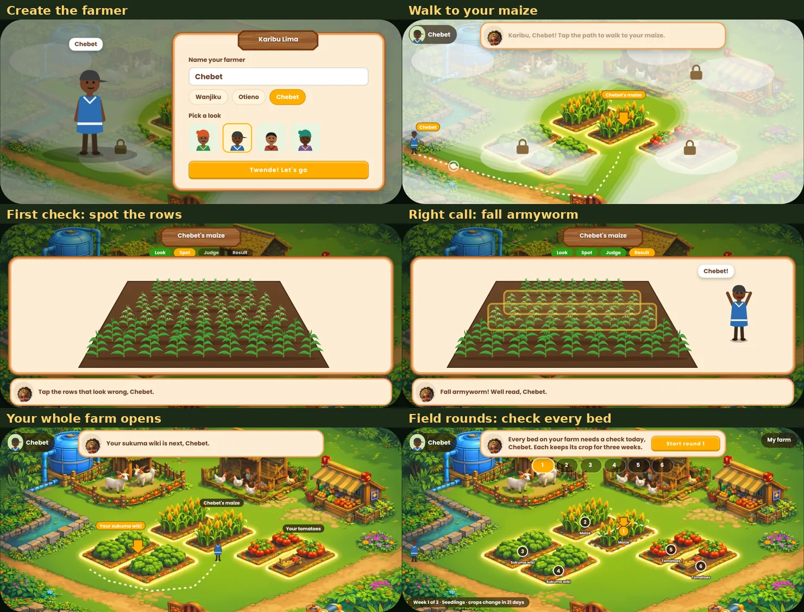
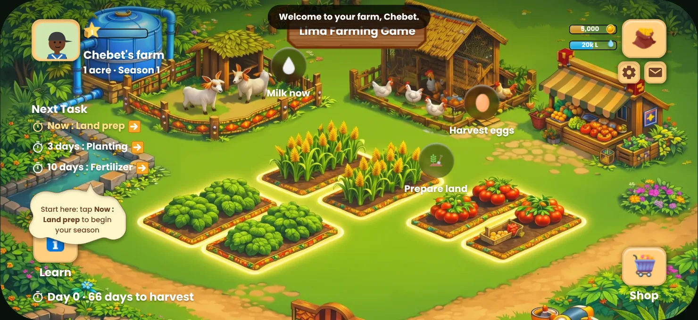
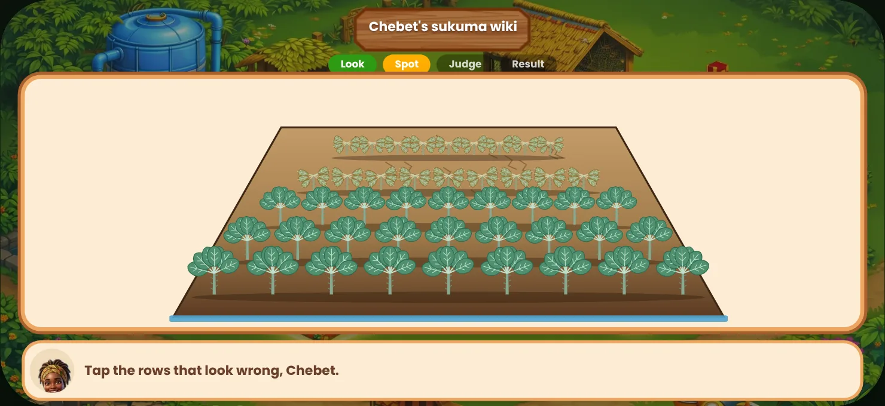
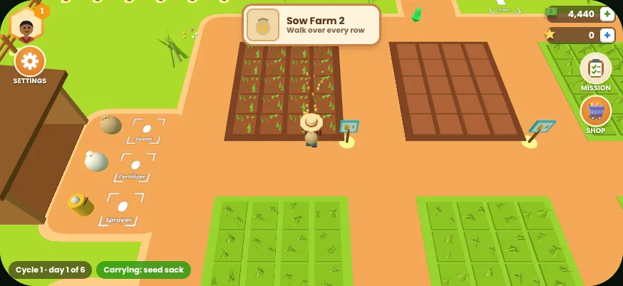
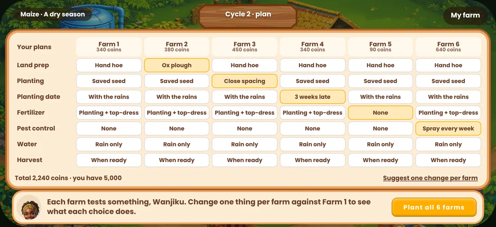
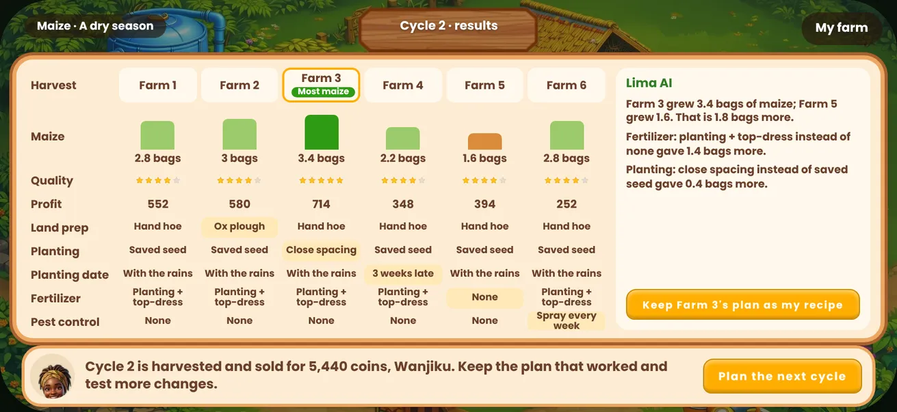
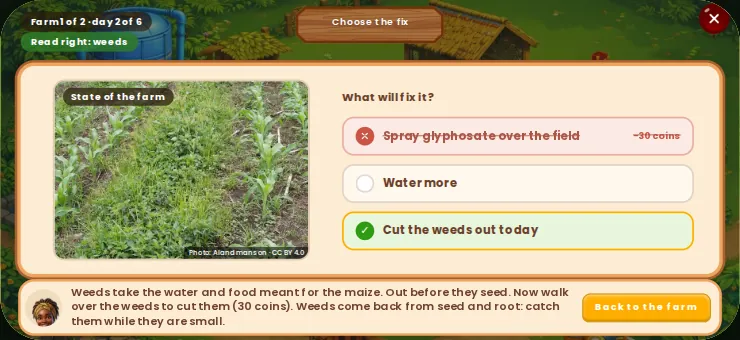
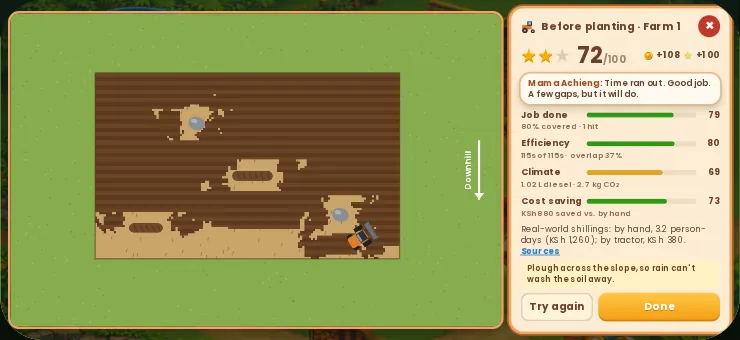

# Lima Farming Game

A farming game for young Africans who farm or want to — including "satellite farmers" with a city job and a
rural farm — played on a landscape phone. It is **one farm, the player's own** — there are no neighbours. The
player learns to read their crops with their own eyes, then checks every bed on the farm often, so the farm keeps
growing healthy, nutritious food. Its core is **the six farms**: the same maize grown to six different plans side
by side, so a year or more of trial and error happens in a few weeks of play. Seasons of maize turn every choice
(doing the work, when to harvest, how to store, whether to process) into what they earn. Points unlock real
partner discounts.

The game is built in React + TypeScript from the Figma file **"29 Oct Farm Management App"**
(`dvRxEJtTy8rGBPIVmCLb4E`, section *Farm game*). The Figma farm map is the ground of the whole game.

**▶ Play it: https://dgtechbuilder.github.io/limagame/** — best on a phone held sideways. On Android or
iPhone, *Add to Home screen* runs it full screen like an app.



---

## Contents

- [What a player does](#what-a-player-does)
- [Run it locally](#run-it-locally)
- [Deploy](#deploy)
- [Project structure](#project-structure)
- [How the Figma design maps to code](#how-the-figma-design-maps-to-code)
- [The first session](#the-first-session)
- [The season](#the-season)
- [Field rounds](#field-rounds)
- [The farm world](#the-farm-world)
- [The six farms](#the-six-farms)
- [From Wakala Agent](#from-wakala-agent)
- [Plots and inputs](#plots-and-inputs)
- [Navigation and the main menu](#navigation-and-the-main-menu)
- [Page addresses](#page-addresses)
- [Settings](#settings)
- [Climate tracking](#climate-tracking)
- [Character art: retro anime](#character-art-retro-anime)
- [Design review mode](#design-review-mode)
- [Saving, events and privacy](#saving-events-and-privacy)
- [Performance on low-cost phones](#performance-on-low-cost-phones)
- [Assumptions and open decisions](#assumptions-and-open-decisions)

---

## What a player does

| When | What happens |
| --- | --- |
| **0:00** | Names a farmer (or taps *Wanjiku*, *Otieno* or *Chebet*) and picks a look. No menus or text walls first. |
| **0:05** | **The story so far**, three short pages: they bought this farm, last season's harvest failed and lost money, and this season they start by learning from each mistake. |
| **0:10** | Walks across their farm to the maize. The rest of the farm is under mist. |
| **0:25** | Checks the maize by looking: spots the rows with fall armyworm and makes the right call. This is the moment the game is built around. |
| **~2:00** | The whole farm opens. Their sukuma wiki needs the same kind of check, with fewer hints. |
| **~3:00** | **Field rounds**: checks every bed on the farm, one after another — and comes back often, because every bed changes every day. |
| **Then** | **The first planting period** (about 10 minutes): maize on Farm 1, which they clear plot by plot, and sukuma wiki on Farm 2, which they plant plot by plot; then they check both every day for six days and harvest. |
| **Every week** | **Six farms**: a different plan on each farm, one day of checks each real day (or all now), then the harvests compared. The plan that worked becomes their recipe for the next cycle. |
| **Any time** | Plays seasons of maize on Farm Moja: six farming steps, harvest timing, storage, processing, selling, results, rewards. |

A wrong call is part of learning: the clue they missed is circled, and they try again on a second maize bed.

## Run it locally

```bash
npm install
npm run dev        # http://localhost:5173
npm run build      # production build in dist/
npm run preview    # serve the production build
npm run typecheck  # TypeScript, no output files
```

Needs Node 18 or newer. There is no backend: everything runs in the browser.

## Deploy

Every push to `main` builds the site and publishes it to GitHub Pages with
[`.github/workflows/deploy.yml`](.github/workflows/deploy.yml) (install → type-check → `vite build` →
deploy). The workflow can also be started by hand from the *Actions* tab. Pages is set to deploy from
**GitHub Actions** in the repository settings.

`vite.config.ts` uses a relative base (`./`), so the same build works at
`https://<user>.github.io/<repo>/` or any other path.

Optional build setting: `VITE_EVENTS_URL=https://…` sends the first-session events (see below) to your
own collector.

## Project structure

```
src/
  main.tsx                 entry point
  App.tsx                  scales the 874 × 402 stage to the screen; routes first session / farm / modals; review menu
  state.ts                 game state, season rules and saving (useReducer + localStorage)
  data.ts                  farm copy, prices, tasks, rewards, storage and processing options
  assets.ts                image paths (art exported from Figma into public/assets)
  styles.css               design tokens (colours, gold button, panels) and component styles
  components/
    Nav.tsx                Back / Menu / Farm buttons shared by every screen (NavBar, NavContext)
    FarmMap.tsx            the Figma farm map: the ground of the whole game (1× and 2×)
    FarmScene.tsx          farm screen: HUD, Next Task, field bubbles, selected plot
    Modal.tsx, ui.tsx, Icons.tsx   modal frames, buttons, chips, inline SVG icons
  screens/
    MainMenu.tsx           the main menu
    Catalog.tsx            Shop and Farming Steps
    Journey.tsx            harvest timing → sale → storage → value addition → process → results; rewards; info
    Meta.tsx               How the farm works
    Settings.tsx           the Settings page: My farmer, Game, Display, Help & data
    Climate.tsx            the Climate page: Overview, Emissions, Water & soil, Climate shocks, Activity
  art/                     retro anime characters: anime.tsx (SVG kit: farmer, guide, shopkeeper, Ojuok),
                           Cast.tsx (anime or original picture), style.ts (style and read-aloud contexts)
  speech.ts                Read aloud: the phone's own voice (speechSynthesis)
  climate/                 climate tracking: model.ts (every factor, the ledger, rating, levels), track.ts (which
                           actions record what), Tag.tsx (climate tags on choices), sample.ts (design review)
  first/                   the first session (see below)
  world/                   the farm world (see below): field.ts the work by hand, engine.ts the 3D farm, World.tsx the HUD
  trials/                  the six farms (see below): model.ts holds every number; Trials.tsx the screens (loaded when opened)
  care/                    from Wakala Agent: the fix after a right call, the safety kit and product, follow-ups (data.ts),
                           Mama Achieng's lines (voice.ts), and their screens (loaded when opened)
  plots/                   plots and inputs: data.ts (20 plots a farm; seeds, fertilizers, sprayers, tractor types and
                           tools, with what each does and costs); PlotBoard.tsx (a farm's seed, fertilizer and sprayer); TractorPick.tsx
  tractor/                 from Wakala Agent: the tractor drive before planting: data.ts, sim.ts (no DOM), Tractor.tsx
  dev/hook.ts              ?dev in dev builds only: state and jump-to-state helpers for the play-tests
tests/                     Playwright play-tests (npm test)
  rounds/                  field rounds: checks of every bed on the farm, back to back (see below); loaded only when opened
    trial.ts               a six-farm check: what a farm shows today, from its own plan
    photos/                real photos from Wikimedia Commons by situation, credits.json + CREDITS.md (see photos/README.md)
public/
  assets/                  130 images exported from Figma, incl. bg-farm.webp and bg-farm@2x.webp
  manifest.webmanifest     installable web app (landscape, full screen) + icons
design-refs/               PNG renders of the 22 Figma frames, for side-by-side checks
docs/                      screenshots used in this README
```

## How the Figma design maps to code

The design is a landscape phone game on an **874 × 402** frame. The app draws everything on a fixed
874 × 402 stage and scales it to fit the screen, so positions match the Figma frames exactly. Portrait
phones see a "rotate your phone" prompt.

| Figma group | Frames | Code |
| --- | --- | --- |
| Game Design | Game (3 variants), Food, Fertilizer, Water tanks, Equipments | `components/FarmScene.tsx`, `screens/Catalog.tsx` → `ShopModal` |
| New Design | Land Prep (+ completed), Planting, Fertilizer, Pesticides, Water, Harvest, Sale of produce, Info | `screens/Catalog.tsx` → `StepsModal`; `screens/Journey.tsx` → `SaleModal`, `InfoModal` |
| New features | Storage, Outcome comparison, Real world reward (Harvest timing), Reward hub, Value addition, Preview (Select process) | `screens/Journey.tsx` |
| Map (`IMG_5612 1`, in every frame) | The painted farm | `components/FarmMap.tsx`, used by the farm, the first session and behind every review |

Added beyond the Figma file: the first session, Settings, season results with history, empty states and
locked steps. They reuse the Figma frames, colours, wooden title plank and gold buttons.



## The first session

A new player never sees the farm screen first. Everything happens on their own farm. In order:

1. **Create the farmer** — name plus one of four looks, saved immediately. The name is used in every line
   from then on, and the farmer's portrait replaces the HUD avatar.
2. **The story so far** — three pages, each with a picture drawn in the first session's own art
   ([`src/first/Story.tsx`](src/first/Story.tsx); the words are `STORY` in [`src/first/data.ts`](src/first/data.ts)):
   - *A farm of my own*: the farmer saved from a job in town and bought this farm. The plan was to plant maize and
     sukuma wiki, come back at harvest, and sell.
   - *The harvest that failed*: caterpillars ate the maize before anyone looked closely, and the sukuma wiki at
     the back dried out. Spent KSh 38,000, earned KSh 14,500, lost KSh 23,500. A real photo of fall armyworm
     (credited) shows the damage up close.
   - *What went wrong*: three mistakes, each crossed out with what to do instead. These are the lessons the game
     teaches next: check every bed often (the maize check), water by the soil (the sukuma wiki check), and plan
     when to harvest, store and sell (the season). **Start with my maize** begins the walk.

   *Skip story* goes straight to the walk; *Previous* steps back a page; the top Back button goes from the story
   to creating the farmer, and from the walk back to the story. Events: `story_page`, `story_done`, `story_skipped`.
3. **Walk to the maize** — on the Figma map: in along the dirt path, up the grass to the front maize bed.
   The first tap or drag moves the farmer; a pulsing ring shows where to tap. About 10–15 seconds.
4. **First check (the aha moment)** — four steps, the template for every check in Lima:
   - **Look** at four pictures (the crop, pests & disease, soil & water, layout). Tap to zoom; the next one glows.
   - **Spot** the rows that look wrong in the field.
   - **Judge**: healthy · needs water · pests · needs fertiliser.
   - **Result**. Right: the damaged rows light up, the farmer cheers by name and the maize recovers, ending on
     *"You can read your crops now, so check every one of them often."* Wrong: the missed clue is circled and
     the player walks round to the **back maize bed** to try again.
5. **The whole farm opens** — the mist lifts on screen and the crops are labelled. The farmer's **sukuma
   wiki** (the greens on the left of the map) needs a check with fewer hints. Its problem is subtler: no
   holes, just limp, dull leaves and cracked soil at the back.
6. **Into the field rounds** — *"Your tomatoes need a check too: healthy crops mean good food for your
   family."* **Check all my crops** opens the [field rounds](#field-rounds), where the player checks every
   bed on the farm. From then on the farm screen's **Rounds** button brings them back.

Passing the first check marks onboarding done, so it never repeats. Reloading mid-session resumes at the
current moment.



### Every review is data

All the pictures are drawn in SVG from a short record in [`src/first/data.ts`](src/first/data.ts), so every
later review is the same experience with new content:

```ts
first: {
  crop: 'maize',
  condition: 'armyworm',          // what the art draws: holes, droppings in the funnel, a caterpillar
  correct: 'pests',
  problemRows: [2, 3],            // rows that show the problem; the rest are healthy
  hints: 'full',                  // 'full' for the first review, 'few' afterwards
  captions: { crop: '…', pests: '…', soil: '…', layout: '…' },  // one sentence each; points the eye, never diagnoses
  clue: { part: 'pests', text: 'See the holes and the sawdust in the funnel, {name}?' },
  right: 'Fall armyworm! Well read, {name}.',
  practice: 'A pinch of ash or sand in each funnel stops them early.',
  retry: 'lower',                 // shamba to send the player to after a wrong call
}
```

Crops drawn today: maize, beans, sukuma wiki. Conditions: healthy, fall armyworm, drought (water stress),
nitrogen deficiency.

| File in `src/first/` | What it does |
| --- | --- |
| `data.ts` | Reviews, farmer looks, name suggestions, the four calls |
| `art.tsx` | Crops, soil, close-ups, field and farmer, drawn from the data |
| `Review.tsx` | The one review system: Look → Spot → Judge → Result |
| `Village.tsx` | Tap-to-walk over the Figma map along fixed routes; mist, arrows and labels. Bed outlines and routes are in `SPOTS`, `MAIN`, `TO_LOWER`, `TO_SUKUMA`. |
| `Create.tsx`, `FirstSession.tsx` | Farmer creation and the order of moments |
| `track.ts` | Event log (below) |

## The season

One season of maize on *Farm Moja* (the maize beds on the map):

1. **Farming Steps** run in order: Land prep → Planting → Fertilizer → Pesticides → Water → Harvest. Only the
   current step is open; later ones are locked and finished ones are read-only. Each task costs coins (free
   if the input was bought in the Shop) and shows a one-line farming tip. *Finish* moves the calendar on by
   that step's days; *Skip* is allowed but scores zero for that step.
2. **Crop health** is the average score of the growing steps (tasks done ÷ recommended). It sets expected bags
   and quality, shown in Info and Harvest timing.
3. **Harvest timing**: harvest now, wait 2 days (best), or wait a week (lower quality).
4. **Sale → Storage → Value addition → Select process**: prices are editable; storage trades cost per bag
   against bags lost; processing raises the price. *Confirm and sell* pays out coins and points.
5. **Season results** compare seasons, name the three steps that cost the most, and *Lima AI* explains the
   result from the player's own numbers. *Start season N+1* keeps coins, points and history.

Points: +100 × score for each finished step, +5 per bag sold. Rewards cost 800 or 1,500 points. Play time
counts while the game is on screen. Milk and eggs can be collected once a day. The farm always shows
**Now : &lt;task&gt;** and a bubble on the field for the current task.

Balance numbers live in `src/data.ts` (`STEP_META`, `HARVEST_EFFECT`, `STORAGE_OPTIONS`, `PROCESSES`,
`REWARDS`) and `src/state.ts` (`expectedHarvest`, `saleQuote`).

## Field rounds

The farmer has to check all their crops often for the farm to keep progressing and growing healthy food. Field
rounds are how: the first session ends in them, and **Rounds** on the farm screen (right edge, above Shop) opens
them again. The player checks **every bed on the farm back to back** — six beds, named by where they are (middle,
back, left, front-left, right, front-right) because their crops rotate. For every bed the farmer **walks there**
along the paths, then the player:

1. **Looks** at five pictures: the crop, pests & disease, soil, water, and the state of the farm, plus the farmer's
   note (planting date, weather, what was done).
2. **Judges** in two taps: a group (healthy, water, plant food, pests & disease, weeds, animals & weather, plant &
   harvest time), then the exact problem when the group has more than one.
3. Gets the answer. A wrong call shows the one picture that held the clue, then a second look.

### A crop stays for three weeks

Each bed keeps **one crop for 21 real days**, counted from the day the player first opened the rounds. The crop
moves through three stages: **seedlings** (days 1–7), **growing** (8–14) and **harvest time** (15–21). On day 22 the
bed rotates to the next crop (maize → beans → sukuma wiki → tomatoes), so pests and disease do not build up.

Every real day each bed gets a new situation, drawn from what can happen to that crop at that stage. The same farm
on the same day is always the same, so a re-check after 30 seconds shows the same farm. The mix and the stages are in
`src/rounds/hazards.ts`.

| Situation | What it is | Crops | Stages |
|---|---|---|---|
| `healthy` | A healthy crop | maize, beans, kale, tomato | seedlings, growing, harvest |
| `drought` | Not enough water | maize, beans, kale, tomato | growing |
| `flood` | Too much water | maize, beans, kale, tomato | seedlings, growing, harvest |
| `nitrogen` | Short of plant food | maize, kale, tomato | growing |
| `armyworm` | Fall armyworm | maize | growing |
| `aphids` | Aphids | kale, tomato, beans | growing |
| `disease` | A leaf disease | maize, beans, kale, tomato | growing, harvest |
| `weeds` | Weeds | maize, beans, kale, tomato | seedlings, growing |
| `livestock` | Animals broke the fence | maize, beans, kale, tomato | seedlings, growing, harvest |
| `wildlife` | Birds and monkeys | maize, tomato, beans | harvest |
| `hail` | Hail damage | maize, beans, kale, tomato | growing, harvest |
| `plantEarly` | Planted too early | maize, beans, tomato | seedlings |
| `plantLate` | Planted too late | maize, beans, tomato | growing |
| `harvestEarly` | Harvested too early | maize, beans, tomato | harvest |
| `harvestLate` | Harvested too late | maize, beans, tomato | harvest |

Animals that break the fence (`livestock`), birds and monkeys (`wildlife`), hail, flooding, disease, weeds, and
planting or harvesting at the wrong time are there on top of drought, pests and hunger. To add one, add it to
`HAZARDS` and give it a call and, if it needs a new picture, a drawing in `src/rounds/scene.tsx`.

### Rules

- **Every 30 seconds**: each bed can be checked once every 30 seconds (`CHECK_COOLDOWN_S` in `src/rounds/data.ts`).
  A pin shows the countdown. A missed bed can be checked again after 30 seconds, from the chip bar or the summary.
- **Points**: 100 for a right read first time, 50 after a second look, paid **once per bed per day**. Results reset at
  the player's midnight, because every bed is a new situation then.
- **Real photos**: the game ships with 42 real, openly licensed photos from Wikimedia Commons (CC0, public domain,
  CC BY and CC BY-SA): fall armyworm in a maize funnel, aphids on kale and beans, late blight on tomato, rust on maize
  and beans, black rot on sukuma, hail-stripped tomatoes, Striga and weeds between maize rows, flooded and drought
  fields, a quelea flock, goats, hoof prints, seedlings on dry soil and healthy crops. About half of all pictures
  (210 of 430) are photos: every one of the 86 situation, crop and stage combinations has at least one, and 58 show a
  photo as the clue, ringed where it helps. The first walkthrough uses them too. Each photo shows its author and
  licence when zoomed; the full list is in [`src/rounds/photos/CREDITS.md`](src/rounds/photos/CREDITS.md). Pictures
  without a photo stay drawn. To add more, see `src/rounds/photos/README.md`.
- **Review menu**: *Field rounds* lists the map, look, judge, right, wrong and summary screens, and one entry for
  each new situation.
- **Events**: `round_start`, `round_part_viewed`, `round_call` (no names).
- The Figma map has six beds, one round each. The beds are painted art and always show the same plants; the crop
  name on each pin says what is actually growing.

## The farm world

After the first session the game's home is **a walkable 3D farm**: the farmer, in a straw hat, walks the farm and
does every farming step by hand. Tap the ground to walk there, drag anywhere for a joystick, or use the arrow keys or
WASD. The **task card** at the top says what to do next; tap it and the farmer walks there.



- **The six farms** each have **20 plots** (4 × 5 tiles, Plot 1 at the back left), Farms 1–3 at the back and 4–6 in
  front, each with a sign. **Clearing and planting are done one plot at a time**: the farmer stands on a plot, a
  **Clear** or **Plant** button shows under them, and pressing it starts a **3-second timer** (a stopwatch over the
  farmer, its ring filling). Walking off the plot stops the timer and the plot stays as it was. The task card counts
  the plots left and walks the farmer to the next one. The other jobs are done by walking over the plots with the tool
  or load they need:
  - **land prep** by hand is the Clear button (the plan says how: hoe, sickle or mulch); **tractor hire** and
    **oxen** are hired at the **Hire** spot by the shed, and plough the farms themselves while the farmer works elsewhere;
  - **planting** is the Plant button (no seed sack to fetch); **fertilizer at planting** with the bag from the shed;
  - **each day's check**: walk to a farm's sign (a **!** badge) to read it, with the same real photos and calls as the
    field rounds. A right call turns into work by hand: **cut the weeds**, **water** (fill the can at the pond),
    **top-dress**, **spray** (the sprayer from the shed), **dig drains** through puddles, **chase the goat out**,
    **scare the birds off**. The treatment is paid for, and stops most of the damage, only once the work is done;
  - **harvest**: walk the dry rows, and the cobs stack up on the farmer's back; take them to the **Sell** stall.
- What a farm shows comes from its plan and its day: wild grass before digging, furrows, sprouts, knee-high and tall
  maize, dry cobs, stubble; drought-pale soil, yellow hunger, rust, armyworm specks, weeds, puddles, hail, a goat, birds.
  Problems missed earlier leave the farm yellower.
- **The tractor** waits by the shed. Tap **TRACTOR** (left edge) to walk to it; there the farmer picks its type and
  tool, then hops on (**GET OFF** to step down, **Change tool** to swap). The tool decides the job, and the tractor works
  the plots under it as it drives (a column of five plots a pass): see [Plots and inputs](#plots-and-inputs). It drives
  a little faster than walking. A farm whose 20 plots are all done from the seat pays **+30 bonus points** once per
  farm and job (`TRACTOR_BONUS.perJob`). The hired tractor (a *Tractor hire* plan) ploughs a whole farm in one pass.
- **Sleep** at the farmhouse starts the next day (on the fast clock); **Plan** by the house, or **Mission** on the
  HUD, opens the plans, progress and results.
- The HUD: the farmer and their level (top left), settings, coins and points (top right; **+** opens the shop and
  the rewards), Mission and Shop, the day and what the farmer carries (bottom left).
- **Settings → Farm view** switches to the classic painted farm (Farm Moja seasons and the everyday field rounds),
  and back.

Built with [three.js](https://threejs.org) 0.170 from primitives (no model files): static scenery is merged into two
meshes, the six farms are instanced (one draw call per kind of tile), shadows come from one sun that follows the
farmer. The world is loaded only after the first session (`src/world/`, about 150 kB gzipped with three.js).
`src/world/field.ts` holds the field work (which jobs, in which order, which tiles), with no three.js, so the saved
game can use it.

A full guided cycle (clear → plant → fertilize → six days of checks, including a right call becoming weeding and
scaring off birds → harvest → sell) has been played end to end with no errors. **Not yet human-tested**: watering,
spraying, digging drains, chasing the goat, hiring the tractor or oxen, a full six-farm cycle, and the daily clock
(one day per real day). The first session (the village walk) is still the 2D Figma map, not the 3D world.

## The six farms

The six farms are LIMA's core idea: grow the same maize on up to six farms, each to a **different plan**, and
compare the harvests. Six chances to fail safely in one cycle, so a player sees in a few weeks what would take a
year or more on a real farm. **Six farms** on the farm screen opens them (a badge shows how many farms need a check
today, or **!** at harvest).



**One cycle**

1. **Plan.** A table with one column per farm and one row per farming step: land prep, planting (seed), planting
   date, fertilizer, pest control, water (litres per m² a week on top of the rain) and harvest. Tap a box to choose;
   each choice says what the farmer does and what it costs, never how well it works. No two farms may have the same
   plan. Boxes that differ from Farm 1 are gold. *Suggest one change per farm* fills Farms 2–6 with one change each
   against Farm 1, so every farm tests one thing.
2. **Grow.** Six days of checks: two of seedlings, two growing, two at harvest time. Each day every farm gets a
   field check (the same five pictures and calls as the field rounds), and **what a farm shows comes from its own
   plan**: the farm with no watering in a dry season shows drought, the farm with fertilizer at planting only goes
   hungry mid-season, the farm with no pest control can't treat armyworm, a planting date before the rains shows on
   day 1. In the guided cycle both farms share each day's luck, so they differ only where their plans differ; with six
   farms each has its own luck, as real fields do, and the plans set the odds. A right call treats
   the problem (for a few coins) and stops most of the damage; a missed or wrong call lets it run. After the call the
   player is told why this farm has this problem and what was done about it.
3. **Harvest and compare.** Bags of maize, quality, and profit per farm, side by side, with the plan rows that
   differ. **Lima AI** splits the gap between the best and worst farm into its causes from the player's own numbers
   (for example *Fertilizer: planting + top-dress instead of at planting only gave 0.6 bags more*), and says when the
   farm that grew most is not the one that made most. The player can keep any farm's plan as their **recipe**; the
   next cycle starts from it.



**The first planting period** (the first cycle) needs no planning: it starts as soon as the farm opens, with two
farms grown a common way (hand hoe, planted with the rains, fertilizer at planting only, no pest control, rain only,
harvested when ready), each a different crop at a different stage:

- **Farm 1: maize, before planting.** Its 20 plots are still wild grass: the farmer clears each one (the Clear button
  and its 3-second timer), then plants it.
- **Farm 2: sukuma wiki, at planting.** It starts cleared, ready to plant: the farmer plants each of its 20 plots
  (the Plant button, 3 seconds each).

The task card leads in that order: clear Farm 1's plots, then plant the sukuma wiki on Farm 2, then plant the maize on
Farm 1, then fertilizer at planting. Sukuma wiki grows as low, broad-leafed plants in the 3D farm; its checks use the
sukuma wiki pictures and photos of the field rounds, and it meets **aphids** where maize meets armyworm (no birds at
the cobs). The results show each farm's harvest and what it lost. **Sukuma wiki uses maize's yield and price numbers
for now** (bags, at maize prices) until an agronomist sets its own. The days move on as soon as both farms are
checked, so the whole cycle takes about 10 minutes. From the second cycle there are six farms of maize, the season's rain changes (normal, dry, normal, wet),
and the player chooses how the days pass: **one day each real day** (the daily habit, about a week a cycle) or
**all six days now**; they can switch at any time.

**The model** lives in one file, [`src/trials/model.ts`](src/trials/model.ts), so an agronomist can review it
without reading any screen code:

| Table | What it sets |
| --- | --- |
| `PLAN_STEPS` | every choice: its words, its cost in coins, and its yield factor |
| `FORECASTS`, `WATER_NEED`, `WATER_TOO_MUCH` | rain per week by season (8, 15 or 28 L/m²), what maize needs (35), when it waterlogs (above 50) |
| `BASE`, `weightsFor` | how likely each problem is on a day, and how each plan changes that (weeds from land prep, hunger from fertilizer, drought and waterlogging from water, disease from close spacing or a wet season, birds from a late harvest) |
| `DAMAGE` | the share of the harvest a problem costs when missed and when caught, and what the treatment costs |
| `POTENTIAL_BAGS`, `PRICE_BY_QUALITY` | 6 bags (90 kg) per farm when everything goes right; price by quality |

Yield = potential × each step's factor × (1 − loss) for every problem. With perfect checks, in a normal season, the
common plan grows about 2.1 bags; changing one thing on it gives about +0.7 bags (certified seed, a top-dress, or
20 L of water a week) down to −0.4 (planting before the rains or three weeks late); a plan that gets every step
right grows about 5.7. Missing every check costs a good plan about 0.9 bags. Spraying every week or a double dose of
fertilizer grows about as much as the right plan but costs more than it earns. **All of these numbers are
illustrative until an agronomist reviews them.**

*Tractor hire* is a land-prep choice with a placeholder price; it is where a tractor-hire partner would plug in.
Points: the field-check points (100, or 50 on a second look) for each farm each day, plus 50 per farm at harvest.
Events: the checks use the field-round events (`round_start`, `round_part_viewed`, `round_call`).

## From Wakala Agent

[Wakala Agent](https://github.com/dgtechbuilder/wakalarepotest2) is a sister game about a village agent who reads
farms and helps fix them. Its gameplay now runs inside Lima's farm world, on Lima's own state, clock, save and coins:
the logic and data were ported, not its HTML.

**What was added**

- **Choose the fix.** After a right call in the farm world, the check leads to *Choose the fix*: three fixes, one
  right. A wrong one costs coins (the same as the treatment, `WRONG_FIX_COST`), says in one line why it would not
  work, and the player picks again. The right one leads to the same work by hand as before. The pick is saved on the
  check (`fix`, `wrongFixes`), so a reload asks for the fix again only if it was not picked.
- **Safety kit and product.** Picking up the sprayer for a spray job asks for gloves, mask and boots, then which
  product goes in the sprayer (one question per problem being sprayed). A wrong product says why and costs nothing.
- **Follow-up care.** Some treatments need doing again on Lima's clock: water again the next day (drought), water the
  top-dress in (low nitrogen), spray again two days on (armyworm, leaf rust), weed again two days on. A follow-up shows
  on the task card on its day, always inside the six check days, and costs no coins. A follow-up whose day ends undone
  is logged, and the problem is back on that farm's next check ("The problem came back").
- **Mama Achieng**, the farmer's mother, says what she has noticed when the farmer reaches a sign, and about each of
  the five pictures. Her lines sit beside the captions, never instead of them. From cycle 2 she is sure of the wrong
  thing on about one check in four (the same check always shows the same line): her guess, never advice.
- **The tractor drive.** On a farm whose plan says *Tractor hire*, the Hire spot opens the drive before planting:
  a brief, then the player picks the tractor (compact, standard, large) and the implement (eight, nothing
  pre-picked), ticks the ready check and drives against the clock around rocks and trunks: tap and hold to steer,
  arrow keys or WASD, slow or fast, or autopilot (at most 2 stars). The summary scores the job, efficiency, climate
  and cost saving, and shows what the same work would cost by hand, in shillings, as real-world information. Then
  the 3D tractor ploughs the plot and the cycle carries on. Oxen still plough by themselves. Farms 1–4 are Wakala's
  four fields (a slope to plough across, a channel to dig furrows from, clods to harrow, old stalks to turn in);
  Farms 5 and 6 mix the same lessons. A poor job is scored, never blocked.

| Choose the fix | The tractor drive's summary |
| --- | --- |
|  |  |

**Try it**: `?review=1`, group **From Wakala**: *Mama Achieng in a check*, *Choose the fix*, *Safety kit and
product*, *Follow-up due*, *The problem came back*, *Tractor brief*, *Tractor summary*. In a real game, plan a farm
with *Tractor hire* or *Check and treat*, and the moments come up as you play.

**The data tables** (every word and number, for review without touching code)

| File | What is in it |
| --- | --- |
| `src/care/data.ts` | `PRESCRIBE` (three fixes and their lessons for drought, armyworm, aphids, nitrogen, weeds, disease, flood, livestock, wildlife), `KIT`, `PRODUCTS`, `FOLLOW_UP` |
| `src/care/voice.ts` | `SAY`, `REMARK`, `WRONG_GUESS`, how often she guesses wrong and from which cycle |
| `src/tractor/data.ts` | `TRACTORS`, `IMPL` (all eight), `RELATED` (how much a wrong implement still does), `LAYOUTS` (six fields), `MONEY`, `TRACTOR_REWARD` |
| `src/trials/model.ts` | `WRONG_FIX_COST`, and the proposed yield effects: `WAKALA_YIELD_EFFECTS` (off), `TRACTOR_Q_FACTOR`, `MISSED_FOLLOW_UP_RETURNS` |

Lines ported from Wakala are marked `// Wakala` in the data; the rest are new, in the same style.

**Money.** Lima's coins stay the only money. Shillings appear only in the tractor summary, to compare, and its
*Sources* button lists each figure with its source: diesel KSh 228 a litre (EPRA's Nairobi cap for 15 October to
14 November 2026, via [Techish](https://tech-ish.com/2026/10/14/petrol-rises-to-kes-226-96-in-nairobi-and-kerosene-jumps-kes-28-49/)),
tractor ploughing KSh 3,000 and harrowing KSh 1,500 an acre ([Beyond Forest](https://www.beyondforest.org/post/ploughing-cost-per-acre-in-kenya-2026-guide-virgin-vs-uncultivated-land-explained)),
hand ploughing 24 person-days an acre at KSh 400 a day ([FarmBiz Africa](https://farmbizafrica.com/tractors-services-increase-farmer-earnings-lower-production-costs/)).
**Estimates**, labelled as such in the game: ridging, planting, spraying and harvesting hire; hand-work days for
everything but ploughing; diesel per acre for each implement; 2.68 kg of CO₂ a litre. One farm is a sixth of an acre.

**Rewards.** A drive pays 1.5 coins per score point and 50 points per star above the farm's best this cycle, as in
Wakala. *Try again* is allowed until the player is done with the drive, so a good drive can be replayed for coins;
`TRACTOR_REWARD.retryPays = 'improvement'` would pay a retry only for the score above the best (an open decision).

**Yield.** Until the agronomist's review (Gate A), how well the tractor ploughed and whether follow-ups were done are
shown and saved but change no bags: `WAKALA_YIELD_EFFECTS = false`. With it on, a tractor-hire farm's land-prep
factor is scaled by the drive's job quality (`TRACTOR_Q_FACTOR`), and a problem that came back costs harvest like any
other. Wrong fixes cost coins now; those coins count in the farm's costs at harvest.

**Events** (with the first-session ones): `prescribe {hazard, pick, right}`, `kit_on`, `product {hazard, pick,
right}`, `care_started` and `care_done {farm, day, hazard, job, kind}` (treatment or follow-up), `care_missed`,
`tractor_open`, `tractor_pick {tractor, implement, right}`, `tractor_done {score, stars, job, cov, eff, clim, money,
saved, hits, secs, auto, reason}`.

**Not ported** (on purpose): Wakala's review screens and its five calls, its seven written rounds, its clock and
morning and evening windows, the three-misses rule, browser notifications, hold-to-act buttons, the planting and
harvest tractor stages, the boom-sprayer, delivery and route jobs, gems, hub maps, road walking and its onboarding.
Wakala's photos were not added yet (Wikimedia could not be reached from the build session).

**Tests.** `npm test` runs the Playwright play-tests in `tests/` against the dev server (run
`npx playwright install chromium` once): a world check with a wrong then right fix and the work by hand, a
follow-up done and one missed, a spray job with the kit and product, a tractor drive on autopilot, the first session
read right and wrong, saving and *Reset progress*, the tractor's type and tool on its own plot, the plot board at the
seed shed and in the plan, the results by plot, and a tour on a 740 × 340 touch screen that saves screenshots to
`test-results/tour/`. They run on every pull request (`.github/workflows/tests.yml`).

## Plots and inputs

**Every farm is 20 plots**: its 4 × 5 tiles, Plot 1 at the back left to Plot 20 at the front right
(`PLOTS_PER_FARM` in `src/plots/data.ts`; `plotAt` in `src/world/field.ts` finds the plot under the farmer). The work
done is a 20-bit mask per farm and job, one bit per plot. **Clearing and planting are done a plot at a time** with the
Clear and Plant buttons and a 3-second timer (`PLOT_WORK_S`); the other jobs by walking over the plots.

**Inputs are one set per farm**: one seed, one fertilizer and one sprayer for all 20 plots, so the six farms compare
them. Every word and number is in `src/plots/data.ts`, for an agronomist's review.

- **The inputs board** shows a farm's seed, fertilizer and sprayer, with what each choice is, when it is the right one
  and what it costs. It opens in the plan (the *Inputs* row, one box per farm), and at the fertilizer and sprayer sheds.
  A farm already sown or spread keeps its input; a change while the farms grow pays or refunds the difference.
- **The tractor can be used at any point.** At the tractor the farmer picks its type (compact, standard, large: fuel,
  speed, how much it packs the soil) and its tool (plough, harrow, ridger, planter, seed drill, fertilizer spreader,
  boom sprayer, maize or bean harvester), with what each tool is for and which farms need that job today. The tool
  decides the job, and the tractor works the plots it drives over. Fuel is paid once per farm and job (24, 36 or 56
  coins); a farm whose 20 plots are all done from the seat pays 30 points. The first type and tool on a farm are kept
  with its results; spraying from the seat makes the farm's sprayer the boom sprayer. *Change tool* swaps the type or
  tool without getting off.
- **Growth on the field.** A farm's crop grows taller or shorter, greener or paler, with its inputs.
- **Results by input.** The results have a *By input* view: every farm's harvest beside its seed, fertilizer, sprayer
  and tractor, and Lima AI's lessons, each a fair comparison: a farm's harvest against the same farm with one input
  changed to a yardstick (long-season hybrid, no fertilizer, work by hand, the tool the farm needed, no spray),
  averaged over the farms with each choice.
- **Proposed numbers.** Seeds and fertilizers change yield as proposed in `docs/plot-trials-plan.md` (drought-tolerant
  seed in a dry season, DAP and CAN against no fertilizer, a large tractor's soil packing, the wrong tool for the
  ground). They are game estimates until reviewed.
- **Older saves.** A farm saved with four input plots (A to D) keeps Plot A's inputs for the whole farm.

## Navigation and the main menu

Every screen has at least two or three ways to move, and one of them is always the main menu:

| Screen | Back | Menu | Farm |
| --- | --- | --- | --- |
| Shop, Farming Steps, Rewards, Sale, Storage… | one step (to the menu if it was opened from there) | ☰ | ⌂ |
| Mission (six farms), Field rounds, a farm check, Choose the fix, the safety kit | one step | ☰ | ⌂ |
| Settings | close (to the menu if it was opened from there) | ☰ | ⌂ (not in the first session) |
| The tractor drive | the previous step | ☰ (the clock waits while it is open) | ⌂ |
| First session | one step where that is safe | ☰ | Settings instead (the farm is not open yet) |

The **main menu** (`src/screens/MainMenu.tsx`, the **MENU** button on the farm) lists My farm, Mission, Field rounds,
Tractor, Shop, Rewards, Farming steps and Settings. A screen opened from the menu goes back to the menu on *Back*;
*Farm* closes everything. The shared buttons are `NavBar` in `src/components/Nav.tsx`; `ModalShell` adds them to every
modal. `tests/nav.spec.ts` plays them.

## Page addresses

Every page has its own web address after the `#`, so a player can type one in the address bar to go there,
reload without losing their place, bookmark a page, and use the browser's **Back** and **Forward**
(`src/route.ts`). For example `https://dgtechbuilder.github.io/limagame/#/settings/display`.

| Address | Page |
| --- | --- |
| `#/start` | Name your farmer (first session) |
| `#/story/1` · `/2` · `/3` | The story so far, page by page |
| `#/walk/maize` · `#/check/maize` | Walk to the maize, and its check |
| `#/walk/back-maize` · `#/check/back-maize` | The back maize, after a wrong call |
| `#/walk/sukuma` · `#/check/sukuma` | The sukuma wiki, and its check |
| `#/farm` | The farm |
| `#/menu` | Main menu |
| `#/rounds` · `#/rounds/six-farms` | Field rounds: every bed, or today's checks of the six farms |
| `#/mission` | Mission: the six farms |
| `#/settings/my-farmer` · `game` · `display` · `help` | Settings, by section |
| `#/climate/overview` · `emissions` · `water-and-soil` · `shocks` · `activity` | Climate, by section |
| `#/shop/food` · `fertilizer` · `water-tanks` · `equipment` | Shop, by tab |
| `#/steps/land-prep` · `planting` · `fertilizer` · `pesticides` · `water` · `harvest` | Farming steps |
| `#/harvest-timing` · `#/sale` · `#/storage` · `#/value-addition` · `#/process` | The season after harvest |
| `#/farm-info` · `#/results` · `#/rewards` · `#/welcome` | Farm info, season results, rewards, how the farm works |

**The player's session decides where an address can go.** The game's saved state stays the one source of
truth: the address always names the page on show, and a typed address goes through the same rules as a tap.

- **First session:** only its steps, the main menu and Settings can be reached, and only steps the player has
  already reached. They can step back between naming the farmer, the story pages and the walk to the maize
  (as the Back button can), but not skip ahead to a check or open the farm early.
- **After the first session:** every farm page can be reached. The first-session steps can't, and
  `#/rounds/six-farms` works only on a day the six farms have checks.
- **Anything else** (a page that doesn't exist, or one the player can't reach yet) leaves them where they are,
  with a short message, and the address is put back. Addresses are tidied first: any case, extra slashes.
- Opening the game with an address goes straight to that page (if allowed); with no address, it opens where
  the player left off. Each new page adds a step to the browser's history. A correction replaces the address
  instead, so Back never lands on a page the player couldn't open.
- The browser tab's title names the page. *Settings → Help & data* explains addresses to players.
- Design review (`?review` / `?screen`) leaves the address alone.

## Settings

*Settings* (the **SETTINGS** button on the farm, the main menu, or the top bar in the first session) is a full page with
four sections. Every control works at once and is saved on the device; *Reset progress* keeps them.

| Section | Controls |
| --- | --- |
| **My farmer** | rename the farmer; change the look (the farm, the rounds and the HUD all follow) |
| **Game** | *Character style*: Retro anime or Original · *Farm view*: 3D farm or Classic · *Read aloud*: speaks the guide's lines and the game's messages with the phone's voice (a Kenyan English voice when the phone has one), with a Test button |
| **Display** | *Graphics*: Auto (drops shadows by itself on slow phones), High, Low (no shadows, 1× resolution) · *Reduce motion*: ends every animation and transition at once · *Full screen* |
| **Help & data** | How the farm works · Design review · Reset progress (asks twice) |

The settings live in `GameState.settings` (`src/state.ts`). The 3D farm is rebuilt when the character style or the
graphics change. `tests/settings.spec.ts` plays every section.

## Climate tracking

Every job in the game now records what it does to the climate, the water and the land. The **CLIMATE** button
(beside MISSION on the 3D farm, beside Rounds on the classic farm, and in the main menu) opens the **Climate page**.

**What is tracked**

| Measure | What feeds it |
| --- | --- |
| **Emissions** (kg CO₂e), by source | fertilizer (making nitrogen + the N₂O it gives off), diesel (tractor work and drives), chemicals (sprays), water pumping, seed, storage & milling, transport to market, manure |
| **Carbon stored** (kg CO₂) | mulch (no dig), manure, beans between the maize (they fix nitrogen) |
| **Water used** (litres, on top of the rain) | the plan's watering, emergency watering, Farm Moja's water tasks |
| **Pollution** | sprays and herbicide, synthetic nitrogen runoff, over-watering that washes fertilizer away, exhaust, wrong fixes (glyphosate on maize) |
| **Soil health** | up with mulch, manure, beans, hand weeding, drains; down with bare soil, tractor compaction, a double dose, heavy chemicals |
| **Efficiency** | kg CO₂e per 90 kg bag, kg of food per 1,000 L of water, the tractor drives' climate score |
| **Food lost** | bags spoiled in storage, yield lost to problems |
| **Climate shocks** | drought, flood and hail met on the farms, and how many were read right in time (adaptation) |
| **Climate credits** | 1 credit for every 10 kg CO₂ stored or kept out of the air (a real carbon credit is 1,000 kg), plus extras for checking before spraying, weeding by hand and clean tractor drives |

**Where it is recorded** (`src/climate/track.ts`): Farm Moja's tasks; the six farms' plans when planted; tractor
work from the seat in the farm world (by the share of tiles driven); each tractor drive (the diesel it actually burned);
treatments, follow-ups and wrong fixes; a contractor's diesel for tractor-hire farms nobody ploughed; harvests (food grown
and lost); and the trip to market (storage, milling, transport). A harvest closes a season in the history.

**The page** has five sections: *Overview* (a climate rating A–E, the climate level and credits, eight key figures and
the biggest source with what to change), *Emissions* (by source and by season), *Water & soil*, *Climate shocks* and
*Activity* (every recorded job, newest first).

**In the game**: the climate effect shows beside each choice: on the six farms' plan options, the Farm Moja task
cards, and the storage and processing cards. The HUD button carries the climate rating once there is a harvest.
Climate levels (Seedling, Grower, Steward, Champion, Climate hero) pay 100 to 500 points once each. Redeeming the
*solar power discount* in Rewards switches pumping, cold storage and milling to solar.

All factors are in one table in `src/climate/model.ts` (`FACTORS` and the plan, task and market tables), like the six
farms' numbers: illustrative estimates for learning until an agronomist reviews them; the N₂O share cites the IPCC
2006 guidelines. `tests/climate.spec.ts` plays the tracking and the page.

## Character art: retro anime

The characters are drawn in a **retro anime** style by default: flat cel colours with one hard, slightly purple
shadow tone, a purple-black ink outline, tall eyes with two highlights, hatched blush, screentone dots in the shadows
and an 80s cut-stripe sun behind the cast. It is one SVG kit in `src/art/anime.tsx`, so there is nothing extra to
download:

- **The player's farmer**, in all four looks (headwrap, cap, hi-top, headwrap), full length in the first session and
  the field rounds, and as a bust on the HUD, the look picker and the rewards hub.
- **The farming guide**, **the shopkeeper** and **Ojuok** (the rewards hub), replacing the Figma pictures.
- **The 3D farm**: the farmer and the animals use toon shading (three hard light steps) and an inverted-hull ink outline
  (`src/world/toon.ts`); the farmer gets a bigger head with a painted anime face and the look's headwear.

*Settings → Game → Character style → Original* brings back the original pictures and models.

## Design review mode

Open **`?review=1`** (or *Settings → Design review*) for a sandbox with a menu of every screen filled with
sample data: each first-session moment, every Figma frame, and the added screens. Deep-link with
`?screen=<name>`, for example `?screen=Storage` or `?screen=3 · First review`. Review mode never touches the
player's saved game or events.

## Saving, events and privacy

- **Progress** saves on the device in `localStorage` (`lima-farming-game:v2`): farmer, first-session progress,
  coins, points, seasons. *Settings → Reset progress* erases it and starts again with a new farmer. Saves from
  before the first session existed keep their coins and play the first session once.
- **Events**: one per first-session moment, so drop-off can be measured — `create_shown`, `farmer_created`,
  `walk_start`, `first_move`, `shamba_reached`, `review_start`, `part_viewed`, `spot_found`, `call`,
  `review_failed`, `review_passed`, `farm_opened`, `session_close`, and the farm-world events from Wakala Agent
  (see [From Wakala Agent](#from-wakala-agent)). Each has a
  timestamp and time since the first event. They are kept on the device (`lima-events`, last 300) and, only
  if `VITE_EVENTS_URL` is set at build time, sent with `navigator.sendBeacon`.
- **No personal data is sent.** Events never include the farmer's name. There are no accounts, cookies or
  third-party scripts; the only outside request is the Poppins font from Google Fonts.

## Performance on low-cost phones

- Field rounds are a separate chunk (about 17 KB compressed) loaded when opened; they add about 3 KB to the first load.
- The first screen needs about **100 KB** of compressed code; it does not wait for the farm art.
- The farm map is **86 KB** at 1× and **194 KB** at 2× (phones with sharp screens pick 2×).
- All first-session crop art is SVG drawn in code: no images to download.
- Checked with the CPU slowed 6×: taps respond in 0.3–0.6 s and the crop-recovery animation holds ~60 fps.
- Animations respect *reduce motion*, from the phone or from *Settings → Display*.
- *Settings → Display → Graphics → Low* turns off shadows and draws the 3D farm at 1× for the oldest phones.

**The 3D farm on a phone** (`tests/perf.spec.ts` measures it on a 740 × 340 phone screen at 3× and prints the numbers):

- Only the tiles that show are drawn: each kind of tile (crop stages, weeds, puddles…) is an instanced mesh packed
  with what is on the field and its count set to that, instead of all 120 tiles with the hidden ones moved away. A
  two-farm cycle went from about **515,000 triangles a frame to 61,000** (shadows included); the software renderer
  in the test drew **3× as many frames**.
- *Auto* graphics on a phone (a touch screen, a small screen, or 4 GB of memory or 4 cores or fewer) draws at up to
  1.5× pixels (2× on a computer), with a 1,024 shadow map and plain shadow edges (2,048 and soft on a computer), the
  shadows redrawn every other frame. *High* keeps the computer's picture on any device.
- A still farm is drawn about 30 times a second on a phone (60 while anything moves): a cooler phone and a longer
  battery. Nothing is drawn under a full-screen page.
- If frames still come slowly while the farmer moves (under about 25 a second, in the first minute), *Auto* steps
  down by itself: a computer to the phone picture, a phone to no shadows at 1×.
- Every shader is built while the farm opens, not on the first walk; a farm rebuilt (new art style or graphics)
  frees the old one's GPU memory.
- How a farm has fared and how its plots grow is worked out once per day, not on every tile the farmer works.
- The HUD re-renders only when the farmer or a sign moved on screen; the game is saved after a short pause (and at
  once when the phone hides the game), not on every tile.
- Design review's sample screens are a separate chunk: players do not build them at start (about 25 ms on a
  computer, several times that on a phone). The farm world is fetched in the background a few seconds after the
  game opens, so it is ready when the farm does. The Poppins font no longer holds up the first picture.
- A service worker (`public/sw.js`, published game only) keeps the game on the phone: a second visit opens without
  downloading it again, and the game plays on a weak signal. The page is fetched fresh when there is a connection,
  so an update shows at once.

## Assumptions and open decisions

- **Game balance** (task counts, yields, prices, point costs) is illustrative, not agronomic data.
- **Farming advice** in the game (e.g. ash or sand in the maize funnel for fall armyworm; watering at the
  roots in the cool of the morning) should be checked by an agronomist or extension officer.
- **Field-round advice** (ash or sand for armyworm, soapy water for aphids, top-dressing, drainage after floods, what to
  do after hail, when each crop is ready to pick) needs agronomist review, and so do the crop calendar (21 real days
  stand in for a whole season) and the rotation. Round points are illustrative.
- **Lima AI** is a rule-based stand-in that reads the season's numbers; it does not call an AI service.
- **Rewards** are saved in the game but nothing is sent to a partner; there is no redemption backend.
- **Missed checks** cost harvest on the six farms (see `DAMAGE` in `src/trials/model.ts`). In the everyday field
  rounds they still only show as a bed to look at again.
- **The six-farm model** (yields, problem odds, damage, prices) is illustrative and needs agronomist review before any
  pilot. Only maize is planned in it so far; beans, sukuma wiki and tomatoes would each need their own table.
- **No two plans the same** is enforced; *one change per farm* is suggested, not enforced.
- **The 3D farm world** needs human play-testing on watering, spraying, drains, the goat, tractor/oxen hire, a
  full six-farm cycle and the daily (one-day-per-real-day) clock — only a two-farm guided cycle has been run so far.
- **Art styles**: the farm and UI are the painted Figma art; the first-session crops and the farmer are
  drawn flat in code.
- **Language**: English with a little Swahili (*Karibu*, *Twende*, shamba, sukuma wiki). Full Swahili is not done.
- **Messages** shows a reminder to check every bed; there is no inbox yet.
- The faint 5% pattern texture on the cream panels in Figma is omitted.
- **From Wakala Agent**, waiting on a decision: the fix lessons, products, follow-up days and Mama Achieng's lines
  need the agronomist's review; the proposed yield effects stay off until Gate A; only the before-planting tractor
  stage is played; every retried drive pays coins in full, as planned, which a player could farm
  (`retryPays: 'improvement'` closes that); wrong fixes count in the farm's costs at harvest; fuel for the drive is
  free (the plan's hire price covers it); Wakala's photos are still to add.

---

Design: Figma file *29 Oct Farm Management App*. Code built with [Claude](https://claude.ai).
