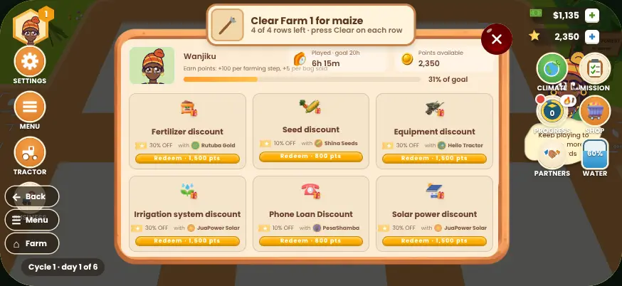
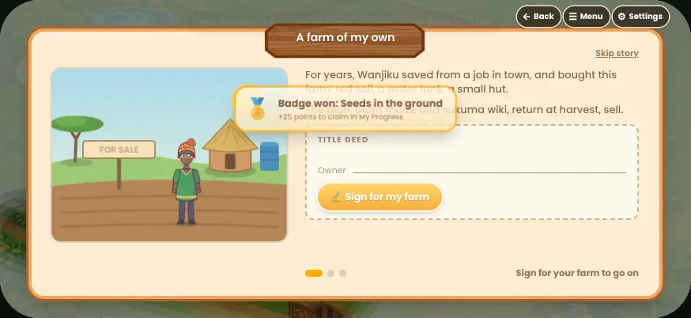
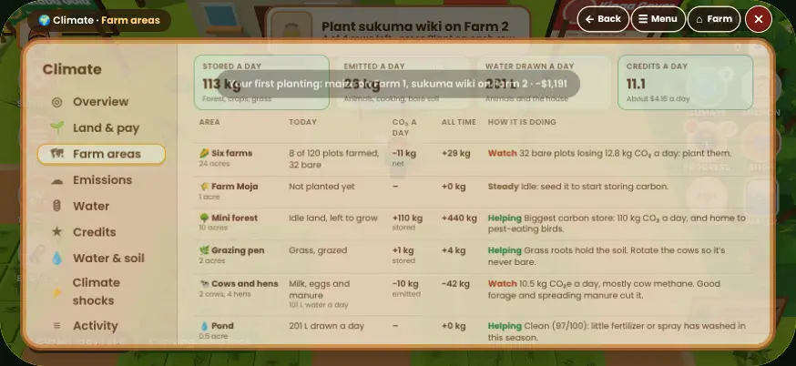
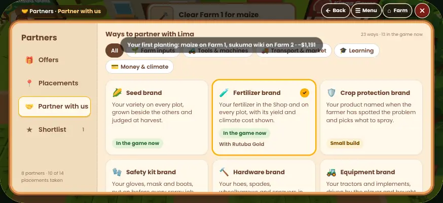

# TemoLima UI: spacing and layout plan

A plan to make every screen feel calm, premium and easy to use on a phone held sideways: one spacing scale, one type
scale, one way to navigate, and a limit on how much any single screen asks of the player. It starts from a measured
audit of all 93 screens in design review (`?review=1`), so each rule fixes something real. The audit was re-run on
the game as of the text trim (#26) and the Partners redesign (#25).

All sizes are in **stage pixels**. The game is drawn on an 874 × 402 stage that is scaled to fit the phone: about
**0.85×** on a small phone (740 × 340), about **1×** on a typical one. So 8px on the stage shows as about 6.8px on a
small phone.

---

## 1. What the audit found

Every screen was opened in design review and measured: text sizes, tap targets, how much text and how many buttons
are in view (a Playwright script over the 93 review screens; counts include items partly scrolled out of a panel).

| Finding | Measured | Why it matters |
| --- | --- | --- |
| **Too many text sizes** | 29 font sizes in the stylesheet, plus 88 sizes set inline in components; 9 per screen on average, up to 15 (Climate) | No clear hierarchy, so screens read as busy |
| **Text too small** | 72 style rules under 9px; 37 screens show text under 9px, 11 under 8px (Shop and Rewards prices at 6–6.5px); on 12 screens more than half the text is under 10px | About 5–7.6px on a small phone: hard to read outdoors |
| **Tap targets too small** | 4 targets per screen under 28px on average, up to 15 (Climate); *Redeem* buttons are 17px tall, Shop price pills about 18px | Missed taps, especially with thumbs |
| **No spacing scale** | 16 different gaps, 18 different paddings, 17 corner radii | Inconsistent rhythm: the main reason screens feel "not quite premium" |
| **Gold buttons fail contrast** | The shared gold button (`.gold-btn`: Redeem, Continue, Select, Harvest…) has white text on gold, **1.86 : 1** (the minimum for text is 4.5 : 1). The newer claim buttons (`.ach-claim`, brown on gold, 4.7 : 1) already pass | Most main calls to action are hard to read |
| **Faded text fails contrast** | 99 rules fade text to 50–80%; brown at 75% or less is under 4.5 : 1 on cream | Secondary text is hard to read |
| **Pop-ups collide with the farm HUD** | Shop, Farming steps, Sale, Storage, Outcome, Harvest timing, Rewards, Value addition open over a live, un-dimmed HUD | See below |
| **Dense pages** | Climate › Farm areas: about 1,500 characters and 26 buttons in view, 77% of its text under 10px, nine tabs; Climate › Activity and Land & pay are close behind; Training's booking success about 1,260 characters | Too much at once: the player cannot tell what matters |



*Rewards (above): the task card covers the pop-up's title, the pop-up's Back / Menu / Farm column sits on TRACTOR and
BUSINESS, the guide's speech bubble sits under PROGRESS, SHOP and PARTNERS, and there are three ways to close (✕,
Back, the HUD). The same happens on every pop-up of this kind; on Sale and Outcome the ✕ lands on CLIMATE.*

**What already works**, and is the reference for the rest: *Name your farmer*, *The story so far*, *Settings*, and
the new *Partners › Partner with us* (built to this plan: 12% of its text under 10px, against about half on the other
Partners tabs).
One panel, generous padding, two or three text sizes, one obvious button, navigation in one place (top right).



---

## 2. The stage and its zones

```
 0                                                                          874
 ┌──────────────────────────────────────────────────────────────────────────┐ 0
 │ 12px edge inset (phone corners are rounded; nothing touches the edge)     │
 │ ┌ TOP BAR 12–48 ─ title chip (left) ──────────── Back · Menu · Farm (right)│
 │ │                                                                        │ │
 │ │ ┌ CONTENT 16–858 × 52–386 ─────────────────────────────────────────┐   │ │
 │ │ │  pages: one panel filling it                                     │   │ │
 │ │ │  pop-ups: a centred panel, at most 620 × 320                     │   │ │
 │ │ └──────────────────────────────────────────────────────────────────┘   │ │
 │ └ BOTTOM 360–390: status chip (farm only) ──────────────────────────────┘ │
 └──────────────────────────────────────────────────────────────────────────┘ 402
```

- **12px edge inset** for everything. Nothing is placed closer to the stage edge.
- **The farm** is the only screen with the HUD: left rail (12–76: Settings, Menu, Tractor, Business), right rail
  (coins and points, then Climate · Mission, Progress · Shop, Partners · Water), the task card top centre, the status
  chip bottom left.
- **Every other screen hides the HUD.** A pop-up or page never shares the stage with HUD buttons. (Today the full
  pages already do this; the older pop-ups do not.)
- **One navigation place**: the top bar, right side, *Back · Menu · Farm*, on every screen, as on Settings, Climate,
  Mission and Partnerships today. The left-hand Back / Menu / Farm column on pop-ups goes.
- **One way to close a pop-up**: *Back* in the top bar (and tapping the dimmed background). The red ✕ outside the
  frame goes, or moves inside the panel's top-right corner if the frame art needs it.

---

## 3. Spacing scale (4-point)

| Token | Value | Use |
| --- | --- | --- |
| `--space-1` | 4px | icon to its label; inside a chip; label to value |
| `--space-2` | 8px | between buttons in a row; between cards in a dense grid; list rows |
| `--space-3` | 12px | inside a card; the stage edge inset; between cards in a normal grid |
| `--space-4` | 16px | inside a panel (pages); heading to its content |
| `--space-5` | 24px | between sections of a page; inside a reading panel (story, dialogs) |
| `--space-6` | 32px | above a page's single main button; around a hero number |

Rules:

- **No other values.** 1, 2, 3, 5, 6, 7, 9, 10, 14 become the nearest step.
- **More space outside than inside**: the gap between two cards is never smaller than the padding inside a card's
  edge minus 4. Groups are made by space, not by extra borders.
- **Rhythm on a page**: panel padding 16 → section heading → 8 → content → 24 → next section.

---

## 4. Type scale

| Token | Size / line height | Weight | Use |
| --- | --- | --- | --- |
| `--text-label` | 8 / 1.3, uppercase, +0.04em | 700 | small section labels, chips (never sentences) |
| `--text-caption` | 8.5 / 1.4 | 500 | notes under a value, timestamps, sources |
| `--text-body-sm` | 9.5 / 1.45 | 500 | card text, list rows, table cells |
| `--text-body` | 10 / 1.5 | 500 | sentences on reading screens (story, overview, advice) |
| `--text-subhead` | 12 / 1.3 | 700 | card titles, values |
| `--text-title` | 14 / 1.2 | 700 | page and pop-up titles |
| `--text-display` | 19 / 1.1 | 800 | one hero number per screen (a profit, a score) |

Rules:

- **Nothing under 8px**, and 8px only for uppercase labels. Anything read as a sentence is 9.5 or larger.
  (Type scale, Nov 2026: every text size was cut to 80% of the sizes below, rounded down to half a pixel, 7px at
  least; sizes passed as props go through `shrink()` in `src/components/ui.tsx`. The table above is the new scale.)
- **At most four sizes on one screen.**
- **Numbers in buttons and pills: 12 or larger, bold** (prices, points, "Redeem · 1,500 pts").
- **Line length**: about 70 characters at most (roughly 460px at 13px). Wider panels use two columns or a side
  picture, as the story does.
- **No sizes set inline in components** (`fontSize: 8` in JSX): every size comes from a token class.

---

## 5. Touch targets

| What | Visual size | Tap area |
| --- | --- | --- |
| Main button (one per screen) | 40px tall, at least 140 wide | 44 × 44 at least |
| Other buttons, tabs, chips | 32px tall | 44px tall via padding or an invisible `::after` |
| Icon buttons (✕, ↑, info) | 32 × 32 | 44 × 44 |
| HUD round buttons | 44 × 44 (as today) | 52 × 52 |

- **8px at least between two tap targets** (`--space-2`).
- A row of small choices (sizes, days, farms) becomes a segmented control 32px tall, not separate pills.

---

## 6. Shape, depth and colour

**Corner radius**: `--radius-sm` 6 (inner chips), `--radius-md` 10 (buttons, inputs, tiles), `--radius-lg` 14
(cards), `--radius-xl` 20 (panels), `--radius-pill` 999. Five values instead of sixteen.

**Depth**: two shadows only: `--shadow-card` (cards, chips on the farm) and `--shadow-panel` (pop-ups, pages).
Borders: 1px `--line` (brown at 20%) for cards; the gold 1.5px border only for the selected item.

**Text colour, solid instead of faded** (contrast on cream / on a card):

| Token | Colour | Contrast | Replaces |
| --- | --- | --- | --- |
| `--ink` | `#6b402b` | 7.6 / 8.3 | body and titles (as today) |
| `--ink-2` | `#7d5440` | 5.7 / 6.2 | every `opacity: 0.7–0.85` on text |
| `--ink-3` | `#86604c` | 4.8 / 5.2 | the faintest text allowed (captions, sources) |
| `--ink-on-gold` | `#4a2a10` | 6.9 on gold | text on every gold button (instead of white, 1.86) |
| `--good` / `--bad` | `#2e6b35` / `#a8382a` | 5.6 / 5.5 | gains and losses (with a + / − sign, never colour alone) |

Dimmed, disabled things keep 50% opacity, with the reason written beside them ("Needs 800 points").

---

## 7. Density budget: how much one screen may ask

| | Doing screens (farm, checks, shop) | Reading screens (story, overview, results) |
| --- | --- | --- |
| Main buttons | **1**, bottom right of the panel, gold | 1 |
| Other buttons in view | 6 at most | 8 at most |
| Cards / options in view | 6 at most (a 3 × 2 grid) | 4 at most |
| Words in view before scrolling | about 60 | about 120 |
| Text sizes | 4 at most | 4 at most |

When a screen needs more, it uses **progressive disclosure**: a card shows a title, one line and a status; tapping it
opens the detail. A list of more than six goes into tabs or a scrolling list with a fade at the bottom edge so the
player can see there is more.

---

## 8. Four layouts, used everywhere

**A. The farm (HUD).** Rails 12px from the edges, 8px between buttons, labels in `--text-label` under 44px icons.
Nothing else stays on the farm: tips and messages appear in the task card or as a toast, then go.

**B. A page** (Settings, Climate, Partnerships, Mission, Rounds, Tractor business). Top bar; a panel at 16 / 52 →
858 / 386, radius 20; side tabs 168 wide, tabs 36 tall and 4 apart; content padding 16 (20 on reading pages); a footer
row for the main button when there is one.

**C. A pop-up** (Shop, Farming steps, Sale, Storage, Harvest timing, Outcome, Rewards, Value addition, Process). The
HUD hides and a 70% scrim covers the farm. A centred panel, at most 620 × 320, padding 16, title in `--text-title`.
Navigation in the top bar. The guide character may stand beside the panel, never over a button.

**D. A dialog** (story pop-ups, "Congratulations", confirmations). 360 wide, padding 24, a title, at most two lines,
one button.

---

## 9. Screen by screen, in order

**Phase 1: collisions and contrast**

1. ✅ **Pop-ups hide the HUD.** Done: on the 3D farm, every screen on top hides the HUD buttons, the task card, the
   coin and point pills and the on-field prompts (the classic farm already did). This clears every overlap in the
   Rewards picture. The pop-ups' Back / Menu / Farm column stays on the left for now: with the HUD gone it no longer
   collides, and moving it to the top bar waits for Phase 2, where the frames' close buttons move too.
2. ✅ **Gold buttons.** Done: `.gold-btn` text is `--ink-on-gold` (6.9 : 1, was white at 1.86 : 1) and `GoldButton`
   text is 10px at least (it defaulted to 8px).
3. **Climate** (still to do): nine tabs become five (Overview, Farm areas, Emissions, Water, Activity; Land & pay and
   Credits move into Overview, Shocks into Activity). *Farm areas* shows each area's name, its status and one line;
   the numbers open on a tap, as on Partners › Partner with us.
   
4. **Tokens.** ✅ Added to `:root` in `src/styles.css`: `--space-1…6`, `--text-label…display`, `--radius-sm…pill`,
   `--ink`, `--ink-2`, `--ink-3`, `--ink-on-gold`, `--good`, `--bad`. Still to do: replace the 99 faded-text rules
   with `--ink-2` / `--ink-3`, screen by screen with Phase 2 (some of those rules fade icons, not text).

Checked by `tests/ui-quality.spec.ts`: eleven pop-ups over the 3D farm, with no HUD button, task card or pill
under any of them, and every visible gold button dark-on-gold at 10px or more.

**Phase 2: the older pop-ups** ✅ (the smallest text in the game)

All of them keep the wooden frame art and are re-laid out inside it with flex and the tokens (`.pp-*` in
`src/styles.css`). On every framed pop-up, *Back · Menu · Farm* sit in the top bar, top right, with the same ✕ as the
pages; the left-hand column and the red ✕ outside the frame are gone. A message (toast) shown over a pop-up moves to
the top left so it never covers the frame's title.

5. ✅ **Shop**: item names 12, prices 12 bold in 26px pills on cards that are the tap target (84px tall), side-tab
   labels 10; the shopkeeper's tip is one line above the grid, and she stands beside the frame instead of inside it.
6. ✅ **Farming steps**: task cards 3 × 2 with 12px row gaps, climate tags 11px, *Skip* as a text button; the step's
   name is the frame's title; the footer says how many recommended tasks are done and why it matters. Water: four
   cards in a row under the amount field.
7. ✅ **Storage**: one row per store with three facts (cost a bag, bags lost, time) at 12px, and a *Costs / Details*
   switch for spoilage and CO₂e; *Continue* is the only gold button, the others *Select*. **Harvest timing**: the
   three choices are a radio group of cards, with one *Harvest* button. **Value addition**: three cards (a line, CO₂e,
   cost) that are the tap target. **Select process** and **Harvest info**: 12 / 15 / 24 with one main button.
8. ✅ **Outcome comparison**: the season's profit as the one hero number (24px); lessons as a list of three;
   *TemoLima AI* as one question row below them, its answer in their place.
9. ✅ **Rewards**: *Redeem* buttons 32px tall with 12px text (secondary, so no screen has six gold buttons); the play
   goal as one bar above the grid, beside the farmer's name; the guide beside the frame, without a speech bubble.

Checked by `tests/ui-quality.spec.ts`: thirteen framed pop-ups with the navigation in the top bar, no ✕ outside the
frame, no text under 10px and at most one gold button in view.

**Phase 3: the farm and the full pages** ✅

10. ✅ **Farm HUD**: round-button labels 10; both rails 12px from the edges, each on a 64px row step (left 66, 130,
    194…; right 72, 136, 200, 264), the right rail's two columns 4px apart.
11. ✅ **Six farms**: day headers, cells and farm names 12px; the sub-labels 11px in `--ink-2`; day cells 30px tall.
    (Rows of 36 do not fit six farms in the panel; 30 + 3 does.)
12. ✅ **Tractor business**, **Field rounds**, **Training**, **My Progress**, **Partners › Offers and Placements**, and
    the **Loan calculator**: every size under 10px is now 10 (labels) or 11 (text), and 10–10.5px text is 11.
    Training is re-laid out as four cards (title, two lines, when and where, price and *Book a seat*). My Progress ›
    Modules puts the module's name on its own line under its status.

**Phase 4: the farm, decluttered** ✅

13. ✅ **One money card.** The harvest estimate and the money at risk were two cards with two different numbers (*−KSh 20k
    if not fixed* on one, *KSh 10k at risk* on the other) and the at-risk card sat on the *Day 1/30* pill. Now the
    at-risk figure is a red tab hanging from the harvest card: one number (today's), the same one the at-risk list,
    the harvest sheet and the cheer use. The sheets say how it grows (*Grows each day it is left: up to −KSh 20k*).
14. ✅ **Nothing under the task card.** The Farm basics lesson chip moved from under the task card into one bottom-left
    stack with today's build and the cycle's day (it never overlaps itself, and moves right of the event card).
15. ✅ **Smaller daily chips.** *Animal chores* and *Daily tidy-up* are one line each (26px), stacked bottom right.
    *Night* is a small chip under the day, top right, instead of floating bottom centre.
16. ✅ **The event card** is three short lines with a *Join ›* button beside them (was four lines and a row of its own).
17. ✅ **In the world**: Mama Achieng's bubble and a sign's *Check* button never reach into the top band of cards; the
    *Check* button is dark text on gold; the billboard tag is smaller.
18. ✅ **The money sheets** (harvest estimate, money at risk) share one style, the reference for the rest: a coloured
    kicker, one 22px title, a plain lead, three stat boxes, white rows, one gold button bottom right (sticky).

**Already done**: *Partners › Partner with us* and *Shortlist* follow this plan (cards with a title, one line and a
status; details on a tap; spacing 4 / 8 / 12 / 16; text 10px and up; solid text colours).


---

## 10. How it is checked

A play-test, `tests/ui-quality.spec.ts`, opens every design-review screen and fails if it finds:

- text under 10px, or any sentence under 12px;
- a tap target under 32px tall;
- a HUD button under an open pop-up or page;
- more than four text sizes, or more than one gold button in view;
- text on a gold button that is not `--ink-on-gold`.

Before and after screenshots of every screen go with each phase, so each change can be reviewed by eye.

---

## 11. Decisions

- **Text floor**: 10 / 12 (labels / sentences), as above.
- **The Figma frames**: kept. Phase 2 re-lays out what is inside them.
- **The guide character on pop-ups**: beside the panel, never over a button (Shop, Rewards).

## One look: the Shop

Every panel, card and button takes the look of the Shop (`src/screens/Catalog.tsx`), as Dean asked on 2026-11-27. The
tokens are at the top of `src/styles.css`:

- **Panel** (`--sheet`, `--frame`, `--sheet-shadow`, `--sheet-radius`): the cream (`--cream`) in the wooden frame art,
  or, where a panel has no frame art, its orange-and-brown edge (`--frame`; `--frame-thin` on the farm's HUD cards).
  Titles stay white on the wooden plank.
- **Card** (`--tile`, `--tile-edge`, `--tile-radius`): the Shop's beige (#f6e4cc) in a soft brown edge.
- **Button**: the orange-gold `.gold-btn` (`--gold`, `--gold-inset`) with dark text (`--ink-on-gold`).

New screens use these, or the `.ui-sheet`, `.ui-tile`, `.ui-title` and `.ui-lead` classes. Green and red stay for money
gained and lost.
