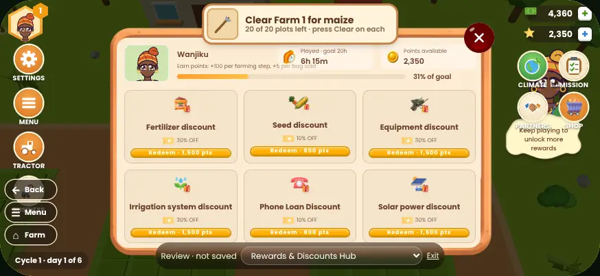
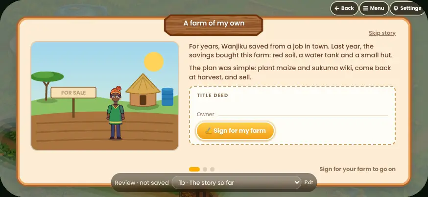
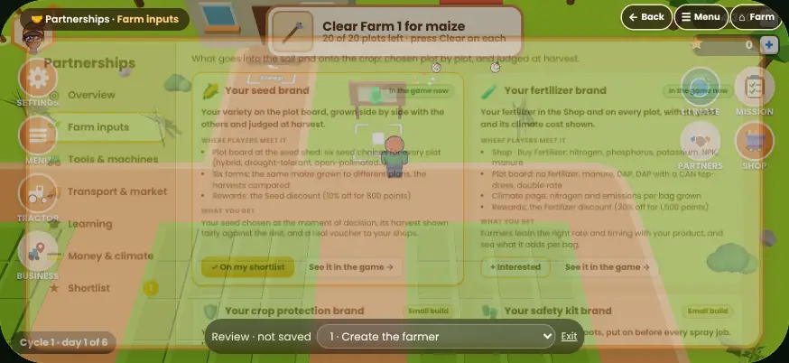
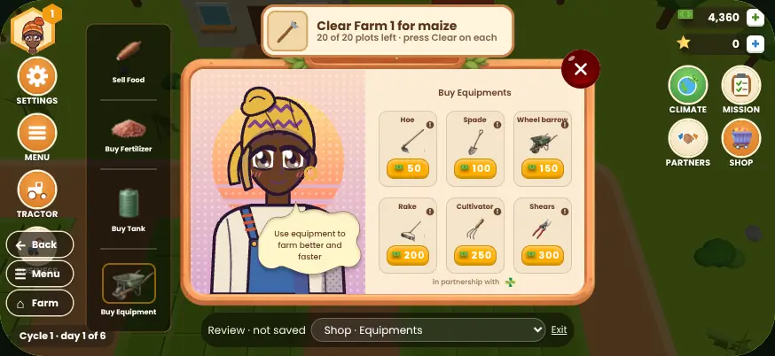

# Lima UI: spacing and layout plan

A plan to make every screen feel calm, premium and easy to use on a phone held sideways: one spacing scale, one type
scale, one way to navigate, and a limit on how much any single screen asks of the player. It starts from a measured
audit of all 86 screens in design review (`?review=1`), so each rule fixes something real.

All sizes are in **stage pixels**. The game is drawn on an 874 × 402 stage that is scaled to fit the phone: about
**0.85×** on a small phone (740 × 340), about **1×** on a typical one. So 8px on the stage shows as about 6.8px on a
small phone.

---

## 1. What the audit found

Every screen was opened in design review and measured: text sizes, tap targets, how much text and how many buttons
are in view (script: Playwright over the 86 review screens).

| Finding | Measured | Why it matters |
| --- | --- | --- |
| **Too many text sizes** | 26 font sizes in the code (plus 90 sizes set inline in components); 7 per screen on average, up to 13 | No clear hierarchy, so screens read as busy |
| **Text too small** | 28 screens have text under 9px; on Outcome, Value Addition, Harvest timing and Storage, half the words are under 9px | About 6.8–7.6px on a small phone: hard to read outdoors |
| **Tap targets too small** | 5 targets per screen under 28px on average; *Redeem* buttons are 17px tall, Shop price pills about 18px | Missed taps, especially with thumbs |
| **No spacing scale** | 15 different gaps, 22 different paddings, 16 corner radii | Inconsistent rhythm: the main reason screens feel "not quite premium" |
| **Gold buttons fail contrast** | White text on gold is **1.86 : 1** (the minimum for text is 4.5 : 1) | Every main call to action is hard to read |
| **Faded text fails contrast** | 38 rules fade brown text to 50–80%; at 75% or less it is under 4.5 : 1 on cream | Secondary text is hard to read |
| **Pop-ups collide with the farm HUD** | Shop, Farming steps, Sale, Storage, Outcome, Harvest timing, Rewards, Value addition open over a live, un-dimmed HUD | See below |
| **Partnerships is the densest screen** | About 1,900 characters and 27 buttons in one view; 77% of its text under 10px | Built in the last change: first to fix |



*Rewards (above): the task card covers the pop-up's title, the pop-up's Back / Menu / Farm column sits on TRACTOR,
the guide's speech bubble covers CLIMATE, MISSION, PARTNERS and SHOP, and there are three ways to close (✕, Back,
the HUD). The same happens on every pop-up of this kind; on Sale and Outcome the ✕ lands on CLIMATE.*

**What already works**, and is the reference for the rest: *Name your farmer*, *The story so far*, *Settings*.
One panel, generous padding, two or three text sizes, one obvious button, navigation in one place (top right).



---

## 2. The stage and its zones

```
 0                                                                          874
 ┌──────────────────────────────────────────────────────────────────────────┐ 0
 │ 12px edge inset (phone corners are rounded; nothing touches the edge)     │
 │ ┌ TOP BAR 12–48 ─ title chip (left) ──────────── Back · Menu · Farm (right)│
 │ │                                                                        │ │
 │ │ ┌ CONTENT 16–858 × 52–386 ─────────────────────────────────────────┐   │ │
 │ │ │  pages: one panel filling it                                     │   │ │
 │ │ │  pop-ups: a centred panel, at most 620 × 320                     │   │ │
 │ │ └──────────────────────────────────────────────────────────────────┘   │ │
 │ └ BOTTOM 360–390: status chip (farm only) ──────────────────────────────┘ │
 └──────────────────────────────────────────────────────────────────────────┘ 402
```

- **12px edge inset** for everything. Nothing is placed closer to the stage edge.
- **The farm** is the only screen with the HUD: left rail (12–76: Settings, Menu, Tractor, Business), right rail
  (coins and points, then Climate · Mission, Partners · Shop), the task card top centre, the status chip bottom left.
- **Every other screen hides the HUD.** A pop-up or page never shares the stage with HUD buttons. (Today the full
  pages already do this; the older pop-ups do not.)
- **One navigation place**: the top bar, right side, *Back · Menu · Farm*, on every screen, as on Settings, Climate,
  Mission and Partnerships today. The left-hand Back / Menu / Farm column on pop-ups goes.
- **One way to close a pop-up**: *Back* in the top bar (and tapping the dimmed background). The red ✕ outside the
  frame goes, or moves inside the panel's top-right corner if the frame art needs it.

---

## 3. Spacing scale (4-point)

| Token | Value | Use |
| --- | --- | --- |
| `--space-1` | 4px | icon to its label; inside a chip; label to value |
| `--space-2` | 8px | between buttons in a row; between cards in a dense grid; list rows |
| `--space-3` | 12px | inside a card; the stage edge inset; between cards in a normal grid |
| `--space-4` | 16px | inside a panel (pages); heading to its content |
| `--space-5` | 24px | between sections of a page; inside a reading panel (story, dialogs) |
| `--space-6` | 32px | above a page's single main button; around a hero number |

Rules:

- **No other values.** 1, 2, 3, 5, 6, 7, 9, 10, 14 become the nearest step.
- **More space outside than inside**: the gap between two cards is never smaller than the padding inside a card's
  edge minus 4. Groups are made by space, not by extra borders.
- **Rhythm on a page**: panel padding 16 → section heading → 8 → content → 24 → next section.

---

## 4. Type scale

| Token | Size / line height | Weight | Use |
| --- | --- | --- | --- |
| `--text-label` | 10 / 1.3, uppercase, +0.04em | 700 | small section labels, chips (never sentences) |
| `--text-caption` | 11 / 1.4 | 500 | notes under a value, timestamps, sources |
| `--text-body-sm` | 12 / 1.45 | 500 | card text, list rows, table cells |
| `--text-body` | 13 / 1.5 | 500 | sentences on reading screens (story, overview, advice) |
| `--text-subhead` | 15 / 1.3 | 700 | card titles, values |
| `--text-title` | 18 / 1.2 | 700 | page and pop-up titles |
| `--text-display` | 24 / 1.1 | 800 | one hero number per screen (a profit, a score) |

Rules:

- **Nothing under 10px**, and 10px only for uppercase labels. Anything read as a sentence is 12 or larger.
  (11 on the stage is about 9.4px on the smallest phone; 13 is about 11px.)
- **At most four sizes on one screen.**
- **Numbers in buttons and pills: 12 or larger, bold** (prices, points, "Redeem · 1,500 pts").
- **Line length**: about 70 characters at most (roughly 460px at 13px). Wider panels use two columns or a side
  picture, as the story does.
- **No sizes set inline in components** (`fontSize: 8` in JSX): every size comes from a token class.

---

## 5. Touch targets

| What | Visual size | Tap area |
| --- | --- | --- |
| Main button (one per screen) | 40px tall, at least 140 wide | 44 × 44 at least |
| Other buttons, tabs, chips | 32px tall | 44px tall via padding or an invisible `::after` |
| Icon buttons (✕, ↑, info) | 32 × 32 | 44 × 44 |
| HUD round buttons | 44 × 44 (as today) | 52 × 52 |

- **8px at least between two tap targets** (`--space-2`).
- A row of small choices (sizes, days, farms) becomes a segmented control 32px tall, not separate pills.

---

## 6. Shape, depth and colour

**Corner radius**: `--radius-sm` 6 (inner chips), `--radius-md` 10 (buttons, inputs, tiles), `--radius-lg` 14
(cards), `--radius-xl` 20 (panels), `--radius-pill` 999. Five values instead of sixteen.

**Depth**: two shadows only: `--shadow-card` (cards, chips on the farm) and `--shadow-panel` (pop-ups, pages).
Borders: 1px `--line` (brown at 20%) for cards; the gold 1.5px border only for the selected item.

**Text colour, solid instead of faded** (contrast on cream / on a card):

| Token | Colour | Contrast | Replaces |
| --- | --- | --- | --- |
| `--ink` | `#6b402b` | 7.6 / 8.3 | body and titles (as today) |
| `--ink-2` | `#7d5440` | 5.7 / 6.2 | every `opacity: 0.7–0.85` on text |
| `--ink-3` | `#86604c` | 4.8 / 5.2 | the faintest text allowed (captions, sources) |
| `--ink-on-gold` | `#4a2a10` | 6.9 on gold | text on every gold button (instead of white, 1.86) |
| `--good` / `--bad` | `#2e6b35` / `#a8382a` | 5.6 / 5.5 | gains and losses (with a + / − sign, never colour alone) |

Dimmed, disabled things keep 50% opacity, with the reason written beside them ("Needs 800 points").

---

## 7. Density budget: how much one screen may ask

| | Doing screens (farm, checks, shop) | Reading screens (story, overview, results) |
| --- | --- | --- |
| Main buttons | **1**, bottom right of the panel, gold | 1 |
| Other buttons in view | 6 at most | 8 at most |
| Cards / options in view | 6 at most (a 3 × 2 grid) | 4 at most |
| Words in view before scrolling | about 60 | about 120 |
| Text sizes | 4 at most | 4 at most |

When a screen needs more, it uses **progressive disclosure**: a card shows a title, one line and a status; tapping it
opens the detail. A list of more than six goes into tabs or a scrolling list with a fade at the bottom edge so the
player can see there is more.

---

## 8. Four layouts, used everywhere

**A. The farm (HUD).** Rails 12px from the edges, 8px between buttons, labels in `--text-label` under 44px icons.
Nothing else stays on the farm: tips and messages appear in the task card or as a toast, then go.

**B. A page** (Settings, Climate, Partnerships, Mission, Rounds, Tractor business). Top bar; a panel at 16 / 52 →
858 / 386, radius 20; side tabs 168 wide, tabs 36 tall and 4 apart; content padding 16 (20 on reading pages); a footer
row for the main button when there is one.

**C. A pop-up** (Shop, Farming steps, Sale, Storage, Harvest timing, Outcome, Rewards, Value addition, Process). The
HUD hides and a 70% scrim covers the farm. A centred panel, at most 620 × 320, padding 16, title in `--text-title`.
Navigation in the top bar. The guide character may stand beside the panel, never over a button.

**D. A dialog** (story pop-ups, "Congratulations", confirmations). 360 wide, padding 24, a title, at most two lines,
one button.

---

## 9. Screen by screen, in order

**Phase 1: collisions, contrast, and the screen I just made worse**

1. **Pop-ups hide the HUD** and use the top-bar navigation (layout C). Fixes every overlap in the Rewards picture.
2. **Gold buttons**: `--ink-on-gold` text. One change in `GoldButton` and the gold button classes.
3. **Partnerships**: cards show icon, name, status and the one-line pitch (3 × 2 grid, 12px gaps). *Where players
   meet it* and *What you get* open in a detail panel with *Interested* and *See it in the game*. The overview loses
   the legend (status chips explain themselves on tap) and keeps facts, areas, and the rules.
   
4. **Spacing, type, radius and colour tokens** added to `:root` in `src/styles.css`, with the faded text replaced.

**Phase 2: the older pop-ups** (the smallest text in the game)

5. **Shop**: item names 12, prices 12 bold in 32px buttons, the side tabs 44px tall; the guide's tip in one line
   above the grid instead of a bubble over the art.
   
6. **Farming steps**: task cards 3 × 2 with 12px gaps, climate tags 11px, *Skip* as a text button.
7. **Storage, Harvest timing, Value addition**: three option cards, each with at most three facts (cost, loss,
   time) at 12px; the rest under *Details*.
8. **Outcome comparison**: the season's profit as the one hero number; lessons as a list of three; *Lima AI*
   below it rather than in a third narrow column.
9. **Rewards**: *Redeem* buttons 32px tall with 12px text; the points goal as one bar above the grid.

**Phase 3: the farm and the full pages**

10. **Farm HUD**: labels from 9.5 to 10 uppercase; the right rail aligned to the same 8px grid as the left.
11. **Six farms**: day headers and cells 12px; the sub-labels ("Seedlings", "Harvest time") 11px; row height 36.
12. **Climate**, **Tractor business**, **Field rounds**: tokens applied; tiles and bars at 11–12px.

---

## 10. How it is checked

A play-test, `tests/ui-quality.spec.ts`, opens every design-review screen and fails if it finds:

- text under 10px, or any sentence under 12px;
- a tap target under 32px tall;
- a HUD button under an open pop-up or page;
- more than four text sizes, or more than one gold button in view;
- text on a gold button that is not `--ink-on-gold`.

Before and after screenshots of every screen go with each phase, so each change can be reviewed by eye.

---

## 11. Open decisions

- **Text floor.** 10 / 12 (as above) keeps today's layouts close to what they are. 11 / 13 reads better on small
  phones but needs more screens split into steps.
- **The Figma frames** (the wooden modal art) set fixed sizes for the older pop-ups. Phase 2 either keeps the frame
  art and re-lays out what is inside it, or moves those pop-ups onto the page panel (layout B), which already looks
  more modern.
- **The guide character on pop-ups** stays beside the panel, or moves into the panel's header as a small portrait.
